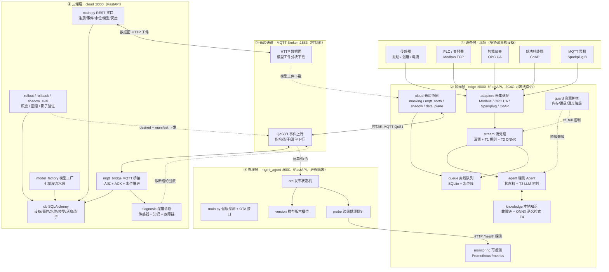
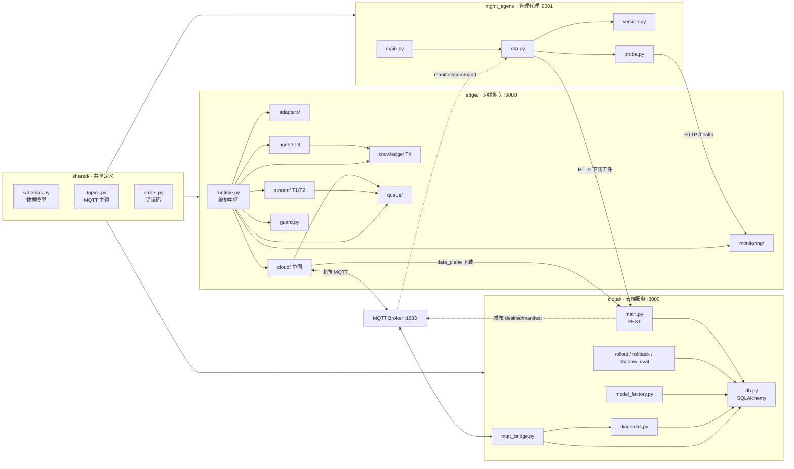
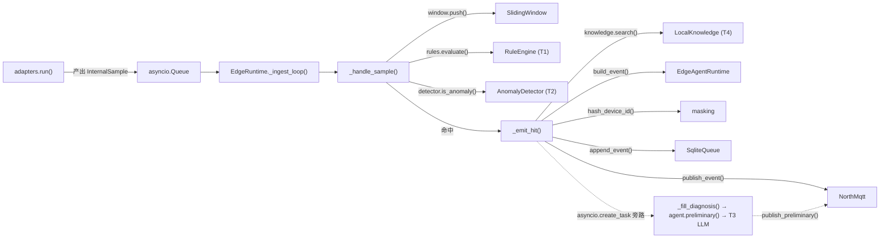
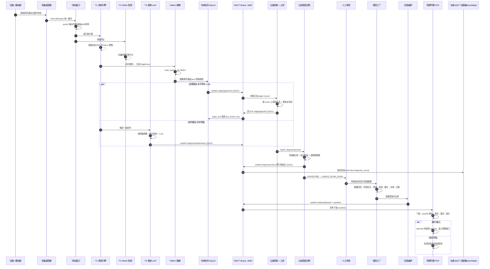
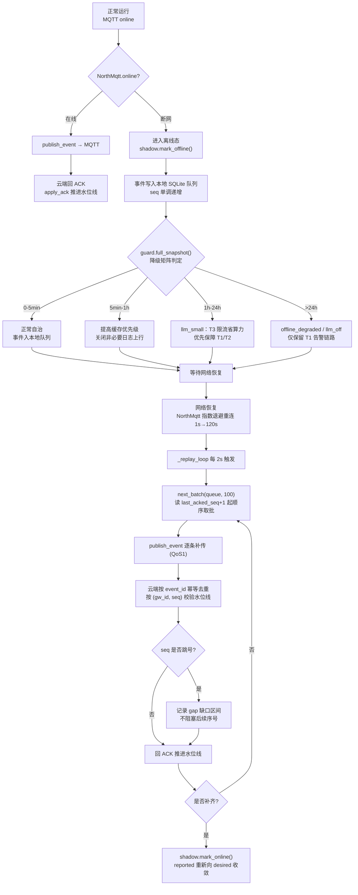
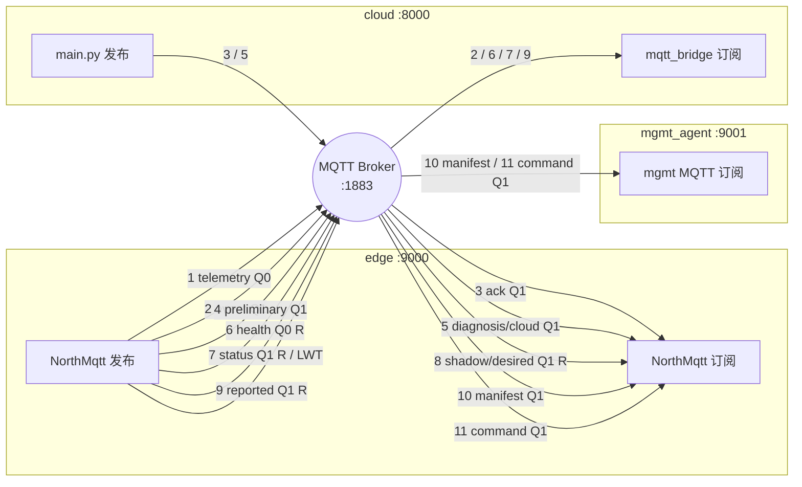
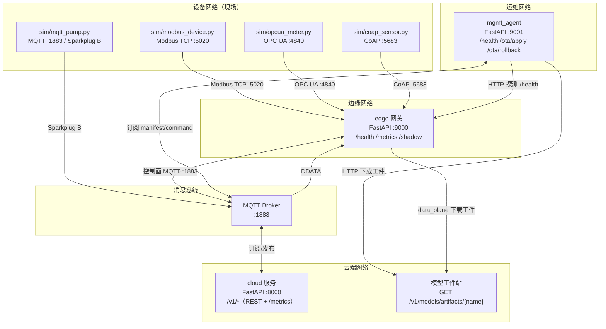

# 端云协同边缘 AI Agent 网关 · 架构图文档

> **文档定位**：以 Mermaid 图为主、说明文字为辅，直观呈现系统整体架构、模块划分、调用关系与数据流转。
> **对应系统**：`edge-ai-agent-gateway`（方案 V1.0 / Phase 0，软件版本 `1.0.0`）
> **技术栈**：Python 3.12 + FastAPI + MQTT（paho-mqtt）+ SQLite/SQLAlchemy + ONNX Runtime + llama.cpp
> **端口约定**：边缘网关 `9000`、云端服务 `8000`、管理代理 `9001`、MQTT Broker `1883`
> **文档依据**：`README.md`、`shared/topics.py`、`edge/runtime.py`、`cloud/main.py`、`mgmt_agent/main.py` 等实际代码

---

## 目录

1. [架构总览图](#一架构总览图)
2. [模块划分表](#二模块划分表)
3. [edge 内部结构图](#三edge-内部结构图)
4. [调用关系图](#四调用关系图)
5. [数据流转图](#五数据流转图)
6. [断网降级数据流](#六断网降级数据流)
7. [MQTT 主题拓扑表](#七mqtt-主题拓扑表)
8. [端口与网络拓扑](#八端口与网络拓扑)

---

## 一、架构总览图

系统自下而上分为 **设备层 / 边缘层 / 云边通道 / 云端层 / 管理层** 五个层次。**决策权在云、执行权在边**：涉及毫秒级实时反应的采集、判定、断网自治由边缘自主完成；涉及全局状态的模型版本、灰度回滚由云端决策后下发。

> **读图要点**
> - **边缘自主闭环**：采集 → 流处理（T1/T2）→ Agent（T3/T4）→ 脱敏 → 本地队列，全程不依赖网络。
> - **控制面 / 数据面分离**：小包事件与指令走 MQTT（`:1883`），大包模型工件走 HTTP 分块下载。
> - **管理面独立**：`mgmt_agent` 与主应用进程隔离，主应用崩溃时仍能探测与回滚。

---

## 二、模块划分表

整个代码仓由 **5 个顶层模块**组成，共 64 个 Python 文件、约 8894 行代码。

| 模块 | 端口 | 职责 | 关键子目录 / 文件 | 文件数(.py，行数) |
|---|---|---|---|---|
| `edge/` | **9000** | 边缘网关：多协议本地采集、滑窗统计、T1 规则、T2 ONNX 异常、T3 LLM 初判、T4 本地知识、HMAC 脱敏、断网离线队列与水位补传、资源降级守护、Prometheus 指标 | `adapters/`、`stream/`、`knowledge/`、`agent/`、`queue/`、`cloud/`、`monitoring/`、`security/`、`guard.py`、`guard_degrade.py`、`runtime.py`、`main.py`、`settings.py`、`config_loader.py` | **41**（5087） |
| `cloud/` | **8000** | 云端增量服务：设备注册、事件入库与查询、水位管理、模型注册与工件下载、灰度下发、深度诊断、模型工厂、影子验证、回滚 | `main.py`、`db.py`、`mqtt_bridge.py`、`diagnosis.py`、`model_factory.py`、`rollout.py`、`rollback.py`、`shadow_eval.py`、`settings.py` | **10**（2866） |
| `mgmt_agent/` | **9001** | 管理代理：模型槽位管理、OTA 应用与回滚编排、边缘健康探测（与主应用进程隔离） | `main.py`、`ota.py`、`probe.py`、`version.py` | **5**（582） |
| `shared/` | — | 跨模块共享定义：Pydantic 数据模型、MQTT 主题族、统一错误码 | `schemas.py`、`topics.py`、`errors.py` | **4**（170） |
| `sim/` | 见 §8 | 设备模拟器：Phase 0 无硬件联调用 | `modbus_device.py`、`opcua_meter.py`、`mqtt_pump.py`、`coap_sensor.py` | **4**（189） |

### 2.1 `edge/` 子目录文件数

| 子目录 / 文件 | 文件数(.py，含 `__init__.py`) | 说明 |
|---|---|---|
| `edge/`（顶层） | 7 | `main.py`、`runtime.py`、`settings.py`、`config_loader.py`、`guard.py`、`guard_degrade.py`、`__init__.py` |
| `edge/adapters/` | 6 | `base.py` + `modbus_tcp.py` / `opcua_client.py` / `mqtt_sparkplug.py` / `coap_sensor.py` |
| `edge/stream/` | 5 | `window.py`、`rules.py`、`rule_loader.py`、`anomaly_onnx.py` |
| `edge/knowledge/` | 3 | `fault_chain.py`、`sqlite_vec.py`（ONNX 语义检索 bge-small int8 / 512 维 + hash-embed 降级） + `fault_chains.json` / `snippets.json` |
| `edge/agent/` | 4 | `state_machine.py`、`llm_llamacpp.py`、`tools.py` |
| `edge/queue/` | 3 | `sqlite_queue.py`、`watermark.py` |
| `edge/cloud/` | 5 | `masking.py`、`mqtt_north.py`、`shadow.py`、`data_plane.py` |
| `edge/monitoring/` | 5 | `metrics.py`、`metrics_endpoint.py`、`probes.py`、`ring_buffer.py` |
| `edge/security/` | 3 | `model_signing.py`、`mtls.py` |
| **合计** | **41** | |

> `cloud/` 与 `mgmt_agent/` 的子目录为扁平结构（无二级子目录），上表已列出全部文件。

---

## 三、edge 内部结构图

边缘层不是"一个大程序"，而是内部再分多层、各管一摊、互不阻塞。`edge/runtime.py` 的 `EdgeRuntime` 是**运行时编排中枢**，负责一次性装配全部组件并调度生命周期。

```mermaid
flowchart TB
    subgraph ENTRY["入口层"]
        MAIN["edge/main.py<br/>uvicorn 启动 :9000"]
        APP["create_app(runtime)<br/>/health /metrics /shadow"]
    end

    subgraph RT["编排中枢 · edge/runtime.py（EdgeRuntime）"]
        RT_core["组件装配 + 4 条异步循环<br/>ingest / telemetry / health / replay"]
    end

    subgraph ADP["adapters/ 采集适配层"]
        A_BASE["base.py<br/>适配器基类"]
        A_MOD["modbus_tcp.py"]
        A_OPC["opcua_client.py"]
        A_SPB["mqtt_sparkplug.py"]
        A_COAP["coap_sensor.py"]
    end

    subgraph STR["stream/ 流处理层"]
        S_WIN["window.py<br/>滑动窗口统计"]
        S_RUL["rules.py<br/>T1 规则引擎"]
        S_RLD["rule_loader.py<br/>规则热更新"]
        S_ONX["anomaly_onnx.py<br/>T2 ONNX 异常检测"]
    end

    subgraph KNW["knowledge/ 本地知识层"]
        K_CHN["fault_chain.py<br/>故障链 ≤2 跳推理 T4"]
        K_VEC["sqlite_vec.py<br/>ONNX 语义检索 512维"]
    end

    subgraph AGT["agent/ 端侧 Agent 层"]
        G_SM["state_machine.py<br/>轻量状态机编排"]
        G_LLM["llm_llamacpp.py<br/>T3 端侧 LLM"]
        G_TL["tools.py<br/>工具白名单"]
    end

    subgraph QUE["queue/ 离线队列层"]
        Q_SQL["sqlite_queue.py<br/>事件持久化 + 审计"]
        Q_WM["watermark.py<br/>水位推进 / 缺口检测"]
    end

    subgraph ECL["cloud/ 云边协同层"]
        E_MSK["masking.py<br/>HMAC 脱敏"]
        E_NOR["mqtt_north.py<br/>北向 MQTT 通道"]
        E_SHD["shadow.py<br/>设备影子 desired/reported"]
        E_DPL["data_plane.py<br/>工件 HTTP 下载"]
    end

    subgraph MON["monitoring/ 可观测层"]
        M_MET["metrics.py"]
        M_EP["metrics_endpoint.py"]
        M_PRB["probes.py"]
        M_RB["ring_buffer.py"]
    end

    subgraph SEC["security/ 安全加固层"]
        SC_SIG["model_signing.py<br/>模型签名验证"]
        SC_MTLS["mtls.py<br/>mTLS"]
    end

    GUARD["guard.py<br/>ResourceGuard<br/>normal/llm_small/llm_off/..."]
    GDD["guard_degrade.py<br/>带滞回降级恢复策略"]

    MAIN --> APP --> RT_core
    RT_core --> A_MOD & A_OPC & A_SPB & A_COAP
    A_MOD & A_OPC & A_SPB & A_COAP -.->|"InternalSample"| RT_core
    RT_core --> S_WIN --> S_RUL & S_ONX
    S_RLD -.-> S_RUL
    RT_core --> G_SM
    G_SM --> G_LLM & G_TL
    G_SM <--> K_CHN
    G_SM <--> K_VEC
    RT_core --> Q_SQL
    Q_SQL --> Q_WM
    RT_core --> E_MSK & E_SHD
    E_NOR --> Q_WM
    E_SHD --> E_NOR
    E_DPL -.-> E_NOR
    RT_core --> GUARD --> GDD
    GUARD -.->|"llm_allowed / t2_full"| G_SM & S_ONX
    RT_core --> M_MET & M_EP & M_PRB & M_RB
    M_EP -.->|"导出指标"| APP
    SC_SIG -.->|"校验下发的模型"| E_DPL
    SC_MTLS -.-> E_DPL
```

> **分层原则**：能确定性判定的绝不用概率模型（T1/T2 优先）；能本地闭环的绝不依赖网络（离线队列）；资源紧张时优先保住告警链路（`guard` 只在内存/磁盘/温度越界时逐级降级 `llm_small` → `llm_off`）。

---

## 四、调用关系图

模块之间依赖方向清晰：`shared/` 是公共底座被所有模块依赖；`edge/runtime.py` 是边缘内部统一调度者；跨节点通信"能走消息总线就走消息总线、传大文件才用 HTTP"。

### 4.1 依赖类型归纳

| 依赖类型 | 示例 | 说明 |
|---|---|---|
| **数据契约依赖** | 所有模块 → `shared/` | 消息格式、主题名、错误码统一，避免"各说各话" |
| **编排依赖** | `edge/runtime.py` → 边缘各组件 | 运行时中枢统一装配、调度与容错 |
| **跨节点 · 控制面** | `edge/cloud/mqtt_north.py` ↔ `cloud/mqtt_bridge.py`（MQTT） | 事件上行、指令/影子/清单下行，解耦、弱网可存活 |
| **跨节点 · 数据面** | `edge/cloud/data_plane.py` / `mgmt_agent/ota.py` → `cloud/main.py`（HTTP） | 大文件模型工件下载、校验、断点续传 |
| **管理面** | `mgmt_agent/probe.py` → `edge` `/health`（HTTP） | 独立进程探测边缘网关健康状态 |

### 4.2 边缘内部调用链（关键调用顺序）

---

## 五、数据流转图

以主演示场景「离心泵驱动端轴承振动异常」为例，串起从 **设备采集 → 四级流水线 → 脱敏入队 → MQTT 上行 → 云端入库深度诊断 → 审核回流 → 模型工厂 → 灰度 → OTA 下发回边缘** 的完整数据流。

> **关键设计：告警与初判异步解耦**
> 规则告警（T1/T2）一旦判定为真就**立即**发事件，绝不等待大模型；T3 LLM 初判以 `asyncio.create_task` 作为**旁路追加**写回同一事件。这样"端到端几十毫秒的确定性告警"和"带语义初判的秒级结果"两个指标互不拖累。
>
> **四级流水线延迟预算（实测基线）**
>
> | 层级 | 内容 | 预算 | 实测 P95 |
> |---|---|---|---|
> | T1 | 滑窗 + 规则告警 | < 50ms | 约 0.96ms |
> | T2 | ONNX 异常检测 | < 200ms | 约 3.37ms |
> | T3 | 端侧 LLM 初判 | < 1.2s | 约 917.6ms |
> | T4 | 本地知识检索（ONNX 语义检索） | < 80ms | 约 6.64ms |

---

## 六、断网降级数据流

网络不可用是工业现场常态而非异常。断网期间边缘**完全自治**：事件继续落本地 SQLite 队列，本地记录就是"本地权威"；联网后通过**水位线（watermark）**机制补传，做到"不丢、不重"。

> **断网降级四档为方案设计目标**
> 图中 0-5min / 5min-1h / 1h-24h / >24h 四档降级是方案规划的完整矩阵。当前实现（`edge/guard/guard_degrade.py`）仅覆盖 **>24h** 一档：`offline_degraded` + `llm_off`，仅保留 T1 告警链路。前三档的细粒度降级策略为后续迭代项。

> **为什么不丢也不重**
> - 事件用全局唯一号 `event_id`（ULID）做**幂等去重**；
> - 补传进度用单调递增的 `seq` + 水位线 `last_acked_seq` 控制；
> - 云端发现序号跳号时记录为 `gap` 缺口，但**不阻塞**后续序号，保证"该到的都到，到了的不重复"。

---

## 七、MQTT 主题拓扑表

主题族定义于 `shared/topics.py`；订阅关系来自 `edge/cloud/mqtt_north.py`、`cloud/mqtt_bridge.py`、`mgmt_agent/main.py`。

| # | 主题（`{gw}` = gw_id） | 方向 | 发布者 | 订阅者 | QoS | retain | 承载内容 |
|---|---|---|---|---|---|---|---|
| 1 | `edge/{gw}/telemetry` | 上行 | edge `NorthMqtt` | 云端（Phase 0 未订阅） | 0 | 否 | 聚合遥测（均值/最值/p95/std/slope） |
| 2 | `edge/{gw}/event` | 上行 | edge `NorthMqtt` | 云端 `mqtt_bridge` | 1 | 否 | 告警事件 `EdgeEvent` |
| 3 | `edge/{gw}/ack` | 下行 | 云端 `mqtt_bridge` | edge `NorthMqtt` | 1 | 否 | 水位确认 `AckPayload` |
| 4 | `edge/{gw}/diagnosis/preliminary` | 上行 | edge `NorthMqtt` | 云端 | 1 | 否 | 端侧一级初判（含置信度，标注"未经验证"） |
| 5 | `edge/{gw}/diagnosis/cloud` | 下行 | 云端 `mqtt_bridge` | edge `NorthMqtt` | 1 | 否 | 云端深度诊断结论 `CloudDiagnosis`（带引用） |
| 6 | `edge/{gw}/health` | 上行 | edge `NorthMqtt` | 云端 `mqtt_bridge` | 0 | 是 | 健康上报 `EdgeHealth`（内存/磁盘/温度/队列深度/链路） |
| 7 | `edge/{gw}/status` | 上行 | edge `NorthMqtt`（含 LWT 遗嘱） | 云端 `mqtt_bridge` | 1 | 是 | 在线状态 `online`/`offline` |
| 8 | `edge/{gw}/shadow/desired` | 下行 | 云端 `main.py` | edge `NorthMqtt` | 1 | 是 | 云端期望状态（模型/配置版本） |
| 9 | `edge/{gw}/shadow/reported` | 上行 | edge `NorthMqtt` | 云端 `mqtt_bridge` | 1 | 是 | 边缘实际状态，驱动 delta 收敛 |
| 10 | `edge/{gw}/manifest` | 下行 | 云端 `main.py` | edge `NorthMqtt`、`mgmt_agent` | 1 | 否 | 模型清单 `ModelManifest`（灰度下发） |
| 11 | `edge/{gw}/command` | 下行 | 云端 / 运维 | edge `NorthMqtt`、`mgmt_agent` | 1 | 否 | 控制命令（如 `{"op":"rollback"}`） |
| 12 | `spBv1.0/{group}/DDATA/{edge_node}/{device_id}` | 上行 | 设备模拟器 `mqtt_pump` | edge `mqtt_sparkplug` 适配器 | — | 否 | Sparkplug B 工业数据 |

### 7.1 主题拓扑图

---

## 八、端口与网络拓扑

三个服务彼此独立、各有专属端口；控制面（MQTT）、数据面（HTTP）、管理面（REST）分离，避免"大文件走 MQTT、小事件走 HTTP"两头不讨好。

### 8.1 端口清单

| 端口 | 服务 / 组件 | 协议 | 来源 |
|---|---|---|---|
| **9000** | 边缘网关 `edge` | HTTP（FastAPI） | `edge/settings.py`（字段 `edge_api_port`，环境变量 `EDGE_API_PORT`） |
| **8000** | 云端服务 `cloud` | HTTP（FastAPI） | `cloud/settings.py`（字段 `cloud_http_port`，环境变量 `CLOUD_HTTP_PORT`） |
| **9001** | 管理代理 `mgmt_agent` | HTTP（FastAPI） | `mgmt_agent/main.py`（环境变量 `MGMT_API_PORT`） |
| **1883** | MQTT Broker | MQTT | `edge/settings.py` / `cloud/settings.py`（字段 `cloud_mqtt_port`，环境变量 `CLOUD_MQTT_PORT`） |
| **5020** | 模拟 Modbus 设备 | Modbus TCP | `sim/modbus_device.py`（`--port` 默认 5020） |
| **4840** | 模拟 OPC UA 电表 | OPC UA | `sim/opcua_meter.py` |
| **5683** | 模拟 CoAP 传感器 | CoAP | `sim/coap_sensor.py` |

### 8.2 对外接口清单

| 服务 | 方法与路径 | 用途 |
|---|---|---|
| edge :9000 | `GET /health` | 运行时健康（链路/队列深度/护栏等级/T1T2 延迟/LLM 可用） |
| edge :9000 | `GET /metrics` | Prometheus 指标导出 |
| edge :9000 | `GET /shadow` | 设备影子 desired/reported/delta 快照 |
| cloud :8000 | `POST /v1/devices/register` | 设备注册 + 初始化影子 |
| cloud :8000 | `GET /v1/events` | 事件查询（最近 100 条） |
| cloud :8000 | `GET /v1/watermarks/{gw_id}` | 水位线查询（含缺口） |
| cloud :8000 | `POST /v1/models/register` | 模型注册（计算 sha256） |
| cloud :8000 | `GET /v1/models/artifacts/{name}` | 工件下载（数据面） |
| cloud :8000 | `POST /v1/rollout` | 灰度下发（写 desired + 发 manifest） |
| cloud :8000 | `POST /v1/rollout/canary` | 创建 Canary 计划 |
| cloud :8000 | `POST /v1/rollout/expand` | 环形扩圈 |
| cloud :8000 | `POST /v1/rollout/rollback` | 回滚评估与执行 |
| cloud :8000 | `POST /v1/rollout/freeze` | 冻结版本 |
| cloud :8000 | `GET /v1/rollout/progress/{plan_id}` | 灰度进度查询 |
| cloud :8000 | `GET /v1/shadow-eval/{gw_id}` | 影子验证 KPI 比对 |
| cloud :8000 | `POST /v1/model-factory/jobs` | 创建模型工厂任务 |
| cloud :8000 | `GET /v1/model-factory/jobs/{job_id}` | 查询工厂任务状态 |
| cloud :8000 | `GET /metrics` | Prometheus 指标导出 |
| mgmt :9001 | `GET /health` | 含边缘探测结果与当前槽位状态 |
| mgmt :9001 | `POST /ota/apply` | 应用新模型清单 |
| mgmt :9001 | `POST /ota/rollback` | 回滚指定层与版本 |

---

## 附：图表索引

| 编号 | 图名 | 类型 | 所在小节 |
|---|---|---|---|
| 图 1 | 架构总览图（五层） | Mermaid flowchart | §一 |
| 图 2 | edge 内部结构图 | Mermaid flowchart | §三 |
| 图 3 | 模块调用关系图 | Mermaid flowchart | §四 |
| 图 4 | 边缘内部调用链 | Mermaid flowchart | §4.2 |
| 图 5 | 端到端数据流转时序图 | Mermaid sequenceDiagram | §五 |
| 图 6 | 断网降级数据流 | Mermaid flowchart | §六 |
| 图 7 | MQTT 主题拓扑图 | Mermaid flowchart | §7.1 |
| 图 8 | 端口与网络拓扑图 | Mermaid flowchart | §八 |

> **说明**：本文件中的架构事实（模块、端口、主题、调用关系、四级流水线、降级矩阵）均严格取自项目实际代码与文档，未虚构任何模块或依赖。