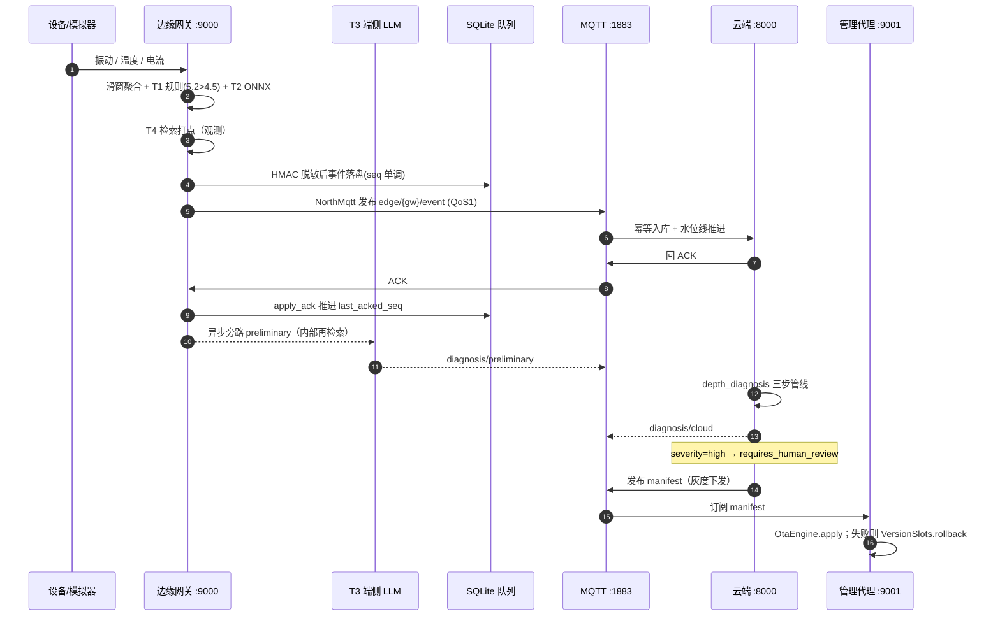
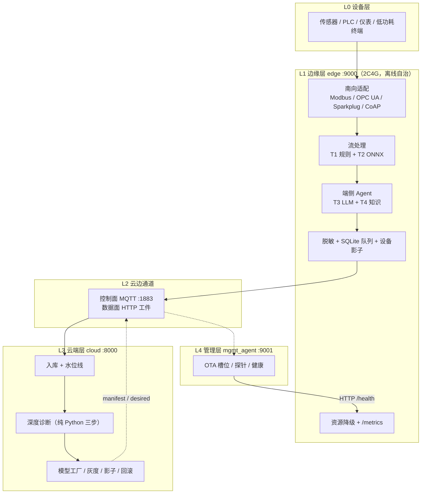
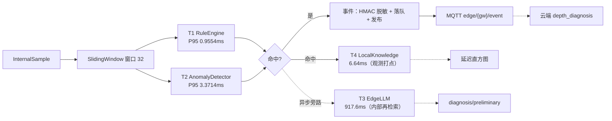

# 端云协同 AI Agent 网关 · 项目简历

> **项目**：`edge-ai-agent-gateway`（边云协同 AI Agent 网关）｜**实现范围**：方案 V1.0 的 Phase 0 主体（E0–E3 机制层）
> **运行时**：Python ≥ 3.12 ｜ **依赖管理**：`uv`（`pyproject.toml` 声明、`uv.lock` 锁定）
> **文档性质**：项目材料（非个人简历），面向技术评审、业务方与管理层的通用读者
> **数据口径**：数字均指向仓库代码、测试或 `evidence/` 原始输出；"已实测"与"方案目标"在文中逐项区分

---

## 一、一页速览

**项目名称**：edge-ai-agent-gateway（边云协同 AI Agent 网关）

**项目角色**：独立开发（方案/编码/测试/部署/文档）

**一句话定位**：把"毫秒级确定性告警、秒级语义初判、断网自治、原始数据不出厂、云端持续进化"放进同一套 2 核 4G 边缘网关，并用"决策权在云、执行权在边"划清云边职责。

**电梯演讲**：工业现场要快、会断网、数据不能出域，纯云和纯边都不成立。本项目在边缘侧用规则、ONNX 判别模型、端侧小模型与本地知识检索组成四级流水线，把"必须毫秒级"和"可以秒级"拆成两条互不阻塞的链路；用 SQLite 队列、水位线补传与事件幂等承受断网；用 HMAC 脱敏与"只上行聚合/事件"守住数据边界；云端负责深度诊断、模型编排、灰度、影子验证与 OTA 回滚。项目以 Python ≥3.12 + FastAPI 交付三服务，核心包 **64 个 Python 文件、8894 行**，测试 **42 个文件、932 个用例、17650 行**。


**关键数字卡**

| 维度 | 数字 | 口径 |
|---|---|---|
| 代码规模 | 核心包 64 个 Python 文件 / 8894 行 | edge 41/5087、cloud 10/2866、mgmt_agent 5/582、shared 4/170、sim 4/189 |
| 测试规模 | 42 个测试文件 / 932 个用例 / 17650 行 | 2026-10-22 基线 932 passed（未显式记录 skipped） |
| T1 确定性告警 | P95 **0.9554ms**（预算 <50ms） | 20 逻辑核开发机，`BENCH_THREADS=2` |
| T2 ONNX 异常检测 | P95 **3.3714ms**（预算 <200ms） | 同上 |
| T3 端侧 LLM 初判 | P95 **917.6ms**（预算 <1200ms） | 同机，Qwen2.5-0.5B Q4_K_M，`n_threads=2`，20 次样本 |
| T4 本地知识检索 | P95 **6.64ms**（预算 <80ms） | ONNX 语义检索，本机 N=300；2C 容器代理 5.78ms |
| 资源约束 | `cpus=2.0` / `mem_limit=4g` / 只读根文件系统 / 非 root / `cap_drop: ALL` | `docker-compose.edge.yml` |
| 工程基线 | 20 次提交 / 192 个跟踪文件 / 3 条规则 / 窗口 32 | git / config |

> 阅读提示：上表延迟均不是"真实 2C4G 边缘盒"实测，而是开发机限线程模拟值或 Docker Desktop WSL2 的 2C 容器代理值。真机迁移未完成，第 9 节展开。

---

## 二、业务背景：为什么纯云不够、纯边也不够

> 为避免与方案阶段 E0–E3 混淆，本节把三道墙称为 W1–W3。

### 2.1 三道墙

**W1 时延墙**：轴承劣化的早期征兆以振动统计量体现，现场希望"越限即告警"。判定放云端，时间就由网络往返、排队与负载决定；网络一抖动，毫秒级承诺即不成立。

**W2 断网墙**：交换机重启、无线抖动、检修隔离都会造成分钟级到小时级失联。纯云断网即失能；"断网就丢数据"等于丢掉故障前后最关键的证据。

**W3 合规墙**：原始振动波形、工艺参数、设备与站点标识属于敏感数据。全量上云增加带宽与存储成本，也带来数据出域风险；很多工厂的底线是"原始数据一步不出厂"。

### 2.2 三种架构形态对比

| 维度 | 纯云 | 纯边 | 边云协同（本项目） |
|---|---|---|---|
| 告警时延 | 受网络往返支配 | 本地毫秒级 | 本地毫秒级，T1 P95 0.9554ms |
| 断网表现 | 直接失能 | 可用，但知识不更新 | 本地队列 + 水位线补传，离线自治 |
| 数据边界 | 原始数据全量出域 | 数据不出域 | 只上行聚合遥测/事件，设备标识 HMAC |
| 模型演进 | 集中管理，覆盖不到实时性 | 需逐台现场升级 | 云端编排 + 环形灰度 + 影子验证 + OTA |


结论不是"边云协同更先进"，而是一个取舍：**"必须现在、必须本地"的判断留在边缘，"需要全局信息、需要人判断"的工作放到云端**。后文职责划分由此推导。

---

## 三、主场景：一次轴承异常的完整旅程

主场景锁定为**离心泵驱动端轴承振动异常**。规则来自 `config/current.yaml` 的 `bearing_rms_high`：`vibration_rms > 4.5` 判为 `severity=high`；另有 `temperature > 80.0`、`current > 18.0` 两条 medium 规则，共 3 条。

以 RMS 5.2 为例，一次完整旅程如下：

1. **采集**：南向适配器把振动/温度/电流统一为 `InternalSample` 写入同一队列；单路断开不影响其他路。
2. **聚合**：`SlidingWindow.push` 维护长度 32 的窗口，输出均值、最值、P95、标准差、斜率。
3. **判定**：`RuleEngine.evaluate` 命中 `bearing_rms_high`（5.2 > 4.5），生成 `RuleHit(severity=high)`；同设备同规则 5 秒内只发一次。
4. **端侧初判**：`EdgeAgentRuntime.preliminary` 内先 `FaultChain.two_hop` 做故障链两跳，再 `LocalKnowledge.search` 检索知识，两者一起 build prompt，最后调 `EdgeLLM.infer` 产出结构化 JSON；文本强制标注"端侧初判，未经验证"。
5. **脱敏上行**：设备标识经 `hash_device_id` 做 HMAC-SHA256 摘要，事件落 SQLite 队列（`seq` 单调），发布到 `edge/{gw}/event`（QoS1）。
6. **云端诊断**：`depth_diagnosis` 依次做传感器分析、知识检索、故障链 ≤2 跳推理，输出带引用的 `CloudDiagnosis`；`severity=high` 时置 `requires_human_review=True`，结论发布到 `edge/{gw}/diagnosis/cloud`。
7. **人工复核与回流**：高风险结论进入人工复核，结论作为下一轮训练/蒸馏候选（设计口径；实际回流未接入，工厂 `_data_reflux` 为 mock）。需说明：复核流程与工单系统不在本仓库，代码只提供标记与诊断结果。
8. **演进与下发**：模型工厂编排新版本，灰度按环放量，影子验证后由 `edge/{gw}/manifest` 下发；`OtaEngine.apply` 完成下载、校验、切槽、探针，失败则在 `previous` 版本非空时由 `VersionSlots.rollback` 回退。



读图要点：第 3、5 步属于"告警主链路"，第 4 步是"旁路"。**告警不等初判**，这是设计地基。

---

## 四、方案总览：决策权在云、执行权在边

### 4.1 五层架构

| 层 | 组成 | 职责 | 关键约束 |
|---|---|---|---|
| L0 设备层 | 传感器、PLC、仪表、低功耗终端、MQTT 泵机 | 产生振动/温度/电流信号 | 协议异构 |
| L1 边缘层 | `edge` :9000 | 采集、滑窗、T1/T2、T3/T4、脱敏、队列、降级、指标 | 2C4G，可离线自治 |
| L2 云边通道 | MQTT Broker :1883 + HTTP | 控制面小包；数据面大文件 | 弱网可存活 |
| L3 云端层 | `cloud` :8000 | 入库、诊断、工厂、灰度、影子、回滚 | 全局视角 |
| L4 管理层 | `mgmt_agent` :9001 | 槽位管理、OTA、健康探测 | 与主应用进程隔离 |

### 4.2 四个交互面

- **控制面**：MQTT（:1883），承载事件、ACK、初判、诊断、影子、manifest、command 与健康；小包、QoS0/1、可 retain。
- **数据面**：HTTP，模型工件分块下载（`GET /v1/models/artifacts/{name}`），避免挤占消息总线。
- **管理面**：`mgmt_agent` 的 REST（`/health`、`/ota/apply`、`/ota/rollback`）与对 edge 的主动探测。
- **南向**：Modbus TCP、OPC UA、MQTT Sparkplug B、CoAP 四类适配器，统一产出 `InternalSample`。

### 4.3 为什么这样分工

"决策权在云"指版本、灰度、回滚、模型注册这些状态只在云端决定；"执行权在边"指采集、判定、脱敏、入队、执行 OTA 必须本地完成。边缘不自行决定版本，只上报 `reported`，版本变更由云端通过清单/OTA 驱动。



---

## 五、技术解法 × 业务价值

每小节按"业务问题 → 技术解法 → 业务收益 → 已知边界"展开。

### 5.1 既要 <50ms 告警，又要秒级初判

**业务问题**：值班人员既要"越限立刻响"，又要"响了之后知道大概是什么毛病"。两者代价差三个数量级，串行必然互相拖累。

**技术解法**：主链路 = T1/T2 判定 + 命中后同步 T4 检索打点（毫秒级）+ 建事件/落队/发布；这次 T4 的返回值只进延迟直方图，不进事件。T3 异步旁路：`preliminary()` 内先 `FaultChain.two_hop` 再 `LocalKnowledge.search`，把结果写进 prompt 后调 `EdgeLLM.infer`。主链路 T4 是"观测"，T3 里的 T4 是"证据"，两者不能混为一谈。

**业务收益**：T1 判定 P95 0.9554ms（不含命中后 T4 打点；emit 链路另加约 6.64ms，仍远低于 50ms 预算），初判 917.6ms，两者互不阻塞。值班人员先收到"确定越限"，再收到"疑似原因"。

**已知边界**：T3 是可选依赖，`llama_cpp` 或模型缺失时返回确定性兜底；917.6ms 只有 20 次样本，P95 接近最大值；开发机单核性能可能优于目标 2C 设备。

### 5.2 厂区断网是常态

**业务问题**：断网不能变哑巴；恢复后不能丢、不能重、不能被一个缺口卡住补传链。

**技术解法**：事件先写本地 SQLite（`SqliteQueue.append_event`），插入前做 `event_id` 幂等检查，重复抛 `E_CONFLICT`；`seq` 单调递增，审计表由 `audit_no_update`/`audit_no_delete` 触发器保证只增不改删。恢复后 `_replay_loop` 每 2 秒取一批（≤100 条），从 `last_acked_seq` 之后顺序补传；云端按 `event_id` 幂等入库，按 `(gw_id, seq)` 记 gap，缺口只记录、不阻塞；`apply_ack` 只前进不回退。

**业务收益**：`evidence/raw/s4.txt` 证明在线 ACK、幂等入库与水位推进；补传路径由单测覆盖，尚未做断网注入实测。断网期间 T1 仍可用。

**已知边界**：四档细粒度断网降级只实现 >24h 一档（`OFFLINE_DEGRADED`）；24h 断网注入与 7 天保留未实测；队列 append-only，无自动清理。95 条为在线联调，非长时断网证据。

### 5.3 原始数据一步不出厂

**业务问题**：合规要求"原始波形不出厂"，云端又需足够信息做诊断。

**技术解法**：上行只发三类：聚合遥测（均值/最值/P95/标准差/斜率）、事件（含窗口快照）、健康状态；原始采样点不上行。设备标识用 `hash_device_id` 做 HMAC-SHA256 摘要。库内另有 `strip_site_fields`、`mask_process_params`、`mask_payload`、`SaltRotator`。

**业务收益**：原始数据物理上不离开边缘；报文被截获，设备标识也不可逆。聚合统计足以支撑阈值判定与趋势分析，云端拿到的是"证据"而非裸数据。

**已知边界**：主链路实际只调用了 `hash_device_id`；站点字段剥离、工艺参数区间化、salt 轮换是库能力，尚未接入 `edge/runtime.py`。上行压缩比 ≥99% 是设计目标与架构性结论，无字节比对实测。

### 5.4 让现场看得懂：端侧 LLM 的结构化输出

**业务问题**：告警文本若只是"RMS 超限"，现场不知道查哪里；自由文本又无法被程序消费。

**技术解法**：`preliminary` 构造 prompt（设备/指标/故障链/知识），`EdgeLLM.infer` 用 `create_chat_completion` 套 chat template，输出 `diagnosis / confidence / tool` 的 JSON。`max_tokens=32`、`num_ctx=2048`、`n_threads=2`，模型 Qwen2.5-0.5B-Instruct Q4_K_M（491,400,032 字节），按 60 秒 TTL 缓存。

**业务收益**：现场拿到"疑似轴承磨损，建议检查润滑"这类方向，带置信度与"未经验证"标注，不会被误当正式结论；JSON 可解析供前端与规则消费。真实模型解析率从 0 到 100%，P95 917.6ms。

**已知边界**：0.5B 模型只做"方向性提示"而非"诊断结论"；P95 只有 20 次样本；模型是通用中文底座。

### 5.5 断网也能查手册：本地语义检索与故障链

**业务问题**：断网时没有云端大模型和在线知识库，现场仍需知道"这条告警对应哪类故障、下一步查什么"。

**技术解法**：`LocalKnowledge.search` 用 ONNX 跑 `bge-small-zh-v1.5` int8（512 维，24,010,842 字节，约 22.9MiB），`tokenizers` 直载 `tokenizer.json`、CLS pooling + L2 归一化、`numpy` 余弦，不引入 torch/transformers；缺失时回退 32 维 hash-embed。`FaultChain.two_hop` 做两跳推理。知识资产是 30 条片段与 3 个故障链根节点（`bearing_wear`、`lubrication_failure`、`overload`）。

**业务收益**：检索 P95 6.64ms（本机 N=300），远低于 80ms 预算；2C 容器代理 5.78ms（N=100、1000 条语料、arena ON）。模型 22.9MiB、容器峰值 344.6MiB，使本地语义检索在 2C4G 上成为可选项而非奢侈品。

**已知边界**：6.64ms 为开发机数据，未在 2C4G 容器复测；5.78ms 来自 Docker Desktop WSL2 的 CFS 配额代理，不是真实边缘盒；hash-embed 的 0.1441ms 只用于兜底，不具语义代表性。

### 5.6 越用越聪明，但必须可回退

**业务问题**：模型要持续演进，但每次下发都可能搞坏现场；"发得出去"与"退得回来"必须同时成立。

**技术解法**：`ModelFactory` 用 `PipelineStage` 编排七阶段：数据回流 → 清洗标注 → 蒸馏 → 剪枝 → 量化 → 校准评测 → 注册，产出带 `sha256`、`quant`、`requires_firmware` 的清单。`RolloutOrchestrator` 按 `internal_test → canary → expand_ring → stable_window → full_release` 五步推进，环 `[1, 10, 50, 100]`、稳定窗口 24h、回滚窗口 168h、最小样本 100。`ShadowEvaluator` 让新旧模型并行推理、只记录不生效，按一致率相对现网下降不超过 2pp、延迟 ≤1.2×、内存 ≤1.15×、JSON 可解析率 ≥95%、误报率五项 KPI 加样本量判定，并用 Wilson 区间标注。`OtaEngine.apply` 走 11 态（下载→校验→暂存→激活→探针→观察→成功/回滚）；探针失败时 `VersionSlots.rollback` 回退并冻结问题版本（需 `previous` 非空）。

**业务收益**：发布风险被拆成四层可回退控制：影子不改线上结果、灰度限制影响面、探针自动判定、槽位保留上一版本；模型/固件/配置三层解耦。

**已知边界**：工厂的编排、状态、注册、manifest 是真实的，但阶段内部多为 mock（固定样本、写 JSON、固定剪枝参数、固定评测值 0.92/45ms/512MB），非真实蒸馏/量化结果。灰度与影子有代码与单测，无生产切流证据。OTA 无 100 次统计，"成功率 99%/回滚 100%/回滚 <10s"都是验收目标。

### 5.7 2C4G 资源治理：资源不失控、升级可接管

**业务问题**：边缘盒子内存与算力很紧，LLM 一加载就可能挤死告警链路；升级失败往往发生在主进程不可用时。

**技术解法**：`ResourceGuard` 采集内存、磁盘、温度、离线时长，`DegradePolicy.evaluate` 输出 7 级矩阵：`NORMAL / LLM_SMALL / LLM_OFF / TEMP_THROTTLE / OFFLINE_DEGRADED / DISK_CRITICAL / EMERGENCY`；多个高危同时触发升 `EMERGENCY`，升级立即、恢复过迟滞。部署侧用 compose 的 `cpus: 2.0`、`mem_limit: 4g`、`memswap_limit: 4g`、`read_only: true`、`cap_drop: ALL` 与非 root 用户做硬约束。OTA 与槽位管理在独立进程 `mgmt_agent`（9001），`probe_edge` 单点探测、`comprehensive_probe` 五维探测；主进程崩溃不影响其存活与接口可达，但"崩溃后自动接管回滚"未实现，自动回滚只在 `OtaEngine.apply` 探针失败分支、且需 `previous` 版本非空。可观测性由 `/metrics` 与 Prometheus/Grafana 承载。

**业务收益**：edge 分阶段 RSS 从 18.2MiB 基线，经 ONNX 50.5、T2 76.7、FastAPI 96.2、LLM 252.7，到推理后 623.5MiB；T4 同进程约 764.6MiB、sidecar 约 968.1MiB，距 4GB 仍有 3GiB 以上余量。降级矩阵保证"资源不够先关 LLM、先保告警"。

**已知边界**：以上 RSS 为开发机口径，真实 2C4G 边缘盒未复测；离线维度只有 >24h 一档；监控有配置与看板，无长期趋势。



---

## 六、量化成果与证据

### 6.1 已实测

| 指标 | 数值 | 预算 | 实测前提 | 出处 |
|---|---:|---:|---|---|
| T1 P95 | **0.9554ms** | <50ms | 20 逻辑核开发机，`BENCH_THREADS=2`，3 条规则，窗口 32，2000 次 | `evidence/raw/bench_latency.txt` |
| T2 P95 | **3.3714ms** | <200ms | 同上，500 次，ONNX 模型 942,080 字节 | 同上 |
| T3 P95 | **917.6ms** | <1200ms | Qwen2.5-0.5B Q4_K_M，`n_threads=2`，`max_tokens=32`，20 次 | 同上 |
| T4 P95（ONNX） | **6.64ms** | <80ms | 本机 N=300，512 维，bge-small int8；直调 `LocalKnowledge.search`，非 runtime 集成链路 | `t4_onnx_verification_report_round2.md` |
| T4 P95（2C 容器代理） | **5.78ms** | <80ms | Docker Desktop WSL2，2C/4g，N=100，语料 1000 条 | `rag_onnx_bench.md` |
| T4 容器峰值 RSS | 344.6MiB（arena ON）/ 220.0MiB（arena OFF） | 4096MiB | 同上，无 OOM | `rag_onnx_bench.md` |
| edge 峰值 RSS | 623.5MiB | 4GB | 含一次 LLM 推理峰值 | `evidence/raw/edge_baseline.txt` |
| T4 同进程集成峰值 | ≈764.6MiB | 4GB | edge + RAG 模块 | `rag_onnx_bench.md` |
| T4 sidecar 集成峰值 | ≈968.1MiB | 4GB | edge + RAG 进程 | 同上 |
| 测试基线 | 932 passed（报告未显式记录 skipped 数） | — | 2026-10-22，143.31s | round2 报告 |
| 端到端联调 | 95 事件入库 / 水位 90 / `gaps=[]` | — | 在线 ACK/水位推进，非补传注入 | `evidence/raw/s4.txt` |


### 6.2 方案目标（未实测，不作为成果）

| 指标 | 目标 | 当前事实 |
|---|---:|---|
| 云端诊断端到端 | <3s | 三步管线，无延迟基准 |
| 上行压缩比 | ≥99% | 只上行聚合/事件，无字节比对 |
| 断网自治时长 | ≥24h 全功能 / ≥7 天告警 | 队列持久化已实现，无长时注入 |
| OTA 成功率 / 回滚率 / 回滚耗时 | ≥99% / 100% / <10s | 有流程与单测，无统计样本 |
| 影子一致率 | 相对现网基线下降 ≤2pp（方案目标 ≥75%） | 阈值已实现，无真实影子数据 |
| 补传完整率 | 100% | 机制已实现，无断网注入实测 |
| 补传幂等性 | 0 重复 | `event_id` 唯一约束 + 测试，无大规模实测 |
| 云端升级率下降 | 3 迭代后 ≥30% | 指标存在，无趋势数据 |
| 端侧误报率 | ≤15% | 无人工抽检 |
| 真机迁移改动量 | 0 行 | 无真机证据 |

> 保留这张表，是为了让"没做到"和"做到了"同样可查。

---

## 七、工程方法与质量体系

**四道门禁**：`ruff check`、`ruff format --check`、`mypy`（检查五个核心包共 64 个源文件）、`pytest`（932 用例）。统一入口是 `Makefile` 与 `scripts/check.sh`；`.github/workflows/ci.yml` 执行同一套命令，安装也走 uv，避免"本地绿、CI 红"。

**测试结构**：42 个测试文件、932 个用例、17650 行。分层覆盖单元（规则、异常、队列、护栏、OTA、灰度、影子、回滚、工厂）、端到端（主链路、断网自治、云边协同）与契约（schemas / topics / errors）。可选依赖测试用 skip 降级，真实推理单列 `test_edge_llm_real.py`，保证无声环境仍全绿。

**依赖与运行**：Python ≥3.12，依赖由 uv 管理（`pyproject.toml` + `uv.lock`），不使用 `requirements.txt`。三服务各自 uvicorn 启动，端口 9000/8000/9001，MQTT 1883。

**容器与联调**：`Dockerfile` + `docker-compose.edge.yml` 以 cgroup 限额模拟 2C4G，只读根文件系统、非 root、`cap_drop ALL`；`deploy/` 提供 Prometheus 抓取、告警规则、Grafana 看板与 systemd 单元；`sim/` 四类模拟器支撑零硬件联调；`scripts/e2e.sh` 按 cloud → edge → sim 顺序复现主链路。

**一个取舍**：没有为了"看起来完整"引入 Celery、Kafka、K8s。工厂用 `threading`，队列用 SQLite，消息用 MQTT；单机 2C4G 下，少一个中间件就少一个故障面。

---

## 八、三个关键难题的解决过程

### 8.1 T3 JSON 解析率从 0% 到 100%

**现象**：端侧 LLM 能跑，但结构化输出解析率恒为 0，系统静默降级到规则兜底。

**定位**：两个根因：`EdgeLLM.infer` 用 completion 接口、未套 chat template，模型把 prompt 当续写文本；prompt 的字段示例形似 set 简写，诱导出非标准 JSON。

**修复**：改用 `create_chat_completion` 套用对话模板；示例改成标准 JSON；解析加轻量容错（去尾逗号、单引号转双引号）；补真实模型集成测试。结果：解析率从 0 到 100%（20/20 样本），P95 917.6ms。

**为什么值得写**：这不是"调 prompt"，而是接口语义用错 + 输出契约不明确的工程缺陷；价值是让端侧 LLM 可被程序消费。

### 8.2 T4 从 hash-embed 占位到 ONNX 真实语义检索

**起点**：最初 `LocalKnowledge` 用 32 维 hash-embed 兜底，靠字节袋相似度检索，接口能跑但无语义——"轴承磨损"与"润滑不足"几乎无关。

**两条路线**：A 是 PyTorch + sentence-transformers，依赖重，2C4G 下内存接近上限，CPU 争用威胁 T1/T2；B 是 ONNX int8 + tokenizers + numpy，模型 24,010,842 字节（约 22.9MiB），无 torch/transformers。

**选型依据**：B 在 2C 容器代理下 T4 P95 5.78ms、峰值 344.6MiB（arena ON），叠加 edge 后约 764.6MiB，4GB 内余量充足；A 的内存与 CPU 风险不可接受。选 B，保留 hash-embed 兜底。

**加固**：真实模型接入暴露脏数据——空向量、维度不一致、非有限值会让余弦排序崩溃。解法是矩阵加载做元素级校验、异常时整体降级到 hash-embed，并补脏数据用例（12/12）与降级用例（8/8）。round2 确认 512 维语义生效、932 用例全绿。

**结论**：选型不是"ONNX 更好"，而是"在 2C4G 约束下，ONNX 不会反噬告警链路"。

### 8.3 从模块级测试到端到端可运行：容器编排、指标补齐与演示环境

**问题**：模块级测试通过，不代表容器能起来、指标能看到、演示链路能走通。从"能跑单测"到"能起完整栈"，还差一层编排与可观测性。

**修复**（提交 `f810bf7` 的五项）：

1. `Dockerfile`：ENTRYPOINT 只保留 tini，启动命令移到 CMD，compose 用 command 覆盖 CMD。
2. `edge/runtime.py`：补齐 10 个 Prometheus 指标 + 1 个 Info 元数据，覆盖队列深度、模型版本、降级等级、网络、离线时长、缓存命中率、温度、磁盘、期望版本、升级计数。
3. `cloud/main.py`：新增 `/metrics` 端点 + 6 个 cloud 指标。
4. 新建 `sim/Dockerfile`，让模拟设备进入编排。
5. `docker-compose.edge.yml` 增加 `DATA_DIR=/var/lib/edge-agent`，把可写数据目录从只读根文件系统分离。

**结果与局限**：compose 起 6 个 service——核心四个服务 edge / cloud / mgmt_agent / mosquitto 均已启动并可达（edge/cloud/mgmt 健康检查通过，mosquitto 仅确认运行），另有 device-sim-modbus、device-sim-opcua 两个模拟服务。e2e 在线通路 95 条事件入库、水位到 90、`gaps=[]`；这是在线 ACK，非断网补传注入。OTA 工件仅 16/22 字节，只证明流程跑通，不构成真实模型载荷验证。

---

## 九、边界与诚实声明

**已经做到的（有代码与测试）**：四级流水线与异步旁路；四类南向适配器（CoAP 弱依赖）；SQLite 队列、水位线、`event_id` 幂等、gap、append-only 审计；设备标识 HMAC 脱敏；影子接口；纯 Python 云端诊断三步管线；模型工厂七阶段编排与注册；环形灰度、影子验证、OTA 下载/校验/切槽/探针回滚/冻结；7 级降级矩阵；Prometheus/Grafana；2C4G compose 限额与进程隔离；932 用例全绿。

**方案目标（未实测）**：云端诊断 <3s；上行压缩比 ≥99%；24h 断网与 7 天保留；OTA 成功率/回滚率/回滚耗时；影子一致率；云端升级率下降；端侧误报率；真机零改码迁移。

**明确没做**：真实 2C4G 边缘盒（RK3588 / Orin Nano）迁移与复测；四档断网降级（仅 >24h）；云端历史工单与强制人工审核中断（仅 `requires_human_review` 标记）；模型工厂真实蒸馏/剪枝/量化/评测（阶段内部为 mock）；知识包云端下发（无下发接口）；主链路工艺参数区间化（未接主链路）；runtime 主动拉取 desired（mgmt_agent 承担）；"崩溃后自动接管回滚"未实现（自动回滚仅 `OtaEngine.apply` 探针失败分支，且需 `previous` 版本非空）；100 次 OTA 统计。

**几处容易误读、需要特别说明**：

1. 云端诊断走 hash-embed（`_retrieve_knowledge` 未传 `model_dir`），只有边缘 T4 走 ONNX 512 维；不要被 docstring 误导。
2. T4 的 0.1441ms 是 hash-embed 降级路径，6.64ms 才是 ONNX 语义检索；两者不能混用。
3. T2 是合成数据训练的 Isolation Forest（skl2onnx 导出），不是真实工业数据自编码器；AE 只是兜底图。
4. 自动回滚发生在 `OtaEngine.apply` 的模型槽位（`anomaly` / `intent`），且需 `previous` 版本非空；不是分区级固件双系统。
5. 延迟均为开发机或 Docker Desktop 代理口径，不能外推为"真实 2C 设备达标"。

> 能把"机制已实现"与"生产已验证"分开写，本身即工程成熟度。

---

## 十、适用场景与复用价值

**P0 工业预测性维护**：离心泵、风机、压缩机等旋转设备的轴承/润滑/过载故障；替换规则表与知识文件即可迁移。

**P1 园区楼宇**：空调机组、水泵、电梯的振动/温度/电流监测；时延要求低于产线联锁，但"断网自治 + 数据不出园"成立，南向适配器可直接复用。

**P2 无人值守站点**：基站、泵站、偏远井场；网络差、维护周期长，断网队列 + 补传 + 本地检索价值最直接，进程隔离与自动回滚降低"人不在现场"风险。

**可复用组件**：

| 组件 | 复用方式 |
|---|---|
| 四级流水线与异步旁路 | 任何"快判定 + 慢解释"的场景 |
| SQLite 队列 + 水位线 + 幂等 + gap | 任何弱网/断网数据回传场景 |
| HMAC 脱敏与"只上行聚合" | 任何有数据出域合规要求的场景 |
| 设备影子 + manifest + OTA 槽位回滚 | 任何远程升级边缘软件的设备群 |
| 7 级降级矩阵 | 任何资源受限的边缘部署 |
| 模型工厂编排 + 灰度 + 影子 | 任何"可控演进"的模型分发 |

**不建议直接复用**：具体规则阈值、知识片段与故障链是场景资产，换行业必须重写；端侧 LLM 的 prompt 与输出 schema 也需要按场景重新设计。

---

## 十一、术语表

| 术语 | 一句话解释 |
|---|---|
| 边云协同 | 边缘负责实时自治、云端负责全局决策 |
| 四级流水线（T1–T4） | T1 规则、T2 ONNX 判别、T3 端侧 LLM、T4 本地知识检索；编号按代价分层，T4 在主链路、T3 异步 |
| 异步旁路 | 告警先发事件，LLM 初判独立任务后到，不阻塞告警 |
| 设备影子 | 云端保存 desired、边缘上报 reported，delta 表示差异 |
| 水位线 | 云端已确认的最大序号，边缘从它之后补传 |
| 幂等 | 同一 `event_id` 重复到达只生效一次 |
| gap（缺口） | 补传中发现的序号断档，只记录、不阻塞 |
| 灰度 | 按环逐步放量，环为 1/10/50/100 百分比 |
| 影子验证 | 新旧模型并行推理、只记录不生效的验证 |
| 降级 | 资源/网络不足时按矩阵关非关键能力、保告警 |
| A/B 槽位 | 目录槽位 + 指针切换，保留上一版本供回滚 |
| OTA | 模型/固件/配置的远程分发与安装 |
| HMAC-SHA256 | 带密钥的哈希，用于设备标识不可逆脱敏 |
| hash-embed | 32 维哈希向量兜底检索，无语义能力 |
| ONNX | 跨框架模型交换与推理格式，用于 T2/T4 |
| GGUF | llama.cpp 的量化模型文件格式 |
| MQTT / QoS | 轻量消息总线；QoS0 最多一次、QoS1 至少一次 |
| manifest | 模型发布清单，含版本/sha256/依赖固件 |
| P95 | 95% 请求不超过的延迟值 |
| sidecar | 与主进程并行的辅助进程 |
| Wilson 置信区间 | 小样本比例估计的区间法 |
| pp | 百分点，2pp 即两个百分点 |

---

## 十二、附录

### 12.1 复现命令（依赖统一 uv）

```bash
uv sync                                   # 安装依赖
uv run pytest                             # 932 个用例
uv run python scripts/bench_latency.py    # 四级基准
uv run python scripts/download_bge_onnx.py  # 下载 bge ONNX 模型
uv run python -m edge.main                # edge  :9000
uv run python -m cloud.main               # cloud :8000
uv run python -m mgmt_agent.main          # mgmt  :9001
```

### 12.2 证据索引

| 证据 | 证明什么 | 使用注意 |
|---|---|---|
| `evidence/raw/bench_latency.txt` | T1/T2/T3 与 T4(hash) 的 P95、环境前提 | T4 是 hash 降级路径；非真实 2C 设备 |
| `evidence/t4_onnx_verification_report_round2.md` | T4 ONNX 6.64ms、512 维、932 passed、脏数据 12/12、降级 8/8 | 本机 N=300，未在 2C4G 容器复测 |
| `evidence/rag_onnx_bench.md` | 2C 容器 5.78ms、RSS 344.6/220.0MiB、同进程 764.6MiB | Docker Desktop WSL2 代理 |

| 证据 | 证明什么 | 使用注意 |
|---|---|---|
| `evidence/raw/s4.txt` | e2e 95 事件、水位 90、`gaps=[]` | 在线 ACK，非断网补传 |
| `evidence/raw/s8.txt` | 模型注册 + rollout `rings=[1,10,50,100]` | 工件仅 16/22 字节 |

---

**结语**：这套系统的价值不在于用了多少模型，而在于把"哪些判断必须现在做、哪些可以晚点做、哪些必须由人兜底"拆清楚了。代码与测试是这套拆法的证据，未实测项则是下一步的清单。