# Palpation 核心业务流程（讲解版）

> 项目：**端云协同边缘 AI Agent 网关**　方案版本：V1.0（Phase 0）　技术栈：Python + FastAPI
> 文档定位：面向**不具备深入技术背景的讲解对象**，用"讲人话 + 画流程 + 点真实接口"的方式，把系统的主演示链路和其他关键流程讲清楚。
> 服务端口约定：边缘 edge=**9000**、云端 cloud=**8000**、管理代理 mgmt=**9001**、MQTT Broker=**1883**。

---

## 零、先读这一页：这套系统到底在做什么

一句话卖点在方案里是这样写的：**"一个跑在 2 核 4G 边缘盒子上的诊断 Agent——断网时它能自己判断、联网时它会被云端越用越聪明，而且原始数据一步都不出工厂。"**

它要解决三个现实矛盾：

| 编号 | 矛盾 | 通俗解释 |
|---|---|---|
| E1 | 时延与带宽的物理下限 | 数据传到云端再传回来太慢，产线等不起 |
| E2 | 网络不可用是常态 | 厂区断网是家常便饭，断了不能变"哑巴" |
| E3 | 全量上传成本与合规双重不可行 | 10kHz 原始振动数据既贵又涉及数据出域 |

因此这套架构把智能"劈成两半"：**决策权在云，执行权在边**。边缘负责毫秒级的实时反应（阈值判定、协议转换、断网自治），云端负责全局决策（用哪个模型、什么时候回滚、什么算高风险）。

### 系统全景与主链路

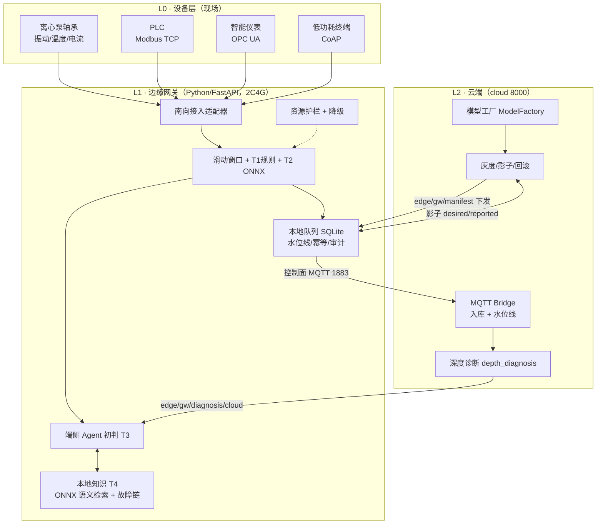

四种交互面（决定"用什么协议说哪种话"）：

| 交互面 | 方向 | 协议 | 典型内容 |
|---|---|---|---|
| 南向（设备面） | 设备 → 边缘 | Modbus TCP / OPC UA / MQTT / CoAP | 原始遥测 |
| 北向·控制面 | 双向 | MQTT QoS1（+Sparkplug B） | 事件上行、指令下行、影子、健康上报 |
| 北向·数据面 | 双向 | HTTPS 流式 + Range 断点续传 | 模型分块下载、断点续传 |
| 管理面 | 双向 | HTTPS REST + mTLS | 注册、清单、灰度编排、回滚 |

> **术语先解释三个**：**边云协同**指边缘算力和云端算力各干各的擅长活；**控制面**指传递"小指令/小事件"的通道（MQTT 最优）；**数据面**指传递"大文件"的通道（HTTP/2 最优）。把两者分开是借鉴 KubeEdge 的思路，避免"大包小包挤一条路，两头都不讨好"。

### 主演示链路总览

主场景锁定为 **"离心泵驱动端轴承振动异常"**（方案 §1.4）。下面 14 个阶段串成一条闭环：

---

## 一、阶段①：设备注册与设备影子的初始化

**做什么（可复述的操作步骤）**

1. 运维在云端调用注册接口：`POST http://<cloud>:8000/v1/devices/register`，请求体 `{"gw_id":"gw-sim-001","site":"lab","hardware":{...}}`。
2. 云端把网关写入 `edge_devices` 表，并**同时创建一条设备影子**（`edge_shadow` 表）。
3. 云端把期望配置 `desired`（`model_version=0.9.1`、`config_version=v0001`、`sampling_policy=10hz`、`upload_policy=agg-10s`）以 **retain 消息**发到主题 `edge/{gw_id}/shadow/desired`。
4. 边缘收到后写入本地影子，并回发 `edge/{gw_id}/shadow/reported` 上报自己的真实状态。

**执行流程与状态变化**

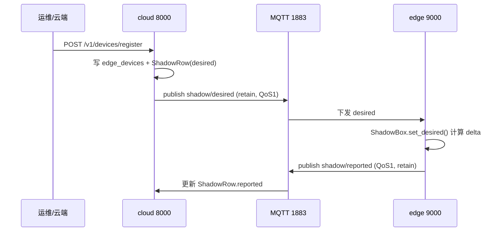

**关键类与接口**

| 类型 | 名称 | 说明 |
|---|---|---|
| HTTP | `POST /v1/devices/register` | `cloud/main.py:register()` |
| 数据表 | `EdgeDevice` / `ShadowRow` | `cloud/db.py` |
| 边缘类 | `ShadowBox` | `edge/cloud/shadow.py`：`set_desired()` / `needs_pull()` / `update_reported()` |
| 主题 | `edge/{gw_id}/shadow/desired`、`.../shadow/reported` | `shared/topics.py` |

**输入/输出与异常**

- 输入：`gw_id`（必填）、`site`、`hardware`。输出：`{"gw_id": "..."}`。
- 影子三段语义：`desired` **只有云端能写**，`reported` **只有边缘能写**，`delta` 是差集。**边缘永不自己决定"我要升级到哪个版本"**——这就是"决策权在云"的落地机制。
- 异常：缺字段会触发 500/422；重复注册是**幂等**的（`s.merge()` 覆盖），不会报错。

**特点与场景**：注册不只是"登记设备"，而是**同时建立一条期望状态基线**。设备重装、恢复出厂后，只要重新注册，云端就能用 retain 消息把配置"推"回去，无需人工逐个登录设备。与普通设备管理（只存台账）相比，这里多了"影子"这一层，是后续所有灰度/回滚的锚点。

---

## 二、阶段②：多协议数据采集（Modbus / OPC UA / MQTT / CoAP）

**做什么**

1. 边缘 `EdgeRuntime.__init__` 初始化四个适配器：`ModbusTcpAdapter`、`OpcuaAdapter`、`MqttSparkplugAdapter`、`CoapAdapter`。
2. `start()` 时为每个适配器各起一个异步任务，它们把采集结果统一写入一个 `asyncio.Queue`。
3. 所有协议最终都被翻译成**同一个内部模型** `InternalSample(device_id, source, ts, metrics)`——上层完全不关心数据从哪来。

**执行流程**

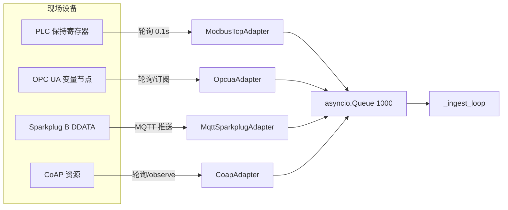

**关键类与接口**

| 协议 | 适配器类 | 关键点 |
|---|---|---|
| Modbus TCP | `ModbusTcpAdapter` | `RegisterMap(address, scale, name)` 寄存器映射，默认 `vibration_rms/temperature/current`；连接失败指数退避 |
| OPC UA | `OpcuaAdapter` | `NodeMap(browse_name, metric_name, required)`；必选节点缺失则本轮失败，可选节点缺失优雅跳过 |
| MQTT | `MqttSparkplugAdapter` | Sparkplug B 主题 `spBv1.0/{group}/DDATA/{edge_node}/{device_id}` |
| CoAP | `CoapAdapter` | `poll_interval_s` 可配（低功耗 60–600s）、`observe_mode` 服务器主动推送更省电 |

统一协议接口：`Adapter.run(out: asyncio.Queue[InternalSample], stop: asyncio.Event)`（`edge/adapters/base.py`）。

**输入/输出与异常**：输入是各协议原始值，输出是 `InternalSample`。任一路链路断开不影响其他路；`connected` 标志实时反映链路状态，并汇总进 `input_links()` 供健康上报。适配器不抛异常给主循环，而是记录日志并退避重连。

**特点与对比**：新增一种协议**只需加一个适配器**，不动上层逻辑——这是"南向接入层"的收敛点。相比"每种协议各写一套业务逻辑"，统一内部模型让后续滑窗/规则/异常检测完全协议无关。

---

## 三、阶段③：滑动窗口聚合

**做什么**

1. 每个采样点的每个指标（`vibration_rms` 等）都推入 `SlidingWindow`。
2. `push(metric, value)` 把值放进定长队列（默认窗口长度取自配置 `sampling.vibration_window`），并**当场算出统计量**。
3. 统计量封装为 `WindowStats`（avg/max/min/p95/std/slope/sample_count/zscore/last），供两条路使用：**实时判定**与**周期遥测上报**。

**执行流程**

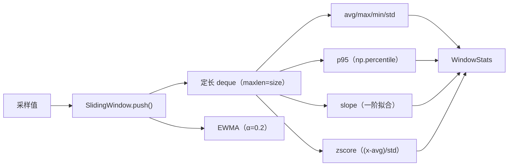

**关键类与接口**：`edge/stream/window.py` 的 `SlidingWindow.push()`、`values()`、`snapshot_id()`。`snapshot_id` 生成形如 `win:vibration_rms:20261014T...` 的证据引用 ID。

**输入/输出与异常**：输入 `(metric, value)`，输出 `WindowStats`。窗口未满时 `slope` 返回 0、`std` 为 0；这是**有意的**"冷启动保护"，避免早期抖动误报。

**特点与对比**：这里是"**数据最小化**"的第一道闸门——原始 10kHz 波形在本地就降成统计量，带宽可降低约 99%（方案 §5.1）。相比"先把原始数据存起来再离线算"，在线滑窗能在毫秒级给出可用特征。

---

## 四、阶段④：T1 规则引擎 + T2 ONNX 异常检测

**做什么**

1. 样本进入 `_handle_sample()`，先跑 **T1 规则引擎**：`RuleEngine.evaluate(metrics)` 返回命中的规则列表 `RuleHit`。
2. 再跑 **T2 判别模型**：若 `guard.t2_full` 为真且存在 `vibration_rms`，调用 `AnomalyDetector.is_anomaly(window, "vibration_rms")` 得到 `(是否异常, 异常分数)`。
3. 若 T2 判异常、且 T1 未命中 `bearing_rms_high`，则**追加一条** `RuleHit(rule_id="t2_ae_vibration", severity="high")`——即两条路径的结论会合流成同一种事件。

**执行流程**

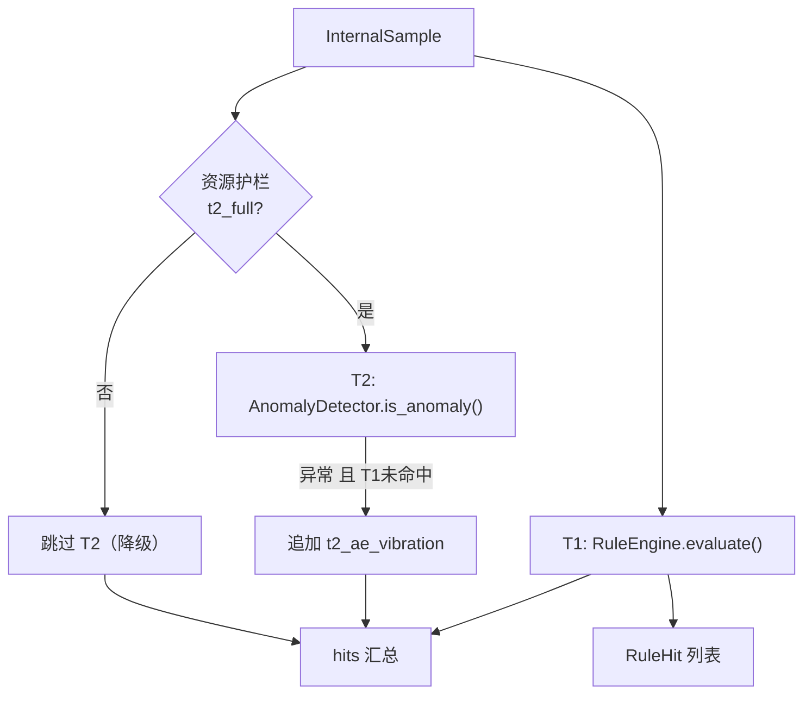

**关键类与接口**

| 层 | 类 | 说明 |
|---|---|---|
| T1 | `RuleEngine` | `evaluate()` 返回 `list[RuleHit]`；支持 `add_rule/update_rule/remove_rule/reload` 与版本号 |
| 规则定义 | `RuleHit` | `rule_id/metric/value/threshold/severity/description` |
| T2 | `AnomalyDetector` | ONNX Runtime 推理；`score()` 越大越异常，`is_anomaly()` 与阈值比较 |

**输入/输出与异常**：T1 输入指标字典、输出命中列表；T2 输入窗口时序、输出 `(bool, float)`。**T2 可安全降级**：ONNX 加载失败时回退 numpy 评分器，完全不可用时返回 `(False, 0.0)`，绝不阻塞告警链路。

**特点与对比**：这是本方案的关键工程决策——**确定性的 T1/T2 告警路径永不等待 LLM（T3）**。方案 §3.1 明确"判定为真即立刻发事件"。相比"什么都交给大模型判断"，这种分层设计让"端到端 <50ms 告警"和"带语义初判 <1.2s"两个指标互不拖累。

---

## 五、阶段⑤：一级告警事件生成与端侧初判

**做什么**

1. 对每个命中 `hit` 调用 `_emit_hit()`：先做 **5 秒去重**（同一设备同一规则 5 秒内只发一次）。
2. 生成证据引用 `evidence_refs=[window.snapshot_id(hit.metric)]`，并做一次 T4 本地知识检索。
3. 用 `agent.build_event(...)` 构造 `EdgeEvent`（`event_id` 为 ULID，`device_id_hash` 已脱敏），写入本地队列 `SqliteQueue.append_event()`，获得单调递增 `seq`，并写审计。
4. **旁路**异步填充端侧初判：`_fill_diagnosis()` 调用 `agent.preliminary()`，结果回填 `preliminary_diagnosis` / `preliminary_confidence`，并发布到 `edge/{gw_id}/diagnosis/preliminary`。

**执行流程（含端侧状态机）**

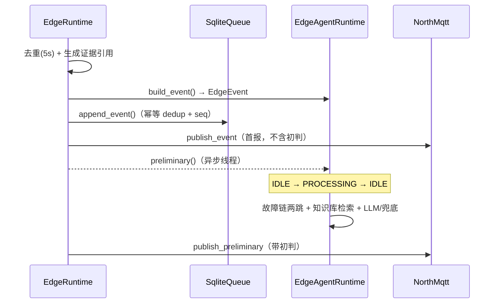

**关键类与接口**

| 类型 | 名称 | 说明 |
|---|---|---|
| 类 | `EdgeAgentRuntime` | `preliminary()`、`build_event()`；状态 `IDLE/PROCESSING` |
| 类 | `RuleHit` → `EdgeEvent` | `edge/agent/state_machine.py` |
| 队列 | `SqliteQueue.append_event()` | 幂等 + 分配 `seq` + 审计 |
| 主题 | `edge/{gw_id}/event`、`edge/{gw_id}/diagnosis/preliminary` | 前者首报、后者初判 |

**输入/输出与异常**：输入 `InternalSample + RuleHit`；输出 `EdgeEvent`。初判有 **60 秒 TTL 缓存**（相同 `device:metric:rule` 复用），LLM 不可用或降级时使用**确定性兜底话术**，且初判文本强制带"端侧初判，未经验证"字样。重复 `event_id` 入队抛 `EdgeError(E_CONFLICT)`。

**特点与对比**：首报事件与语义初判**解耦成两条消息**，是"快"与"准"的分离。相比"等 LLM 写完再发事件"，这里事件先落地，初判后到——即使 LLM 卡住，告警也已经出手。

---

## 六、阶段⑥：HMAC 脱敏

**做什么**

1. 设备标识不直接上行，而是 `hash_device_id(device_id, salt)` 做 **HMAC-SHA256**，得到不可逆的 `device_id_hash`。
2. 按"需哈希 / 需剥离"两类字段执行 `mask_payload()`：`site/customer/plant/device_id` 等被剥离。
3. 工艺参数用 `mask_process_params()` 做**区间化**（如温度落入 `[40,60)`），不泄露精确值。
4. `SaltRotator` 定期轮换 salt，并保留历史 salt 以便**校验旧数据**。

**执行流程**

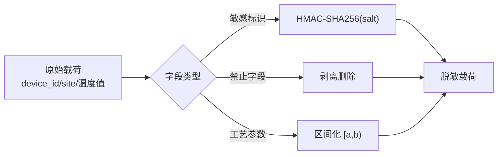

**关键类与接口**：`edge/cloud/masking.py` 的 `hash_device_id()`、`bin_value()`、`strip_site_fields()`、`mask_process_params()`、`mask_payload()`、`SaltRotator`（`rotate()/verify()/is_rotation_due()`）。

**输入/输出与异常**：输入原始 dict + salt；输出新 dict（**不修改原对象**）。salt 为空或轮换间隔 ≤0 时抛 `ValueError`；哈希校验用 `hmac.compare_digest` 恒定时间比较，防时序攻击。

**特点与对比**：对应方案 §5.4"隐私四层防线"的第①②层。相比"上传后再在云端脱敏"，**在这里脱敏意味着原始数据从物理上就没离开工厂**，这也是满足《个人信息保护法》与工业数据分级的硬要求。

---

## 七、阶段⑦：MQTT 上行

**做什么**

1. 事件通过 `NorthMqtt.publish_event()` 发布到 `edge/{gw_id}/event`，**QoS1**（不可丢）。
2. 遥测走 `publish_telemetry()`（QoS0，可丢）、健康走 `publish_health()`（QoS0 + retain）、影子走 `publish_reported()`（QoS1 + retain）。
3. 边缘设置**遗嘱消息（LWT）**：连接异常断开时，Broker 自动发布 `edge/{gw_id}/status = offline`，云端**立即感知掉线**，无需等心跳超时。

**执行流程**

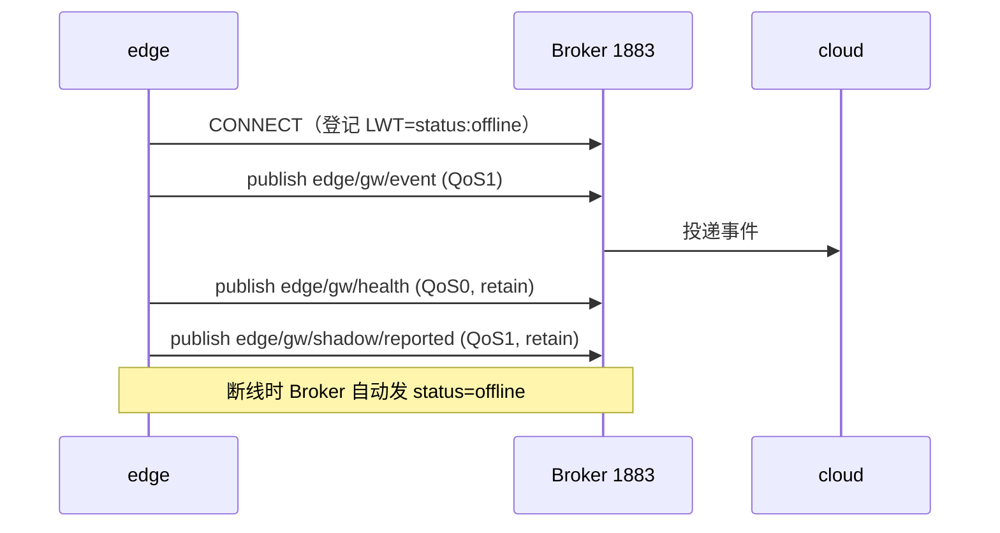

**关键类与接口**

| 方法 | 主题 | QoS / retain |
|---|---|---|
| `publish_event()` | `edge/{gw_id}/event` | QoS1 |
| `publish_telemetry()` | `edge/{gw_id}/telemetry` | QoS0 |
| `publish_health()` | `edge/{gw_id}/health` | QoS0 + retain |
| `publish_reported()` | `edge/{gw_id}/shadow/reported` | QoS1 + retain |
| `will_set()` | `edge/{gw_id}/status` | QoS1 + retain（遗嘱） |

边缘连接成功后会订阅 `ack`、`shadow/desired`、`manifest`、`command`、`diagnosis/cloud` 五个下行主题。

**输入/输出与异常**：输入 `EdgeEvent`/`EdgeTelemetry`/`EdgeHealth` 对象，内部 `json.dumps(default=str)` 序列化。断线时 `NorthMqtt.reconnect_delay_set(1, 120)` 做**指数退避重连**（1s→120s），避免"惊群"。

**特点与对比**：QoS 分级是刻意的——**事件必达、遥测可丢**。相比"全部用 QoS2"，方案明确只用 QoS0/QoS1，因为 QoS2 需四次握手，代价不划算。

---

## 八、阶段⑧：云端入库与水位线（watermark）推进

**做什么**

1. 云端 `mqtt_bridge.attach()` 订阅 `edge/+/event`、`edge/+/health`、`edge/+/shadow/reported`、`edge/+/status`。
2. 收到事件后 `_ingest_event()`：先按 `event_id` **幂等去重**（`edge_events.event_id` 唯一索引），再推进水位线。
3. 水位线规则：`expected = last_acked_seq + 1`；若 `seq == expected` 正常推进；若 `seq > expected` 说明中间**有缺口**，记录 `gaps` 并把水位线跳到当前 `seq`（**不阻塞后续**）。
4. 回到边缘：发布 `AckPayload` 到 `edge/{gw_id}/ack`，边缘 `apply_ack()` 推进本地水位线（**单调不回退**）。
5. 随后立即做深度诊断并发布结果。

**执行流程**

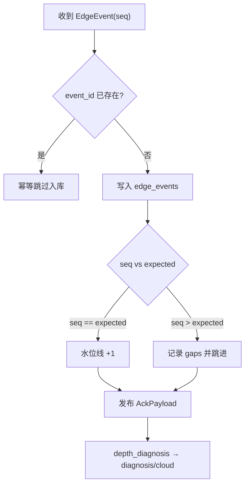

**关键类与接口**

| 类型 | 名称 | 说明 |
|---|---|---|
| 函数 | `cloud/mqtt_bridge.py:_ingest_event()` | 入库 + 水位线 + ACK + 诊断 |
| 表 | `EdgeEventRow` / `Watermark` | `cloud/db.py` |
| HTTP | `GET /v1/events`、`GET /v1/watermarks/{gw_id}` | 查询事件与水位 |
| 边缘 | `edge/queue/watermark.py` | `next_batch()` / `apply_ack()` / `detect_gaps()` |

**输入/输出与异常**：输入 MQTT 事件负载；输出入库记录 + ACK + 诊断。整段处理包在 `try/except` 内，单条消息失败只记日志，**不拖垮整条订阅循环**。

**特点与对比**：方案 §5.3 提出"同一份数据只有一个权威源"——**边缘的本地队列是本地权威，云端是全局权威**。联网后是"同步"而非"上报"，因为断网期边缘可能比云端知道得更多。缺口只记录不清空地跳过，保证可用性优先。

---

## 九、阶段⑨：云端深度诊断

**做什么**

1. `depth_diagnosis(event)` 执行三步：**传感器分析** → **本地知识检索** → **故障链图谱推理**。
2. 综合成一份 `CloudDiagnosis`：`conclusion`（人类可读结论）、`confidence`（0–1 置信度）、`citations`（引用来源）、`requires_human_review`。
3. 结论发布到 `edge/{gw_id}/diagnosis/cloud`，回流给边缘。

**执行流程**

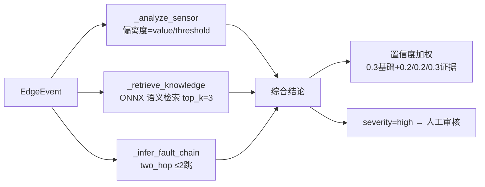

**关键类与接口**：`cloud/diagnosis.py` 的 `depth_diagnosis()`、`_analyze_sensor()`、`_retrieve_knowledge()`、`_infer_fault_chain()`；数据类 `SensorAnalysis` / `KnowledgeRetrieval` / `FaultInference`。

**输入/输出与异常**：输入 `EdgeEvent`；输出 `CloudDiagnosis`。知识库或图谱文件缺失时**优雅降级**（返回空引用并降低置信度），置信度上限 0.95。`severity=high` 时 `requires_human_review=True`——涉及停机的动作强制人工审核。

**特点与对比**：T4 知识诊断是"深度但慢"的云端能力，与边缘 T1/T2 的"浅但快"互补。方案 §2.4 明确：**深度诊断是主责在云**，因为需要全量知识库与多跳图谱，边缘只做子集缓存。相比"端侧硬扛全量检索"，这里的职责边界清晰。

---

## 十、阶段⑩：模型注册

**做什么**

1. 模型工厂产出并评测通过后，调用 `POST /v1/models/register`（multipart 上传）。
2. 云端计算 `sha256`，落盘到 `artifact_dir`，组装 `ModelManifest`（含 `artifact_url`、`size_bytes`、`quant`、`runtime`、`requires_firmware`、`preproc_ver`、`rollout` 策略）。
3. 写入 `model_registry` 表；后续通过 `GET /v1/models/artifacts/{name}` 提供下载。

**执行流程**

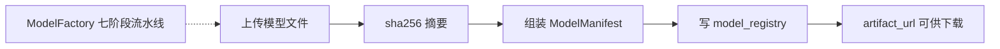

**关键类与接口**

| 类型 | 名称 | 说明 |
|---|---|---|
| HTTP | `POST /v1/models/register` | 表单字段 model_id/version/runtime/quant/requires_firmware/preproc_ver |
| HTTP | `POST /v1/model-factory/jobs`、`GET /v1/model-factory/jobs/{job_id}` | 七阶段流水线 |
| 类 | `ModelFactory` / `PipelineStage` / `JobStatus` | `cloud/model_factory.py` |
| 表 | `ModelRegistry` | `cloud/db.py` |

七阶段流水线（`PipelineStage`）：**数据回流 → 清洗标注 → 蒸馏 → 剪枝 → 量化 → 校准评测 → 注册**。

**输入/输出与异常**：输入模型二进制 + 元数据；输出 `ModelManifest`。同 `(model_id, version)` 重复注册是**幂等更新**（覆盖 sha256 与 manifest），不报错。磁盘不足时下载端会抛 `E_DISK_FULL`。

**特点与对比**：`requires_firmware`（固件硬约束）、`preproc_ver`（前处理脚本与权重强绑定）、`sha256`（完整性）**三个字段缺一不可**。方案 §4.3 特别提醒：模型换了但预处理没换会"**静默输出错误结果，比崩溃更危险**"。

---

## 十一、阶段⑪：灰度发布（环形 / 五步节奏）

**做什么**

1. 创建发布计划：`POST /v1/rollout/canary`（或简单版 `POST /v1/rollout`）。请求体含 `model_id/version/ring_config`。
2. `RolloutOrchestrator.create_plan()` 建立计划，初始步为 `internal_test`。
3. 按**五步节奏**推进：内部实验（1 台）→ Canary（≈1%）→ 扩圈（10%→50%）→ 稳定窗口（默认 24h）→ 全量。
4. 扩圈：`POST /v1/rollout/expand`（`expand_ring()` 按站点/型号分组轮询 interleaving 选设备）。
5. 查询进度：`GET /v1/rollout/progress/{plan_id}`。

**执行流程（五步节奏 + 发布状态机）**

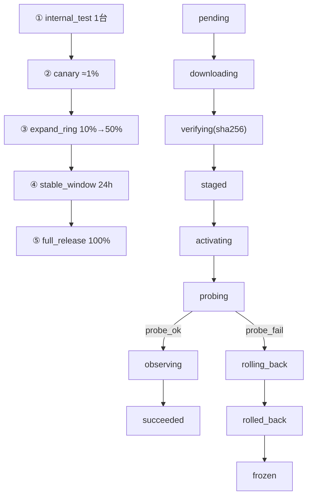

**关键类与接口**：`cloud/rollout.py` 的 `RolloutOrchestrator`（`create_plan`/`select_devices`/`advance_step`/`transition_state`/`can_deploy_to_canary`/`expand_ring`/`check_stable_window`/`full_release`/`get_rollout_progress`）、`RingConfig`、枚举 `RolloutStep`/`RolloutState`；状态转换表 `_VALID_TRANSITIONS`。

**输入/输出与异常**：非法状态跳转（如 `pending → succeeded`）抛 `ValueError`；对已冻结计划扩圈抛 `ValueError`；缺 `model_id/version` 返回 HTTP 400。`can_deploy_to_canary()` 要求至少 1 台内部设备 `succeeded` 才允许进 Canary。

**特点与对比**：五步节奏的关键约束是——**灰度验证的不是"数量比例"，而是"恢复能力"**。相比只看"包发下去了没"的普通发布，这里每一步都要过探针、看健康。

---

## 十二、阶段⑫：影子验证

**做什么**

1. 新模型在 Canary 组**与在线模型并行推理**，结果只记录、不生效（写入 `shadow_inference` 表）。
2. `ShadowEvaluator.compare(gw_id, new_version, baseline_version)` 比对两版 KPI。
3. `should_promote()` 综合判定是否达标；达标才允许切流（扩圈）。
4. 查询：`GET /v1/shadow-eval/{gw_id}?new_version=...&baseline_version=...`。

**执行流程**

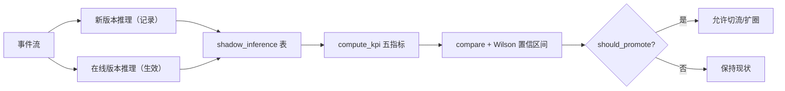

**关键类与接口**：`cloud/shadow_eval.py` 的 `ShadowEvaluator`（`record_inference`/`compute_kpi`/`compare`/`should_promote`/`confidence_interval`）、`KpiMetric`/`KpiThreshold`/`ShadowResult`。

`should_promote()` 六个条件需同时满足：

| KPI | 阈值（相对现网版本） |
|---|---|
| 端侧初判与云端结论一致率 | ≥ 现网 − 2pp |
| 推理 P95 延迟 | ≤ 现网 × 1.2 |
| 峰值内存 | ≤ 现网 × 1.15 |
| JSON 可解析率 | ≥ 95% |
| 误报率 | 不劣化 |
| 样本量 | ≥ min_samples（默认 100） |

**输入/输出与异常**：输入影子推理记录；输出 `ShadowResult`（含 `passed` 与 Wilson 置信区间）。无样本时 KPI 返回全 0、`passed=False`（**宁可不放行**）。

**特点与对比**：方案 §4.6 点明必要性——"**离线评测集达标 ≠ 现场达标**"。现场数据分布与评测集不同，影子验证**把现场当最终评测集，且零业务风险**（结果不生效）。

---

## 十三、阶段⑬：OTA 落地

**做什么**

1. 灰度推进后，云端把 `ModelManifest` 发到 `edge/{gw_id}/manifest`。
2. 管理代理 `mgmt_agent`（端口 9001，**与主应用进程隔离**）订阅该主题，收到后调用 `OtaEngine.apply()` 或模块级 `deploy()`。
3. 完整部署流程：**兼容性检查 → 分块下载 + sha256 校验 → A/B 双槽切换 → 综合探针 → 自动回滚**。
4. 也可通过 `POST /ota/apply` 手动触发；查询状态 `GET /health`。

**执行流程（OTA 状态机）**

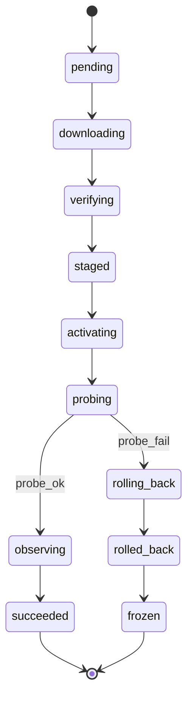

**关键类与接口**

| 类型 | 名称 | 说明 |
|---|---|---|
| 类 | `OtaEngine` / `OtaState` | `mgmt_agent/ota.py` |
| 函数 | `deploy()` / `download()` / `switch_slot()` / `rollback()` | 分块下载、A/B 切换、回滚 |
| 类 | `VersionSlots` | Windows 用 `current.txt`，兼容符号链接 |
| 类 | `comprehensive_probe()` | 探针：推理/内存/磁盘/温度/输入链路 |
| HTTP | `POST /ota/apply`、`POST /ota/rollback` | 管理面触发 |

**输入/输出与异常**：输入 `ModelManifest`；输出 `OtaState`。固件不匹配抛 `E_REQUIRES_FIRMWARE`；sha256 不匹配抛 `E_MODEL_HASH_MISMATCH`；探针失败自动回滚并冻结该版本；下载前磁盘预检不足抛 `E_DISK_FULL`。管理代理返回 HTTP 400 时带 `{"code","message"}`。

**特点与对比**：管理代理**独立进程**是关键——主应用崩溃时它仍能远程接管、执行回滚（方案 §2.2⑤）。相比"OTA 就是把包覆盖上去"，这里是"下载 → 校验 → 切槽 → 探针 → 观察"的完整闭环。

---

## 十四、阶段⑭：失败回滚

**做什么**

1. 云端 `RollbackManager.evaluate_trigger(trigger)` 评估一个 `RollbackTrigger`（信号 + 设备 + 版本 + 严重度）。
2. 按信号选择**回滚层级**（三层版本解耦）并判断是否需要回滚、冻结哪个版本、回滚到哪个目标版本。
3. 需要回滚则 `execute_rollback()`：写 `RolloutRecord` 状态 `rolling_back → rolled_back`，并冻结问题版本。
4. 接口：`POST /v1/rollout/rollback`、`POST /v1/rollout/freeze`。

**回滚触发信号与层级**

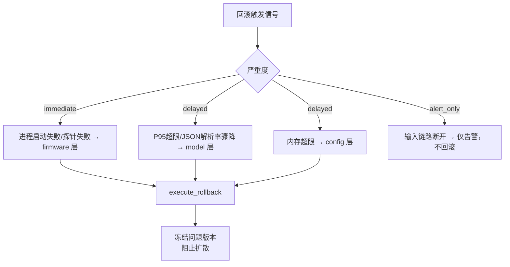

**关键类与接口**：`cloud/rollback.py` 的 `RollbackManager`、`RollbackSignal`、`RollbackTrigger`、`RollbackDecision`、`RollbackPolicy`、`VersionLayer`。信号→严重度映射 `_SEVERITY_MAP`、信号→层级映射 `_LAYER_MAP`。

| 信号 | 严重度 | 回滚层级 |
|---|---|---|
| `process_start_failure` / `probe_failure` | immediate | firmware |
| `p95_latency_exceeded` / `json_parse_rate_drop` | delayed | model |
| `mem_exceeded` | delayed | config |
| `input_link_down` | alert_only | config（**不回滚**） |

**输入/输出与异常**：输入 `RollbackTrigger`；输出 `RollbackDecision`（含 `should_rollback/layer/reason/frozen_version/target_version`）。已冻结版本**不重复回滚**（幂等）；无历史成功版本则不回滚（边界保护）。非法 `severity` 或未知信号返回 HTTP 400。

**特点与对比**：方案 §4.7 强调"**回滚触发信号必须是推理链路级，而非设备在线级**"。输入链路断开只告警不回滚，因为它可能是**外部原因**（比如 PLC 被拔线）。三层版本解耦让回滚"哪层出问题退哪层"，而不是整体回退。

---

## 十五、其他流程（补充，体现完整性）

### 15.1 断网降级

**做什么**：网络不可用时，边缘按 **断网时长**与**资源水位**逐步降级，始终保住最关键的 T1 告警链路。

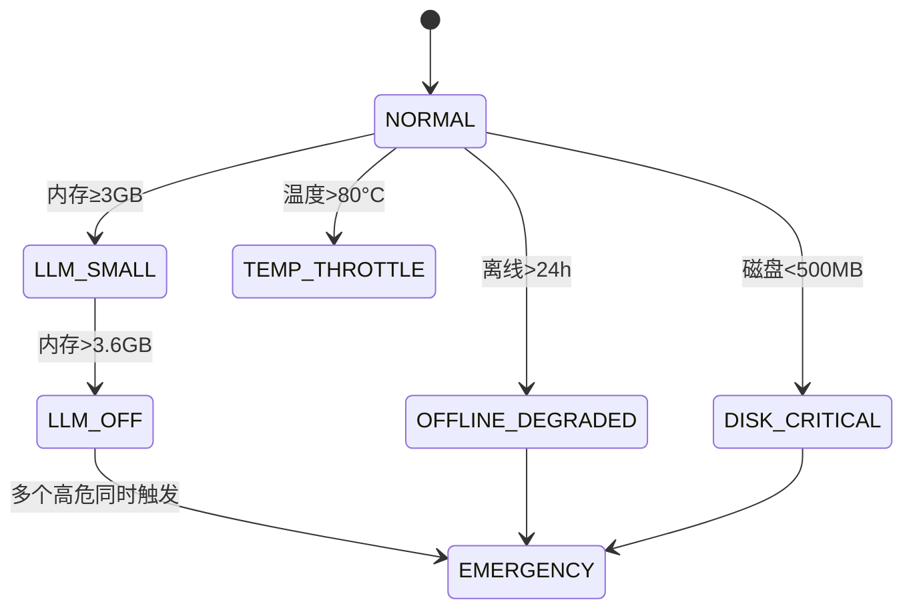

**断网降级矩阵（方案 §6.6）**

| 断网时长 | 边缘行为 | 云端可见性 |
|---|---|---|
| 0–5min | 正常自治，事件入本地队列 | 心跳中断告警 |
| 5min–1h | 提高本地缓存保留优先级，关闭非必要日志上行 | 标记"离线" |
| 1h–24h | T3 调用限流，上报频率降最低档 | 影子停止更新，展示最后已知状态 |
| >24h | 仅保留 T1 告警链路，T2/T3 降级或关闭 | 标记"长期离线"，进入人工排查 |
| 恢复 | 顺序补传 + 重新同步影子 | 补传完成后退出离线态，gap 留存 |

**关键类与接口**：`edge/guard_degrade.py` 的 `DegradeLevel`（NORMAL/LLM_SMALL/LLM_OFF/TEMP_THROTTLE/OFFLINE_DEGRADED/DISK_CRITICAL/EMERGENCY）、`DegradePolicy.evaluate()`；`edge/guard.py` 的 `GuardState`；`ShadowBox.mark_offline()/mark_online()`。

**输入/输出与异常**：输入 `GuardState`（内存/磁盘/温度/离线时长）；输出 `DegradeDecision`（级别 + 动作列表）。采用**迟滞（hysteresis）**：升级立即触发，恢复需资源低于阈值 × (1−margin)，避免频繁抖动。`NORMAL→LLM_SMALL` 边界（内存阈值）需按 `DegradeThresholds` 解读。

**特点与对比**：相比"断网就彻底停摆"，这里保证**降级不降关键能力**。方案特别提醒：**任何降级不得默认沿用原指标**，因为降级后的可用能力已变。

### 15.2 离线队列重放补传

**做什么**：断网期事件落本地 SQLite；联网后按水位线**顺序批量补传**，不丢不重。

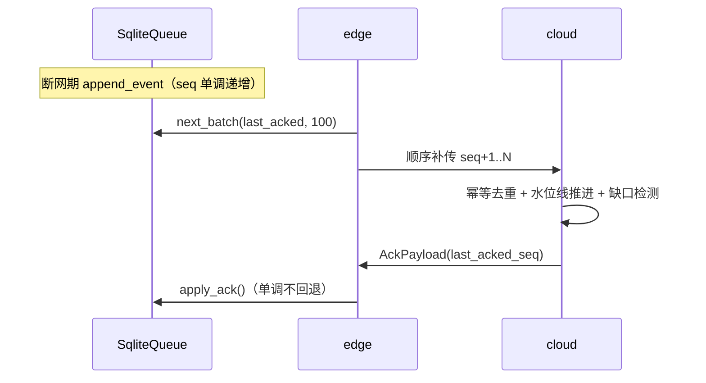

**关键类与接口**：`edge/queue/sqlite_queue.py` 的 `SqliteQueue`（`append_event`/`pending_batch`/`unacked_batch`/`gap_detection`/`set_acked`/`queue_stats`/`audit`）；`edge/queue/watermark.py` 的 `next_batch`/`apply_ack`/`detect_gaps`/`replay_status`。补齐循环在 `runtime._replay_loop()`（每 2 秒一批，每批 ≤100）。

**输入/输出与异常**：输入本地队列 + 云端 ACK；输出补传批次与状态摘要 `ReplayStatus`。重复 `event_id` 入队抛 `E_CONFLICT`；`apply_ack` 仅在水位线前进时更新（**永不回退**）。审计表用触发器实现**追加式**（禁改禁删）。

**特点与对比**：这是"边缘本地权威 + 云端全局权威"的落地。相比"断网直接丢数据"，这里保留 7 天并可审计、可追溯。

### 15.3 CoAP 低功耗链路

**做什么**：面向电池供电的远传传感器（NB-IoT 等），用 CoAP 替代高频轮询。

**关键类与接口**：`edge/adapters/coap_sensor.py` 的 `CoapAdapter`。支持两种模式：轮询（`poll_interval_s` 可设 60–600s）与 `observe_mode`（服务器主动推送，更省电）；`max_retries` / `backoff_base_s` / `backoff_max_s` 做指数退避。

**输入/输出与异常**：输入 CoAP 资源 URI；输出 `InternalSample`。`aiocoap` 未安装时适配器**保持 idle**（MVP 的 Should 项，不强制依赖），不影响其他链路。

**特点与对比**：方案 §6.1 给出量化依据：NB-IoT 传感器改 CoAP 后平均电流从 120μA 降到 45μA。相比 MQTT/HTTP，CoAP 基础头仅 4 字节，电池寿命优先场景更优；但 NB-IoT 时延 1.6–3s，**高实时场景不适用**。

### 15.4 规则表热更新

**做什么**：不重启边缘进程即可更新 T1 规则，且校验失败时保持旧规则不变。

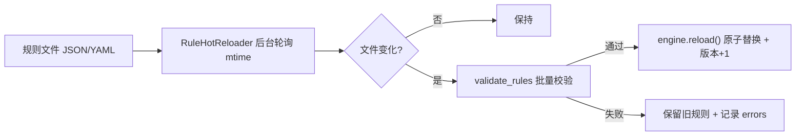

**关键类与接口**：`edge/stream/rule_loader.py` 的 `RuleLoader`（`load`/`save`/`has_changed`/`reload_if_changed`/`start_watching`）、`RuleHotReloader`（`start`/`stop`/`force_reload`/`reload_count`）；`edge/stream/rules.py` 的 `RuleEngine.reload()`（线程安全、原子替换）。

**输入/输出与异常**：输入规则文件（支持顶层列表或 `{"rules":[...]}` 包装）；输出新版本号。非法规则抛 `ValueError`，旧规则**保持不变**；单条规则要求含 `id/metric/threshold/op/severity`，`op` 必须合法且 `threshold` 为数值。

**特点与对比**：`RuleEngine` 评估时读规则**快照**（原子引用读取），增删改在锁保护下替换列表，保证评估期间不会看到半更新状态。相比"改规则要重启服务"，热更新让阈值调整秒级生效，是 config 层最轻量的止血手段。

---

## 十六、术语表

| 术语 | 一句话解释 |
|---|---|
| 边云协同 | 边缘负责毫秒级实时反应，云端负责全局决策与深度分析 |
| 设备影子（Device Twin） | 用 `desired`（云写）/`reported`（边写）/`delta`（差集）三段描述设备期望与现状，边缘只观察不自己决定版本 |
| 水位线（watermark） | 云端已确认收到的最大事件序号 `last_acked_seq`，用于断网补传的"从哪里接着传" |
| 脱敏 | 通过 HMAC 哈希、字段剥离、区间化等手段让原始敏感数据无法出域 |
| HMAC-SHA256 | 带密钥的哈希算法，用于把设备 ID 变成不可逆的 `device_id_hash` |
| 降级 | 资源不足或断网时，按策略关闭次要能力、保住关键告警链路的机制 |
| T1 | 确定性规则路径（阈值判定），纯代码，P95 <50ms |
| T2 | 判别式小模型路径（ONNX 异常检测），P95 <200ms |
| T3 | 端侧轻量 LLM，用于意图识别与一级初判，P95 <1.2s，异步旁路 |
| T4 | 本地知识检索（ONNX 语义检索 bge-small int8 / 512 维 + 故障链），P95 <80ms |
| 一级初判 | 端侧给出的"疑似…建议…"结论，强制标注"未经验证" |
| 深度诊断 | 云端的多源融合正式诊断，带引用来源，高风险强制人工审核 |
| 灰度发布（环形） | 按 1%→10%→50%→100% 逐环放量，配合五步节奏验证恢复能力 |
| 五步节奏 | 内部实验→Canary→扩圈→稳定窗口→全量的发布流程 |
| 影子验证 | 新模型与在线模型并行推理、只记录不生效，用现场数据比对 KPI 决定是否切流 |
| 冻结 | 将问题版本加入黑名单、阻止其继续扩散的动作 |
| 回滚 | 失败后按 firmware/model/config 层把版本退回上一个稳定版 |
| 三层版本解耦 | 固件版本/模型版本/配置版本分开管理，各自可独立回滚 |
| OTA | 通过远程方式把新模型/固件下发并生效的过程 |
| A/B 双槽 | 新旧版本各占一个目录，用 `current` 链接原子切换，旧版保留供回滚 |
| ModelManifest | 模型发布的最小单元，含 sha256、前后置依赖、硬件目标等 |
| ULID | 可按时间排序的全局唯一 ID，用作 `event_id` |
| QoS | MQTT 消息投递质量等级，0 最多一次、1 至少一次、2 恰好一次 |
| LWT（遗嘱） | 客户端异常断开时由 Broker 代发的消息，用于即时感知掉线 |
| Sparkplug B | 工业 MQTT 负载规范，统一设备数据的语义与主题结构 |
| Modbus TCP | 存量产线常用的轮询式工业协议 |
| OPC UA | 面向智能仪表的工业通信与信息模型标准 |
| CoAP | 面向低功耗设备的轻量协议，头部小、可 observe 推送 |
| ONNX | 跨平台模型交换格式，一套模型多端运行 |
| Z-Score | 用 `(当前值−均值)/标准差` 衡量偏离程度 |
| EWMA | 指数加权移动平均，用于平滑趋势 |
| Wilson 置信区间 | 比普通正态近似更稳健的比例区间估计，用于影子验证结论 |
| KPI | 影子验证用于比对的五项指标（一致率/延迟/内存/可解析率/误报率） |
| 缺口（gap） | 事件序号中缺失的区间，云端记录但不阻塞后续 |
| 幂等 | 同一事件重复投递不会产生重复副作用（靠 `event_id` 去重） |

---

## 十七、关键代码文件索引

| 环节 | 文件 |
|---|---|
| 消息契约 | `shared/schemas.py`、`shared/topics.py`、`shared/errors.py` |
| 边缘运行时 | `edge/main.py`、`edge/runtime.py`、`edge/settings.py` |
| 南向接入 | `edge/adapters/{modbus_tcp,opcua_client,mqtt_sparkplug,coap_sensor,base}.py` |
| 流处理与判定 | `edge/stream/{window,rules,anomaly_onnx,rule_loader}.py` |
| 端侧 Agent | `edge/agent/{state_machine,tools,llm_llamacpp}.py` |
| 脱敏与影子 | `edge/cloud/{masking,shadow,mqtt_north,data_plane}.py` |
| 本地队列 | `edge/queue/{sqlite_queue,watermark}.py` |
| 资源护栏 | `edge/guard.py`、`edge/guard_degrade.py` |
| 可观测性与安全 | `edge/monitoring/{metrics_endpoint,metrics,probes,ring_buffer}.py`、`edge/security/{model_signing,mtls}.py` |
| 云端 | `cloud/main.py`、`cloud/mqtt_bridge.py`、`cloud/diagnosis.py`、`cloud/db.py`、`cloud/settings.py` |
| 灰度/影子/回滚 | `cloud/rollout.py`、`cloud/shadow_eval.py`、`cloud/rollback.py`、`cloud/model_factory.py` |
| 管理代理 | `mgmt_agent/{main,ota,version,probe}.py` |
| 端到端联调 | `scripts/e2e.sh` |

> **联调顺序提示**：`scripts/e2e.sh` 会依次启动 cloud → edge → sim 模拟器，然后查询 `/health`、`/v1/events`、`/v1/watermarks/{gw}`，再依次调用 `/v1/devices/register` → `/v1/models/register` → `/v1/rollout`，完整复现"采集→判定→上行→入库→诊断→OTA"主线。