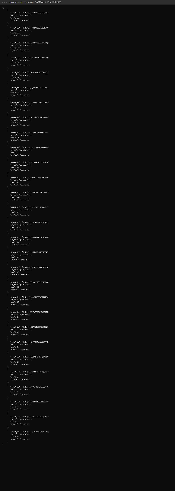
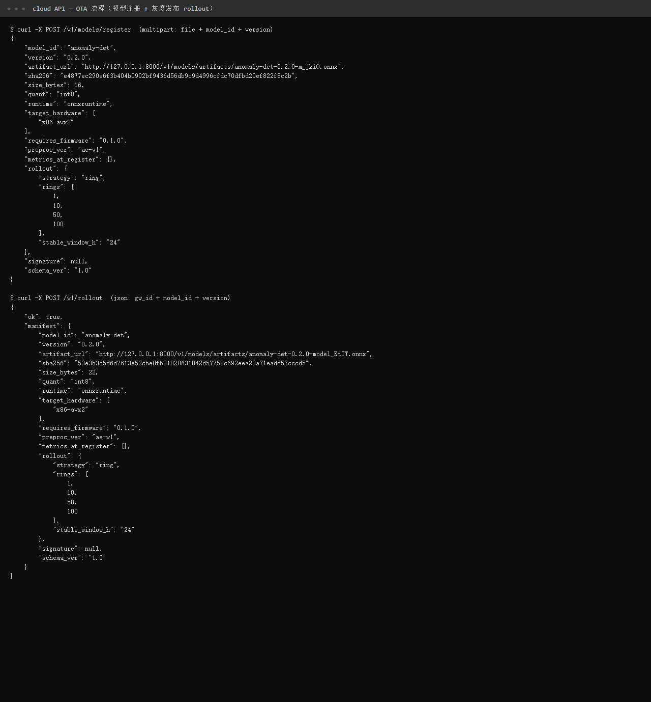
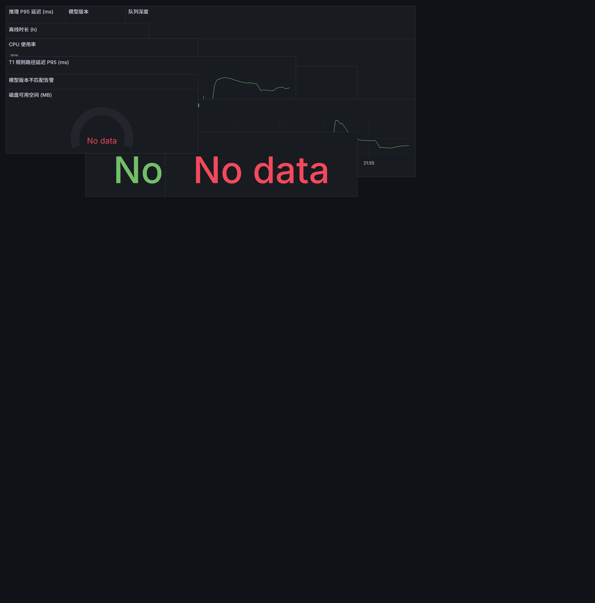
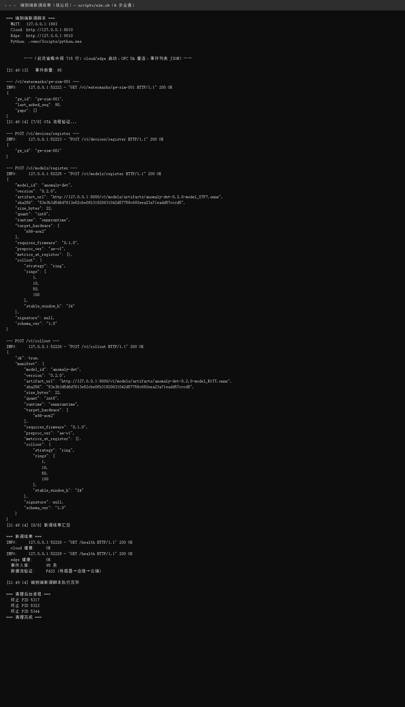
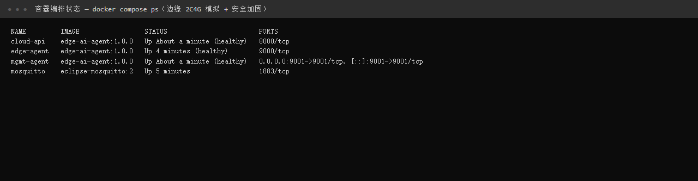
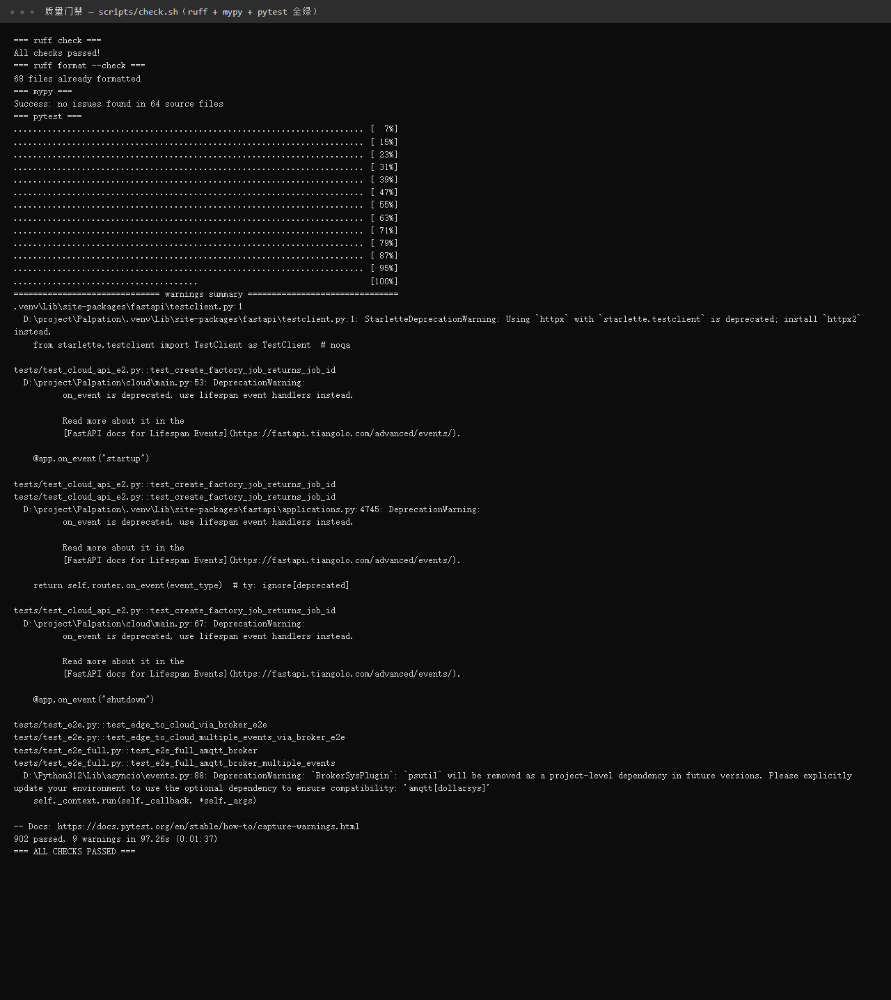

# 端云协同边缘 AI Agent 网关 · 用户操作手册

> 适用于 `edge-ai-agent-gateway`（方案 V1.0 / Phase 0，软件版本 `1.0.0`）

---

## 目录

- [1. 文档说明](#1-文档说明)
- [2. 系统概述](#2-系统概述)
- [3. 系统架构概览](#3-系统架构概览)
- [4. 环境准备](#4-环境准备)
- [5. 快速开始](#5-快速开始)
- [6. 核心操作指引](#6-核心操作指引)
- [7. 监控与可观测](#7-监控与可观测)
- [8. 一键端到端演示](#8-一键端到端演示)
- [9. 容器化部署](#9-容器化部署)
- [10. 常见问题与排障](#10-常见问题与排障)
- [11. 附录](#11-附录)

---

## 1. 文档说明

### 1.1 适用读者

| 读者角色 | 关注章节 |
|---|---|
| 现场部署 / 运维人员 | 第 4、5、6、9、10 章 |
| 演示 / 售前工程师 | 第 2、5、8 章 |
| 云端运维 / 平台开发人员 | 第 6、7、11 章 |
| 质量 / 验收人员 | 第 1.3 节、第 6 章各"验收点"、第 8 章 |

### 1.2 手册定位

本手册面向**使用与运维人员**，描述如何在开发/演示环境中把"边云协同 AI Agent 网关"跑起来、如何执行核心业务操作、如何观测与排障。所有命令均为**可复制命令**；所有截图均为在真实环境执行后的实测输出。

### 1.3 版本与验收口径

| 项目 | 值 |
|---|---|
| 方案版本 | V1.0（定稿 2026-09-30） |
| 实现阶段 | Phase 0 |
| 软件版本 | `1.0.0` |
| 主演示设备 | 网关 `gw-sim-001` / 泵机 `pump-de-01` |
| 默认端口 | cloud `8000`、edge `9000`、mgmt `9001`、MQTT broker `1883` |
| 依赖管理 | [uv](https://docs.astral.sh/uv/)（`pyproject.toml` 声明、`uv.lock` 锁定；**不使用 pip**） |
| 质量门禁 | `ruff check` + `ruff format --check` + `mypy` + `pytest` 全绿 |
| 单元测试规模 | 902 passed |
| 端到端联调 | `scripts/e2e.sh` 8 步全通，数据流 PASS |

---

## 2. 系统概述

### 2.1 一句话定位

> **一个跑在 2 核 4G 边缘盒子上的诊断 Agent——断网时它能自己判断、联网时它会被云端越用越聪明，而且原始数据一步都不出工厂。**

（引自方案 §1.5）

### 2.2 核心目标

在资源受限（**2 核 4GB 起**）的边缘网关上，构建一个**可离线自治、可被云端持续演进**的 AI Agent 网关：完成 **设备接入 → 本地一级告警与诊断 → 脱敏上行 → 模型与知识增量落地** 的闭环，把云端诊断为**兜底与深度分析**，而非唯一路径。（引自方案 §1.2）

边缘侧立论的三个硬矛盾（方案 §1.1）：

| 编号 | 矛盾 | 表现 |
|---|---|---|
| E1 | 时延与带宽的物理下限 | 产线级联锁要求 ≤60ms，云端往返难稳在 3s 内 |
| E2 | 网络不可用是常态而非异常 | 云端一断，设备从"智能"退化为"哑巴" |
| E3 | 全量上传的成本与合规双重不可行 | 原始振动 10kHz 级采样，数据出域违规 |

### 2.3 主演示场景：离心泵驱动端轴承振动异常（方案 §1.4）

1. **边缘侧（<1s）**：订阅 Sparkplug B 振动/温度/电流流 → 滑动窗口 Z-Score + 轻量自编码器 → 判定"驱动端轴承振动 RMS 越限（severity=high）" → 端侧输出**一级初判**（标注"端侧初判，未经验证"）。
2. **云端（<3s）**：接收事件 → 走完整诊断链路 → 输出带引用来源的正式报告 → 高风险动作强制人工审核。
3. **闭环**：人工审核结论回流 → 成为云端蒸馏数据 → 下一版端侧模型下发。

> **安全边界（永久 Won't）**：端侧**不做任何"一键执行"**，只做一级判定、初判建议、脱敏上行、模型落地、断网自治与远程可运维。（方案 §1.6）

---

## 3. 系统架构概览

### 3.1 三级分层架构（方案 §2.1）

| 层级 | 名称 | 职责 |
|---|---|---|
| **L0** | 设备层 | 振动/温度/电流传感器、PLC/变频器（Modbus TCP）、智能仪表（OPC UA）、低功耗终端（CoAP） |
| **L1** | 边缘层（本项目） | 采集 → 流处理 → 端侧 Agent → 本地知识 → 管理代理 → 资源护栏 → 本地队列 |
| **L2** | 云端层（主线） | MQTT Broker + Sparkplug B、LangGraph 编排、模型工厂、前端/审核/审计 |

### 3.2 边缘侧内部六层（对应方案 §2.2 的 ①–⑦）

| 层 | 模块 | 职责 |
|---|---|---|
| ① 接入层 | 协议适配器 | Modbus TCP / OPC UA / CoAP → 统一内部事件模型 → Sparkplug B 上行 |
| ② 流处理层 | 窗口 + 判定 | 滑动窗口 Z-Score、EWMA、轻量 AE / Isolation Forest（ONNX）；**规则路径永不被 LLM 阻塞** |
| ③ Agent 运行时 | 轻量状态机 | 意图识别 → 工具调用（白名单）→ 一级初判；状态落 SQLite 可恢复 |
| ④ 本地知识层 | ONNX 语义检索 + 规则表 | 缓存 Top-N 手册片段（`bge-small-zh-v1.5` int8 / 512 维，`numpy` 余弦）与"故障→原因→措施"邻接表（只读，云端下发） |
| ⑤ 管理代理 | 进程隔离 | 健康探针、版本清单、OTA 接收、回滚执行 |
| ⑥ 资源护栏 | cgroup / slice | CPU/内存/磁盘配额，防止 LLM 抢占饿死接入链路 |
| ⑦ 本地队列 | SQLite 环形缓冲 | 断网期事件落盘、水位线、幂等去重 |

### 3.3 端云职责划分（一条灰线，方案 §2.4）

> **决策权在云，执行权在边**：涉及全局状态（用哪个模型、何时回滚、什么算高风险）的判定，边缘**只执行不发明**；涉及毫秒级实时反应（阈值判定、一级初判、协议转换、断网自治）的判定，边缘**自主完成**。

---

## 4. 环境准备

### 4.1 前置软件

| 软件 | 版本要求 | 说明 |
|---|---|---|
| Python | **3.12**（`>= 3.12`） | 运行 edge / cloud / mgmt / sim 全部服务 |
| uv | 近期版本（≥ 0.4） | 依赖与虚拟环境统一管理；本项目**不使用 pip / `requirements.txt`** |
| MQTT Broker | Mosquitto 2.x | 本机已安装于 `C:\mosquitto`，需允许匿名连接 |
| Docker（可选） | 近期版本 | 仅第 9 章容器化部署需要 |

### 4.2 安装依赖（uv sync）

本项目依赖由 [uv](https://docs.astral.sh/uv/) 统一管理：依赖声明位于 `pyproject.toml`，版本由 `uv.lock` 锁定（**请勿使用 `pip` 或新增 `requirements.txt`**）。在项目根目录执行：

```bash
uv sync
```

> 该命令依据 `pyproject.toml` **自动创建 `.venv` 虚拟环境**，并安装**全部运行期与开发依赖**（含 `ruff` / `mypy` / `pytest` 等，可直接执行第 11.4 节的质量门禁，无需额外安装）。
>
> - 如需端侧 LLM 能力（`llama-cpp-python` 可选依赖）：`uv sync --extra llm`
> - 如需安装全部依赖组：`uv sync --all-groups`
> - 运行任意命令时前置 `uv run`（如 `uv run pytest`）；亦可直接调用解释器 `.venv\Scripts\python.exe`（Linux/macOS 下为 `.venv/bin/python`）。

### 4.3 准备环境变量

```bash
copy .env.example .env
```

`.env` 关键变量（与 `.env.example` 对应）：

| 变量 | 默认值 | 说明 |
|---|---|---|
| `GW_ID` | `gw-sim-001` | 网关标识 |
| `CLOUD_MQTT_HOST` / `CLOUD_MQTT_PORT` | `127.0.0.1` / `1883` | 云端 MQTT Broker |
| `CLOUD_API` | `http://127.0.0.1:8000` | 云端 HTTP 地址 |
| `EDGE_API_PORT` | `9000` | 边缘网关端口 |
| `MGMT_API_PORT` | `9001` | 管理代理端口 |
| `DATABASE_URL` | `sqlite:///./data/cloud.db` | 云端数据库 |
| `HMAC_SALT` | `sim-only-replace-me` | 设备标识脱敏盐值（**生产须替换**） |

### 4.4 启动 MQTT Broker（本机 mosquitto）

`scripts/demo_up.ps1` 会在 `C:\mosquitto\demo.conf` 自动生成允许匿名连接的配置。若需手动启动：

```bash
C:\mosquitto\mosquitto.exe -c C:\mosquitto\demo.conf
```

`C:\mosquitto\demo.conf` 内容：

```text
listener 1883 127.0.0.1
allow_anonymous true
```

> ⚠️ `allow_anonymous true` 仅用于本地仿真；生产环境必须配置认证与 TLS。

---

## 5. 快速开始

### 5.1 方式一：一键启动（推荐，Windows）

```bash
powershell -ExecutionPolicy Bypass -File scripts\demo_up.ps1
```

脚本按顺序启动：**mosquitto(1883) → cloud(8000) → edge(9000) → sim 数据注入**，并将各服务日志写入 `logs\` 目录。脚本内部通过 `uv run --no-sync` 启动各服务，因此执行前需已完成第 4.2 节的 `uv sync`。

预期输出：

```text
演示环境已启动: cloud=http://127.0.0.1:8000  edge=http://127.0.0.1:9000  broker=127.0.0.1:1883
```

验证服务健康：

```bash
curl http://127.0.0.1:8000/health
curl http://127.0.0.1:9000/health
```

停止演示环境：

```bash
powershell -ExecutionPolicy Bypass -File scripts\demo_down.ps1
```

### 5.2 方式二：手动逐服务启动

分别打开 4 个终端，在项目根目录执行（须先完成第 4.2 节的 `uv sync`）：

```bash
# 终端 1：MQTT Broker
C:\mosquitto\mosquitto.exe -c C:\mosquitto\demo.conf

# 终端 2：云端 API（8000）
uv run uvicorn cloud.main:app --host 0.0.0.0 --port 8000

# 终端 3：边缘网关（9000）
uv run uvicorn edge.main:app --host 0.0.0.0 --port 9000

# 终端 4：设备模拟器（持续注入传感器数据，5 秒后触发故障）
uv run python -m sim.mqtt_pump --host 127.0.0.1 --port 1883 \
  --gw gw-sim-001 --device pump-de-01 --rate 2.0 --fault-after 5
```

> 管理代理（可选）：`uv run uvicorn mgmt_agent.main:app --host 0.0.0.0 --port 9001`

---

## 6. 核心操作指引

> 以下 `curl` 命令以 Windows Bash / Git Bash 语法给出；PowerShell 下请将行末 `\` 改为反引号 `` ` `` 或将命令写成一行。

### 6.1 设备注册

将边缘网关登记到云端，并下发初始设备影子 `desired`。

```bash
curl -X POST http://127.0.0.1:8000/v1/devices/register \
  -H "Content-Type: application/json" \
  -d '{"gw_id":"gw-sim-001","site":"lab"}'
```

预期输出：

```json
{
  "gw_id": "gw-sim-001"
}
```

> **验收点**：返回 HTTP 200 且包含 `gw_id`；云端随即向 `edge/gw-sim-001/shadow/desired` 发布保留消息。

### 6.2 传感器数据注入

模拟离心泵驱动端数据（振动/温度/电流），默认 2Hz、5 秒后注入轴承故障（振动 RMS 跃升至 6.3）。

```bash
uv run python -m sim.mqtt_pump --host 127.0.0.1 --port 1883 \
  --gw gw-sim-001 --device pump-de-01 --rate 2.0 --fault-after 5
```

| 参数 | 默认值 | 说明 |
|---|---|---|
| `--host` / `--port` | `127.0.0.1` / `1883` | MQTT Broker 地址 |
| `--gw` | `gw-sim-001` | 网关标识 |
| `--device` | `pump-de-01` | 设备标识 |
| `--rate` | `2.0` | 采样发布频率（Hz） |
| `--fault-after` | `25.0` | 注入故障延迟秒数（`-1` 表示不注入） |

边缘侧规则 `bearing_rms_high`（`vibration_rms > 4.5`，severity=high）命中后，事件经 MQTT 上报云端入库。

### 6.3 查询事件与水位

**查询已入库事件**（按入库倒序，最多 100 条）：

```bash
curl http://127.0.0.1:8000/v1/events
```

**查询指定网关的水位线**（`last_acked_seq` 与缺号 `gaps`）：

```bash
curl http://127.0.0.1:8000/v1/watermarks/gw-sim-001
```

预期输出：

```json
{
  "gw_id": "gw-sim-001",
  "last_acked_seq": 90,
  "gaps": []
}
```

下图展示 `GET /v1/events` 的真实返回：事件按 `seq` 从 29 到 1 连续排列，每条均为 `status: received`，无缺号。



*图 6-1　云端事件入库（`GET /v1/events`）*

- **说明**：传感器 → 边缘规则/异常检测 → 事件上报 → 云端入库的链路打通后，云端可按网关查询事件序列。
- **对应验收点**：事件成功入库、`seq` 单调连续、`status=received`，证明"数据采集/一级判定/脱敏上行"环节工作正常。

### 6.4 模型注册与灰度发布（OTA）

#### 6.4.1 注册模型工件（multipart）

准备一个模型文件（Phase 0 可用占位文件），以 `multipart/form-data` 上传：

```bash
# 生成占位模型文件
echo "fake onnx model bytes" > model_0.2.0.onnx

curl -X POST http://127.0.0.1:8000/v1/models/register \
  -F "file=@model_0.2.0.onnx" \
  -F "model_id=anomaly-det" \
  -F "version=0.2.0"
```

预期返回（节选，`sha256` 由服务端对文件内容计算）：

```json
{
  "model_id": "anomaly-det",
  "version": "0.2.0",
  "artifact_url": "http://127.0.0.1:8000/v1/models/artifacts/anomaly-det-0.2.0-model_xxxx.onnx",
  "sha256": "53e3b3d5d6d7613e52cbe0fb31820631042d57758c692eea23a71eadd57cccd5",
  "size_bytes": 22,
  "quant": "int8",
  "runtime": "onnxruntime",
  "rollout": { "strategy": "ring", "rings": [1, 10, 50, 100], "stable_window_h": "24" }
}
```

#### 6.4.2 灰度下发（rollout）

将已注册的模型版本下发到指定网关（写入影子 `desired` 并推送 manifest）：

```bash
curl -X POST http://127.0.0.1:8000/v1/rollout \
  -H "Content-Type: application/json" \
  -d '{"gw_id":"gw-sim-001","model_id":"anomaly-det","version":"0.2.0"}'
```

预期输出：

```json
{
  "ok": true,
  "manifest": { "model_id": "anomaly-det", "version": "0.2.0", "...": "..." }
}
```

下图展示上述两步的真实返回：`POST /v1/models/register` 返回完整模型元数据（含 `sha256`、`size_bytes`、环状灰度配置），`POST /v1/rollout` 返回 `"ok": true` 及 manifest。



*图 6-2　模型注册与灰度发布（OTA）*

- **说明**：注册阶段服务端计算并落库工件哈希，生成可下载的 `artifact_url`；下发阶段把版本写入设备影子 `desired` 并推送 `manifest`，边缘观察到 `desired ≠ reported` 后主动拉取——体现"决策权在云、执行权在边"。
- **对应验收点**：模型成功注册（返回 `sha256`、`artifact_url`）；灰度下发返回 `ok=true` 且携带正确 `version`。

#### 6.4.3 工件下载

```bash
curl -O http://127.0.0.1:8000/v1/models/artifacts/anomaly-det-0.2.0-model_xxxx.onnx
```

### 6.5 灰度五步：canary → expand → progress → rollback → freeze

灰度编排提供以下端点，构成完整发布闭环：

#### 6.5.1 创建 Canary 发布计划

```bash
curl -X POST http://127.0.0.1:8000/v1/rollout/canary \
  -H "Content-Type: application/json" \
  -d '{"model_id":"anomaly-det","version":"0.2.0","ring_config":{"rings":[1,10,50,100],"stable_window_h":24}}'
```

预期输出：

```json
{
  "plan_id": 1,
  "model_id": "anomaly-det",
  "version": "0.2.0",
  "rings": [1, 10, 50, 100],
  "can_deploy_to_canary": true
}
```

#### 6.5.2 扩圈（expand）

按目标百分比扩圈到下一环（如 1% → 10%）：

```bash
curl -X POST http://127.0.0.1:8000/v1/rollout/expand \
  -H "Content-Type: application/json" \
  -d '{"plan_id":1,"target_percent":10}'
```

响应返回新增的灰度记录列表与 `count`。

#### 6.5.3 查询发布进度（progress）

```bash
curl http://127.0.0.1:8000/v1/rollout/progress/1
```

#### 6.5.4 回滚（rollback）

依据推理链路级触发信号评估并执行回滚。`signal` 取值：`process_start_failure`、`probe_failure`、`p95_latency_exceeded`、`mem_exceeded`、`json_parse_rate_drop`、`input_link_down`；`severity` 取值：`immediate`、`delayed`、`alert_only`。

```bash
curl -X POST http://127.0.0.1:8000/v1/rollout/rollback \
  -H "Content-Type: application/json" \
  -d '{"signal":"probe_failure","gw_id":"gw-sim-001","model_id":"anomaly-det","version":"0.2.0","severity":"immediate"}'
```

> `severity=alert_only`（如输入链路断开）**不自动回滚**，仅告警——避免把外部原因误判为模型问题。

#### 6.5.5 冻结版本（freeze）

```bash
curl -X POST http://127.0.0.1:8000/v1/rollout/freeze \
  -H "Content-Type: application/json" \
  -d '{"model_id":"anomaly-det","version":"0.2.0"}'
```

预期输出：

```json
{ "model_id": "anomaly-det", "version": "0.2.0", "frozen": true }
```

### 6.6 影子验证（Shadow Eval）

在不影响线上流量的前提下，比对候选版本与基线版本的关键 KPI：

```bash
curl "http://127.0.0.1:8000/v1/shadow-eval/gw-sim-001?new_version=0.2.0&baseline_version=0.1.0"
```

返回包含 `new_kpi` / `baseline_kpi`（`agreement_rate`、`p95_latency_ms`、`peak_mem_mb`、`json_parse_rate`、`false_positive_rate`）、`sample_size`、`confidence_interval` 与 `passed`。

### 6.7 模型工厂任务（可选）

创建模型工厂流水线任务（蒸馏/剪枝/量化/注册异步任务）：

```bash
curl -X POST http://127.0.0.1:8000/v1/model-factory/jobs \
  -H "Content-Type: application/json" \
  -d '{"model_id":"anomaly-det","target_version":"0.3.0"}'
```

查询任务状态：

```bash
curl http://127.0.0.1:8000/v1/model-factory/jobs/<job_id>
```

---

## 7. 监控与可观测

### 7.1 指标暴露

| 组件 | 端点 | 说明 |
|---|---|---|
| edge | `GET /metrics` | Prometheus 文本格式业务/系统指标（端口 9000） |
| edge | `GET /health` | JSON 健康状态 |
| cloud | `GET /health` | 云端健康状态（返回 `{"ok":"true","role":"cloud-increment-stub"}`） |
| cloud | `GET /metrics` | 云端指标（Prometheus 采集端口 8000） |

```bash
curl http://127.0.0.1:9000/metrics
curl http://127.0.0.1:9000/health
```

### 7.2 Prometheus + Grafana

采集配置见 `deploy/prometheus.yml`：`edge-agent` 作业采集 `localhost:9000/metrics`（10s），`cloud-api` 作业采集 `localhost:8000/metrics`（15s），告警规则引用 `deploy/alerts.yml`。

看板标题为 **「Edge AI Agent - 边缘监控看板」**，共 15 个面板：

```text
推理 P95 延迟 (ms) | 模型版本 | 队列深度 | 离线时长 (h) | 缓存命中率
云端升级率趋势 | CPU 使用率 | 内存使用率 | CPU 温度 (°C)
T1 规则路径延迟 P95 (ms) | T2 异常检测路径延迟 P95 (ms)
模型版本不匹配告警 | 降级级别状态 | 网络连接状态 | 磁盘可用空间 (MB)
```

下图为主演示环境启动 Prometheus + Grafana 后的真实看板：



*图 7-1　Grafana 边缘监控看板*

- **说明**：当前看板 15 个面板中，**5 个面板已有数据、10 个面板显示 `No data`**（如推理 P95 延迟、队列深度、离线时长等）。原因是 **edge 侧部分业务指标尚未暴露**（当前主要暴露 CPU/内存/磁盘等系统级指标），属预期现象，非系统错误。
- **对应验收点**：监控链路可用（CPU 使用率、磁盘可用空间等面板有连续折线），Grafana 可正常渲染看板；业务指标面板待 edge 侧补齐 `/metrics` 指标后自然点亮。

> **排障提示**：若面板显示 `No data`，先确认 `http://127.0.0.1:9000/metrics` 可访问、Prometheus Targets 为 `UP`，再核对面板查询表达式与指标名是否一致。

---

## 8. 一键端到端演示

### 8.1 运行

```bash
bash scripts/e2e.sh
```

可选环境变量：

| 变量 | 默认值 | 说明 |
|---|---|---|
| `MQTT_HOST` / `MQTT_PORT` | `127.0.0.1` / `1883` | Broker 地址 |
| `CLOUD_PORT` / `EDGE_PORT` | `8000` / `9000` | 服务端口 |
| `FAULT_AFTER` | `10` | 故障注入延迟（秒） |
| `WAIT_SECONDS` | `20` | 数据流等待时长（秒） |

> 端口被占用时可用不同端口隔离验证，例如：`CLOUD_PORT=8010 EDGE_PORT=9010 bash scripts/e2e.sh`。

### 8.2 脚本 8 步说明

| 步骤 | 内容 |
|---|---|
| `[1/8]` 前置检查 | 检查 Python 解释器与 MQTT Broker 连通性 |
| `[2/8]` 启动 cloud | 端口 8000，轮询 `/health` 直至就绪 |
| `[3/8]` 启动 edge | 端口 9000，注入 Broker 地址 |
| `[4/8]` 启动 sim | 注入泵机传感器数据，`FAULT_AFTER` 秒后触发故障 |
| `[5/8]` 等待数据流 | 等待 `WAIT_SECONDS` 秒，完成"采集→检测→上报→入库" |
| `[6/8]` 查询 API 验证 | 调用 `/health`、`/v1/events`、`/v1/watermarks/gw-sim-001` |
| `[7/8]` OTA 流程验证 | `POST /v1/devices/register` → `POST /v1/models/register` → `POST /v1/rollout` |
| `[8/8]` 结果汇总 | 汇总 cloud/edge 健康、事件数量与数据流判定 |

### 8.3 预期结果

```text
=== 联调结果 ===
  cloud 健康:     OK
  edge 健康:      OK
  事件入库:       95 条
  数据流验证:     PASS (传感器→边缘→云端)
```

下图为本机实测结果（端口 8010/9010）：



*图 8-1　端到端联调结果（`scripts/e2e.sh`）*

- **说明**：脚本依次完成 cloud/edge 启动、告警事件入库、水位校验（`last_acked_seq=90`、`gaps=[]`）与 OTA 三步验证，最终自动清理全部后台进程。
- **对应验收点**：8 步全通、`cloud/edge 健康 = OK`、`事件入库 = 95 条`、`数据流验证 = PASS`，即"传感器→边缘→云端"端到端链路验收通过。

---

## 9. 容器化部署

### 9.1 编排说明（`docker-compose.edge.yml`）

模拟 **2C4G** 边缘硬件与安全加固：

| 加固项 | 配置 |
|---|---|
| CPU / 内存限制 | `cpus: 2.0` / `mem_limit: 4g`（mgmt-agent 为 `0.5` / `512m`） |
| 只读根文件系统 | `read_only: true` + `tmpfs` 临时目录 |
| 能力收敛 | `cap_drop: ALL` |
| 进程数限制 | `pids_limit` |
| 健康检查 | 各服务 `healthcheck` 探测 `/health` |

### 9.2 启动

```bash
docker compose -f docker-compose.edge.yml up -d --build
```

### 9.3 查看状态

```bash
docker compose -f docker-compose.edge.yml ps
```

下图为本机实测的容器编排状态：`cloud-api`、`edge-agent`、`mgmt-agent` 与 `mosquitto` 共 4 个容器，`edge-ai-agent` 相关容器均 `Up ... (healthy)`。



*图 9-1　容器编排状态（`docker compose ps`）*

- **说明**：`edge-agent(9000)`、`mgmt-agent(9001)`、`cloud-api(8000)` 三个应用容器均通过健康检查（`healthy`），`mosquitto` 运行于 1883 端口。`mosquitto` 未配置健康检查探针，故不显示 `(healthy)`，属正常。
- **对应验收点**：4 容器 `Up`，三个应用容器 `healthy`——容器化部署与资源护栏验收通过。

### 9.4 停止

```bash
docker compose -f docker-compose.edge.yml down
```

---

## 10. 常见问题与排障

### 10.1 快速定位思路

按"**Broker → edge → cloud → 数据流**"顺序逐层排查：先确认 MQTT 连通，再看 edge 是否订阅并判定，再看 cloud 是否入库，最后核对数据流。

### 10.2 常见问题

| 现象 | 可能原因 | 处理方式 |
|---|---|---|
| `MQTT broker 127.0.0.1:1883 不可达` | mosquitto 未启动 / 端口占用 | 启动 `C:\mosquitto\mosquitto.exe -c C:\mosquitto\demo.conf`，确认配置含 `allow_anonymous true` |
| `/v1/events` 返回空数组 | 链路某一环未启动或未触发故障 | 确认 sim 已注入故障（`--fault-after` 到点）、edge 订阅正常 |
| `/v1/watermarks/{gw_id}` 返回 404 | 该网关尚无水位记录 | 先确保事件已入库（事件到达后才会推进水位） |
| 模型注册报 `404` / 工件缺失 | `artifact_url` 中的文件名与实际不符 | 用注册返回的 `artifact_url` 原样下载，不要手工拼路径 |
| `docker compose ps` 中容器反复重启 | 启动配置问题 | 查看日志 `docker compose logs <service>` |
| Grafana 面板显示 `No data` | 指标未暴露 / Prometheus 未抓到 | 访问 `http://127.0.0.1:9000/metrics`，检查 Prometheus Targets 是否 `UP` |

### 10.3 已知限制（客观说明）

1. **容器的 `data_dir` 需指向可写卷**：`edge-agent` / `mgmt-agent` 采用 `read_only: true` 根文件系统，凡需落盘的数据目录必须通过 `volumes`（如 `edge-queue:/var/lib/edge-agent`）挂载到可写卷，否则写入会失败。
2. **`cloud-api` / `mgmt-agent` 健康异常多为启动配置问题**：这两个容器依赖 MQTT 连接与数据库路径等启动参数，健康检查失败时应优先核对 `environment`（如 `CLOUD_MQTT_HOST`、`DATABASE_URL`）与卷挂载，而非模型/业务逻辑。
3. **Grafana 业务面板数据尚不完整**：edge 侧当前主要暴露系统级指标，业务指标（推理延迟、队列深度等）待补齐，故看板部分面板显示 `No data`（见第 7 章）。

### 10.4 日志位置

| 运行方式 | 日志 |
|---|---|
| 一键脚本 `demo_up.ps1` | `logs\mosquitto.log`、`logs\cloud.log`、`logs\edge.log`、`logs\sim.log`（含 `.err`） |
| 容器 | `docker compose -f docker-compose.edge.yml logs -f <service>` |
| 手动启动 | 各终端标准输出 |

---

## 11. 附录

### 11.1 REST API 清单

**云端（cloud，默认 8000）**

| 方法 | 路径 | 说明 |
|---|---|---|
| GET | `/health` | 健康检查 |
| GET | `/metrics` | Prometheus 指标 |
| POST | `/v1/devices/register` | 设备注册（JSON：`gw_id`、`site`） |
| GET | `/v1/events` | 查询事件（最多 100 条，倒序） |
| GET | `/v1/watermarks/{gw_id}` | 查询水位线与缺号 |
| POST | `/v1/models/register` | 注册模型工件（multipart：`file`、`model_id`、`version`） |
| GET | `/v1/models/artifacts/{name}` | 下载模型工件 |
| POST | `/v1/rollout` | 灰度下发到指定网关 |
| POST | `/v1/model-factory/jobs` | 创建模型工厂任务 |
| GET | `/v1/model-factory/jobs/{job_id}` | 查询模型工厂任务 |
| POST | `/v1/rollout/canary` | 创建 Canary 发布计划 |
| POST | `/v1/rollout/expand` | 扩圈到目标百分比 |
| POST | `/v1/rollout/rollback` | 回滚评估与执行 |
| POST | `/v1/rollout/freeze` | 冻结指定版本 |
| GET | `/v1/shadow-eval/{gw_id}` | 影子验证（`new_version`、`baseline_version`） |
| GET | `/v1/rollout/progress/{plan_id}` | 查询发布进度 |

**边缘（edge，默认 9000）**

| 方法 | 路径 | 说明 |
|---|---|---|
| GET | `/health` | 边缘健康状态 |
| GET | `/metrics` | Prometheus 文本指标 |

**管理代理（mgmt，默认 9001）**

| 方法 | 路径 | 说明 |
|---|---|---|
| GET | `/health` | 健康状态（含边缘探测与槽位状态） |
| POST | `/ota/apply` | 应用新模型清单 |
| POST | `/ota/rollback` | 回滚指定层与版本 |

### 11.2 目录结构

```text
Palpation/
├── cloud/          # 云端增量服务（FastAPI，8000：注册/事件/水位/模型注册与灰度/工件下载）
├── config/         # YAML 配置（current.yaml、v0001.yaml）
├── edge/           # 边缘网关（FastAPI，9000）
│   ├── adapters/   #   采集适配（Modbus / OPC UA / MQTT Sparkplug / CoAP）
│   ├── stream/     #   滑动窗口 + 规则引擎(T1) + ONNX 异常检测(T2)
│   ├── knowledge/  #   故障链与本地检索(T4)
│   ├── agent/      #   Agent 状态机与端侧 LLM
│   ├── queue/      #   离线 SQLite 队列与水位
│   ├── monitoring/ #   /metrics 与 /health
│   └── cloud/      #   masking / mqtt_north / shadow
├── mgmt_agent/     # 管理代理（FastAPI，9001：槽位管理与 OTA 应用/回滚、边缘探测）
├── shared/         # 共享定义（schemas / topics / errors）
├── sim/            # 设备模拟器（modbus / opcua / mqtt / coap）
├── tests/          # 测试用例（pytest）
├── scripts/        # check.sh / e2e.sh / demo_up.ps1 / demo_down.ps1 / train_anomaly_model.py
├── deploy/         # prometheus.yml / alerts.yml / grafana/ / *.service
├── docs/           # 本手册
├── evidence/       # 验收截图
├── docker-compose.edge.yml
├── Dockerfile
├── pyproject.toml
└── README.md
```

### 11.3 关键配置速查（`config/current.yaml`）

| 规则 ID | 指标 | 条件 | 严重级别 | 描述 |
|---|---|---|---|---|
| `bearing_rms_high` | `vibration_rms` | `> 4.5` | high | 驱动端轴承振动 RMS 越限 |
| `temperature_high` | `temperature` | `> 80.0` | medium | 轴承温度越限 |
| `current_high` | `current` | `> 18.0` | medium | 电机电流越限 |

### 11.4 质量门禁

```bash
bash scripts/check.sh
```

依次执行：

1. `uv run ruff check .`
2. `uv run ruff format --check . --exclude tests --exclude plan`
3. `uv run mypy cloud edge mgmt_agent shared sim`
4. `uv run pytest -q`

下图为本机实测的全绿结果：`ruff` 全部通过、68 个文件格式合规、`mypy` 64 个源文件无问题、`pytest` **902 passed**。



*图 11-1　质量门禁（`scripts/check.sh`）*

- **说明**：4 项检查全部通过，其中 9 条 warnings 均为第三方库（Starlette、FastAPI `on_event`、amqtt `psutil`）的弃用提示，不影响结果。
- **对应验收点**：静态检查与单元测试全绿、测试用例 902 条全部通过——代码质量门禁验收通过。

---

*本手册所有命令与截图均来自 `edge-ai-agent-gateway` Phase 0 实测环境；如与实际运行环境存在版本差异，请以 `plan/端云协同边缘 AI Agent 网关方案（V1.0）.md` 与代码实现为准。*