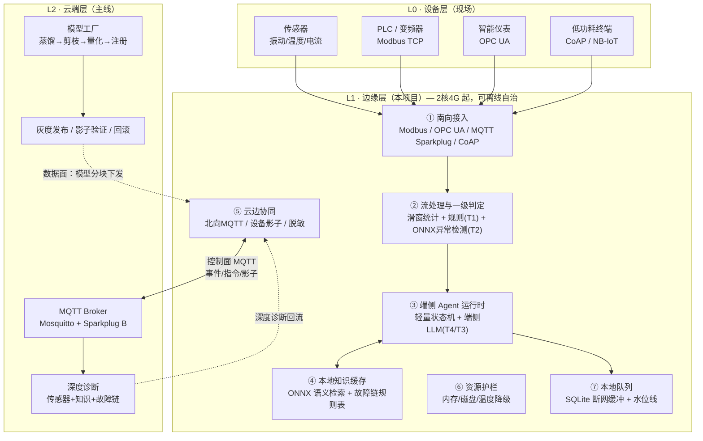
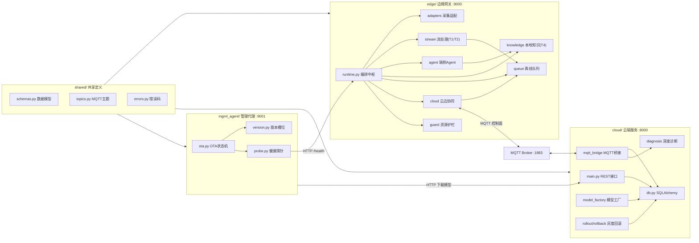
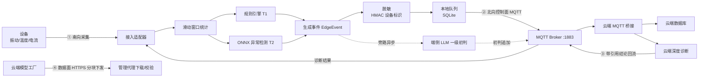
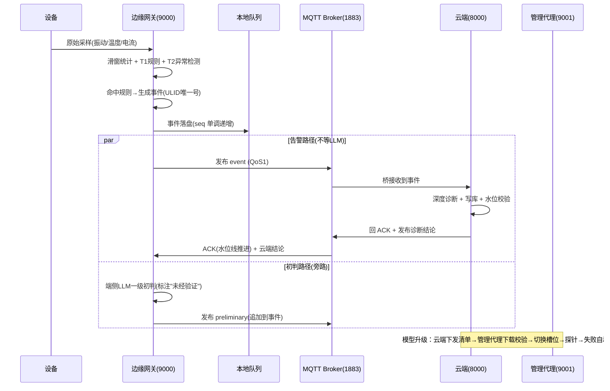
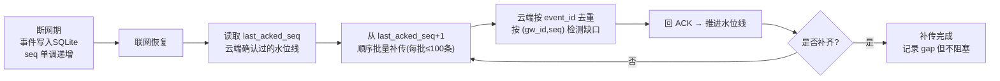
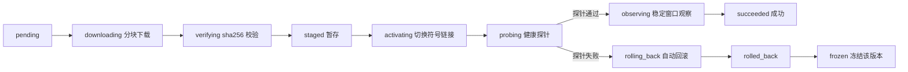
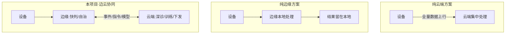

# 端云协同边缘 AI Agent 网关 · 系统整体架构

> **文档类型**：讲解文档（面向演讲 / 汇报场景）
> **适用系统**：`edge-ai-agent-gateway`（方案 V1.0 / Phase 0，软件版本 `1.0.0`）
> **技术栈**：Python 3.12 + FastAPI
> **默认端口**：边缘网关 `9000`、云端服务 `8000`、管理代理 `9001`、MQTT Broker `1883`
> **读者**：管理人员、业务人员、售前/演示人员，以及希望快速建立整体认知的技术人员

---

## 目录

- [一、这是一套什么样的系统](#一这是一套什么样的系统)
- [二、整体架构与分层结构](#二整体架构与分层结构)
- [三、五大模块的职责划分](#三五大模块的职责划分)
- [四、模块之间的依赖与调用关系](#四模块之间的依赖与调用关系)
- [五、关键数据流向与交互流程](#五关键数据流向与交互流程)
- [六、技术选型与架构设计考量](#六技术选型与架构设计考量)
- [七、应用特点、适用场景与方案对比](#七应用特点适用场景与方案对比)
- [八、术语表](#八术语表)

---

## 一、这是一套什么样的系统

### 1.1 一句话认识它

> **一个跑在 2 核 4G 边缘盒子上的诊断 Agent——断网时它能自己判断、联网时它会被云端越用越聪明，而且原始数据一步都不出工厂。**

这句话里藏着三个关键信息：它**很小**（2 核 CPU、4GB 内存的工业小盒子就能跑）；它**能独立工作**（断网也不停工）；它**会成长**（联网后云端不断把新知识、新模型"喂"给它）。

### 1.2 它要解决的三道现实难题

在工业现场，如果把所有智能都放在云端，会遇到三堵墙：

| 编号 | 难题 | 通俗解释 | 后果 |
|---|---|---|---|
| E1 | **时延与带宽的物理下限** | 数据要传到云、排队、算完再传回来，一来一回很难稳定在 3 秒内；可产线联锁要求几十毫秒就要反应 | "AI 还没答完，事故已经发生" |
| E2 | **网络不可用是常态而非异常** | 厂区无线抖动、专线中断、现场根本没有外网 | 云端一断，设备从"智能"退化为"哑巴" |
| E3 | **全量上传的成本与合规双重不可行** | 振动信号每秒上万次采样；工艺参数是企业的核心资产 | 带宽和存储成本爆炸，数据出域还可能违规 |

这三堵墙**不能靠"把云做得更快"绕过去**，只能把**一部分智能下沉到数据产生的地方**——也就是"边缘"。这正是这套系统的立论基础。

### 1.3 解题思路：边云协同

**边云协同**（Edge-Cloud Collaboration）是指让"边缘"和"云端"各干各擅长的事，而不是二选一：

- **边缘**负责"快"：毫秒级采集、秒级告警、断网自治、就近脱敏；
- **云端**负责"深"：跨设备知识融合、深度诊断、模型训练、全局下发。

两者之间有一条清晰的**灰线**——**"决策权在云，执行权在边"**：

- 涉及全局状态的事情（哪台设备用哪个模型、什么时候回滚、什么算高风险），边缘**只执行、不自作主张**；
- 涉及毫秒级实时反应的事情（阈值判定、一级初判、协议转换、断网自治），边缘**自主完成**。

### 1.4 一个能看懂的例子：离心泵轴承振动异常

这是本系统的主演示场景，也是理解全流程的最好入口：

1. **边缘侧（< 1 秒）**：订阅现场振动、温度、电流数据 → 滑动窗口统计 + 轻量异常检测 → 判定"驱动端轴承振动 RMS 越限（严重度 high）" → 端侧小模型给出一级初判："疑似轴承磨损，建议检查润滑"，并明确标注**"端侧初判，未经验证"**。
2. **云端侧（< 3 秒）**：收到事件 → 走完整诊断链路（传感器分析 + 知识检索 + 故障链推理）→ 输出**带引用来源的正式结论** → 高风险动作强制人工审核。
3. **闭环**：人工审核结论回流 → 成为云端蒸馏数据 → 下一版端侧模型下发 → 逐轮降低"需要麻烦云端"的比例。

> **一句话小结**：本系统把"实时采集—本地告警—断网自治—云端深度诊断—模型迭代下发"串成一条完整闭环，核心目标是在资源紧张的现场设备上，实现"够快、够稳、会进化"。

---

## 二、整体架构与分层结构

### 2.1 三级分层：设备层 / 边缘层 / 云端层

系统采用清晰的三级分层。**设备层**是现场机器；**边缘层**是本项目的核心，部署在设备旁边；**云端层**是主线的"大脑"。

### 2.2 边缘侧内部的七层

边缘层不是一个"大程序"，而是内部再分成七层，各管一摊、互不阻塞。对应上图 ①–⑦：

| 层 | 名称 | 职责 | 关键约束 |
|---|---|---|---|
| ① | **接入适配层** | 把 Modbus TCP / OPC UA / MQTT Sparkplug B / CoAP 的不同协议，统一成一种内部数据格式 | 新增协议只需加适配器，不动上层 |
| ② | **流处理层** | 滑动窗口统计（均值/最值/p95/标准差/斜率）、规则引擎（T1 阈值判定）、ONNX 异常检测（T2） | **确定性优先**：规则告警永不被大模型拖慢 |
| ③ | **Agent 决策层** | 轻量状态机编排，调用工具（白名单）给出一级初判；端侧 LLM 可选启用 | 不用重型框架；状态可恢复、可重放 |
| ④ | **本地知识层** | 缓存 Top-N 手册片段（ONNX 语义检索：`bge-small-zh-v1.5` int8 / 512 维）与"故障→原因→措施"故障链规则表（T4） | 只读缓存，由云端下发，边缘不编辑 |
| ⑤ | **云边协同层** | 北向 MQTT 通道、设备影子对齐、设备标识脱敏（HMAC） | 决策权在云，只执行不发明 |
| ⑥ | **资源护栏** | 依据内存、磁盘、CPU 温度在 `normal / llm_small / llm_off` 等档位间切换降级 | 防止大模型抢占把采集告警"饿死" |
| ⑦ | **本地队列** | 断网期事件落盘（SQLite），水位线推进、缺号检测、批量补传 | 补传不丢、不重（幂等去重） |

这七层的排列顺序，体现了边缘侧的工程哲学：**能确定判定的，绝不用概率模型；能本地闭环的，绝不依赖网络。**

### 2.3 云端层与管理面

云端层复用主线的工业 IoT 诊断能力，并在本项目新增了几项**增量**能力：设备注册表、事件与水位的持久化、**模型工厂**（七阶段流水线：数据回流→清洗标注→蒸馏→剪枝→量化→校准评测→注册）、**灰度发布编排**、**影子验证**与**回滚管理**。它对外提供 REST 接口，对内通过 MQTT 桥接订阅边缘上报。

> **一句话小结**：三级分层让"现场—边缘—云端"各安其位；边缘侧内部再分七层，用"分层 + 解耦"把"快"和"深"分开，谁都不拖累谁。

---

## 三、五大模块的职责划分

整个代码仓由五个模块组成，下表逐一说明每个模块**"是什么"**和**"做什么"**。

| 模块 | 是什么 | 做什么 |
|---|---|---|
| `edge/` | **边缘网关**，基于 FastAPI，默认端口 `9000` | 现场自治核心：多协议采集、流处理与一级判定、端侧 Agent、本地知识、离线队列、资源护栏、云边协同 |
| `cloud/` | **云端增量服务**，基于 FastAPI，默认端口 `8000` | 设备注册、事件查询、水位管理、模型注册与灰度下发、工件下载、深度诊断 |
| `mgmt_agent/` | **管理代理**，基于 FastAPI，默认端口 `9001` | 模型槽位管理、OTA 应用与回滚编排、边缘健康探测（与主应用进程隔离） |
| `shared/` | **共享定义** | 跨模块的数据模型（Pydantic）、MQTT 主题族、统一错误码 |
| `sim/` | **设备模拟器** | Phase 0 联调用：模拟 Modbus 设备、OPC UA 电表、MQTT 泵机、CoAP 传感器 |

### 3.1 `edge/` —— 边缘网关

**是什么**：边缘侧主服务，`edge/main.py` 创建 `EdgeRuntime` 并挂载 FastAPI 应用。

**做什么**：`edge/runtime.py` 是**运行时编排中枢**，负责把所有组件装配起来并调度生命周期。它在启动时一次性构建滑动窗口、规则引擎、ONNX 检测器、SQLite 队列、故障链与本地知识、端侧 LLM、Agent 状态机、北向 MQTT、设备影子、资源护栏与三个采集适配器，然后并发启动采集、遥测上报、健康上报、断网补传四条循环：

- `edge/adapters/`：采集适配层（`modbus_tcp.py` / `opcua_client.py` / `mqtt_sparkplug.py` / `coap_sensor.py` + `base.py` 适配器协议）；
- `edge/stream/`：流处理层（`window.py` 滑动窗口、`rules.py` 规则引擎 T1、`anomaly_onnx.py` ONNX 异常检测 T2、`rule_loader.py` 规则热更新）；
- `edge/agent/`：端侧 Agent（`state_machine.py` 轨量状态机、`llm_llamacpp.py` 端侧 LLM、`tools.py` 工具白名单）；
- `edge/knowledge/`：本地知识（`fault_chain.py` 故障链两跳推理、`sqlite_vec.py` **ONNX 语义检索**：`bge-small-zh-v1.5` int8 / 512 维 / `onnxruntime`，`numpy` 余弦，保留 hash-embed 降级）；
- `edge/queue/`：离线队列（`sqlite_queue.py` 事件持久化 + 追加式审计、`watermark.py` 水位线推进与缺口检测）；
- `edge/cloud/`：云边协同（`masking.py` 脱敏、`mqtt_north.py` 北向通道、`shadow.py` 设备影子、`data_plane.py` 数据面下载）；
- `edge/monitoring/`：可观测性（`metrics_endpoint.py` Prometheus 指标导出、`metrics.py` 指标定义、`probes.py` 健康探针、`ring_buffer.py` 环形缓冲）；
- `edge/security/`：安全加固（`model_signing.py` 模型签名验证、`mtls.py` mTLS 双向认证）；
- `edge/guard.py` + `edge/guard_degrade.py`：资源降级守护与带滞回的恢复策略。

### 3.2 `cloud/` —— 云端增量服务

**是什么**：基于 FastAPI 的云端服务。`cloud/main.py` 提供全部 HTTP 接口：设备注册、事件查询、水位查询、模型注册、工件下载、灰度下发。

**做什么**：
- `cloud/db.py`：SQLAlchemy 数据模型（设备、心跳、事件、水位、模型注册表、灰度计划与记录、设备影子）；
- `cloud/mqtt_bridge.py`：MQTT 桥接，订阅边缘上报并写库、回 ACK、触发深度诊断；
- `cloud/diagnosis.py`：云端深度诊断管线（传感器分析 + 知识检索 + 故障链推理，输出带引用的结论）；
- `cloud/model_factory.py`：七阶段模型工厂流水线（异步线程执行，不依赖 Celery）；
- `cloud/rollout.py` / `cloud/rollback.py` / `cloud/shadow_eval.py`：灰度编排、回滚决策与冻结、影子验证。

### 3.3 `mgmt_agent/` —— 管理代理

**是什么**：独立的 FastAPI 服务（端口 `9001`），**与主应用进程隔离**。

**做什么**：`main.py` 提供健康检查、OTA 应用、OTA 回滚接口；`ota.py` 实现完整的发布状态机（下载→校验→暂存→激活→探测→观察→成功/回滚）；`version.py` 管理模型版本 A/B 双槽（用符号链接或 `current.txt` 热切换）；`probe.py` 探测边缘网关健康。关键设计：**主应用崩溃时，管理代理仍能存活并远程接管、回滚**。

### 3.4 `shared/` —— 共享定义

**是什么**：跨模块共享的数据契约与协议定义。

**做什么**：`schemas.py` 定义 `EdgeTelemetry`、`EdgeEvent`、`EdgeHealth`、`ModelManifest`、`DeviceShadow` 等核心消息模型（Pydantic）；`topics.py` 定义 MQTT 主题族（遥测、事件、ACK、诊断、健康、影子 desired/reported、清单、命令、Sparkplug DDATA）；`errors.py` 定义统一错误码。

### 3.5 `sim/` —— 设备模拟器

**是什么**：用于 Phase 0 无硬件联调的现场设备模拟集合。

**做什么**：`modbus_device.py`（模拟 10Hz 振动/温度/电流，内置"故障注入"）、`opcua_meter.py`、`mqtt_pump.py`、`coap_sensor.py`。它们让整套系统在**零硬件**条件下就能跑通全链路。

> **一句话小结**：五个模块 = "现场的手脚（edge）+ 云端的头脑（cloud）+ 独立的运维接口（mgmt_agent）+ 共同语言（shared）+ 可复现的假设备（sim）"。

---

## 四、模块之间的依赖与调用关系

模块之间不是随意调用，而是有清晰的依赖方向：`shared/` 是公共底座，被所有模块依赖；`edge/` 是核心，`cloud/` 与 `mgmt_agent/` 围绕它协同。

依赖关系可归纳为三类：

| 依赖类型 | 示例 | 说明 |
|---|---|---|
| **数据契约依赖** | 所有模块 → `shared/` | 消息格式、主题名、错误码统一，避免"各说各话" |
| **编排依赖** | `runtime.py` → 边缘各组件 | 运行时中枢统一装配、调度与容错 |
| **跨节点通信依赖** | edge ↔ cloud（MQTT）、mgmt → edge/cloud（HTTP） | 边缘与云端通过消息总线解耦，管理代理通过 REST 拉取模型 |

> **一句话小结**：`shared/` 统一语言，`runtime.py` 统一调度，跨节点通信"能消息总线就消息总线、要大文件才走 HTTP"，依赖关系清晰且单向可控。

---

## 五、关键数据流向与交互流程

### 5.1 四个交互面

系统与外界打交道集中在四个"交互面"，每个面承担不同的协议和数据量级：

| 交互面 | 方向 | 协议 | 承载内容 | 频率 / 量级 |
|---|---|---|---|---|
| **南向（设备面）** | 设备 → 边缘 | Modbus TCP / OPC UA / MQTT Sparkplug B / CoAP | 原始遥测与控制回执 | 高频（原始采样在本地消化） |
| **北向 · 控制面** | 双向 | **MQTT QoS1**（+ Sparkplug B） | 事件上行、指令下行、设备影子、健康上报 | 中频（秒级～分钟级） |
| **北向 · 数据面** | 双向 | **HTTPS 流式 + Range 断点续传** | 模型分块下载（规划中：批量日志补传、知识索引增量包） | 低频、大包（MB 级） |
| **管理面** | 双向 | HTTPS（REST）+ mTLS | 设备注册、清单上报、灰度编排、回滚指令 | 低频（小时～天级） |

**为什么控制面和数据面要分开？** 控制面要**极小包、极低延迟、弱网可存活**，所以用 MQTT；数据面要**大包、可续传、可校验**，所以用 HTTP/2。两者混在一起会"两头不讨好"——大文件走 MQTT 会让 Broker 缓冲爆炸，小事件走 HTTP 则每次请求至少两个往返、流量是 MQTT 的几十倍。

### 5.2 端到端数据流图

下面这张图把一次"现场异常 → 云端诊断 → 结果回流"的数据流串起来：

关键点：**规则告警（T1/T2）与端侧 LLM 初判（T3）异步解耦**——告警判定为真就立刻发事件，绝不等待大模型；大模型的初判作为"旁路追加"写回同一事件。这样"端到端几十毫秒的确定性告警"和"带语义初判的秒级结果"两个指标互不拖累。

### 5.3 一次告警的完整旅程（时序）

### 5.4 离线自治与断网补传

断网时，边缘侧**完全自治**：事件继续落本地 SQLite 队列，本地记录就是"本地权威"。联网后，通过**水位线（watermark）**机制补传：

**为什么不丢也不重？** 事件用全局唯一号 `event_id`（ULID）做幂等去重；补传进度用单调递增的 `seq` 加水位线控制。云端若发现序号跳号，会记录为 `gap`（缺口），但不阻塞后续序号——保证"该到的都到，到了的不重复"。

### 5.5 模型下发、灰度与回滚

云端训练好的模型不会"一键全量推送"，而是走**灰度发布**（先小范围试，再逐步扩大）：

灰度的五步节奏是：内部实验机（1 台）→ Canary（约 1%）→ 按站点/型号分环扩圈（10%→50%）→ 稳定窗口观察（默认 24 小时）→ 全量发布并保留回滚窗口（默认 7 天）。其中 **影子验证**（Shadow Inference）让新模型与在线模型并行推理、结果只记录不生效，零业务风险地比对两版指标，达标才切流。发布失败时，边缘可**按层回滚**（固件/模型/配置三层解耦），回滚在秒级完成。

> **一句话小结**：四个交互面各用最合适的协议；告警与初判异步解耦；断网靠"本地队列 + 水位线"实现不丢不重；升级靠"灰度 + 影子验证 + 探针自动回滚"实现可恢复、可收敛。

---

## 六、技术选型与架构设计考量

系统的每一项技术选择，都是为了在"2 核 4G"的强约束下同时满足**实时、可靠、可运维**。下表先速览，再逐项说明"为什么这样选"。

| 技术 | 用途 | 选它的理由（一句话） |
|---|---|---|
| **FastAPI** | 三个服务的 Web 框架 | 异步性能好、自带接口文档、与 Pydantic 天然一体 |
| **paho-mqtt（+ amqtt）** | MQTT 客户端（Broker） | MQTT 头部极轻、弱网可存活、事件驱动省流量 |
| **onnxruntime** | T2 判别式小模型推理 | 一套 ONNX 模型多端可跑，CPU 上开销小、算子稳定 |
| **llama-cpp-python** | 端侧 LLM（T3，可选） | CPU 优化成熟、量化支持最好、跨平台一致 |
| **SQLite + SQLAlchemy** | 本地队列 / 云端持久化 | 零运维、单文件、断网可写；SQLAlchemy 屏蔽数据库差异 |
| **Pydantic** | 数据契约与配置校验 | 端云共用一套 Schema，避免接口"鸡同鸭讲" |
| **Prometheus（+ Grafana）** | 可观测性 | 标准指标格式、生态成熟，边缘云端可纳入同一看板 |
| **Docker** | 部署形态 | 2 核 4G 资源限制可精确模拟，零硬件即可验证 |

**逐一说明：**

- **FastAPI**：三个服务（edge/cloud/mgmt_agent）都用它。它原生异步、启动快、自动生成接口文档，且与 Pydantic 深度集成——请求体、消息体直接用同一套模型校验，既省代码又少出错。
- **paho-mqtt（客户端）+ amqtt（可选纯 Python Broker）**：项目实际使用 `paho-mqtt` 作为边缘与云端的 MQTT 客户端；生产 Broker 用 `Mosquitto`（编排中的 `:1883`），在纯 Python、无法跑外部 Broker 的测试环境下可用 `amqtt` 这类纯 Python Broker 替代。选 MQTT 是因为它**固定头最小仅 2 字节**、支持发布订阅与断线重连，特别适合"极小包、弱网可存活"的控制面；实测中发送 1000 次小消息，MQTT 总流量远低于 HTTP。
- **onnxruntime**：T2 异常检测（轻量自编码器 / Isolation Forest）走 ONNX。ONNX 是模型交换的通用格式，同一份模型可以在 CPU、不同硬件加速器上运行，工程上"一套模型多端跑"，且 CPU 端开销很小、算子集稳定。
- **llama-cpp-python**：端侧 LLM（T3）用它加载 GGUF 量化模型，做**短输出的语义初判**（≤32 token）。它是 CPU 优化最成熟的方案之一，量化支持最好、跨平台一致，适合边缘盒子。它被设为**可选依赖**：环境没有编译工具链时自动跳过，系统降级到规则路径继续工作。
- **SQLite + SQLAlchemy**：边缘的离线队列用 SQLite（单文件、零运维、断网也能写），并用触发器保证审计表"只增不改"；云端用 SQLAlchemy 统一管理多张表。边缘**刻意不引入** Redis / Milvus / Neo4j / TDengine 等重型组件——它们是"云端的能力"，边缘只消费其**结果**。
- **Pydantic**：`shared/schemas.py` 用 Pydantic 定义所有消息模型，端云共用一套契约；配置也用 `pydantic-settings` 从 `.env` 加载，保证"配置即代码"。
- **Prometheus + Grafana**：`/metrics` 端点导出标准指标（推理 P95、队列深度、离线时长、缓存命中率、云端升级率、模型版本等），Prometheus 采集、Grafana 统一看板。**"云端升级率下降"** 这个指标尤为关键——它下降，说明端侧在进步。
- **Docker**：用 `--cpus=2 --memory=4g` 精确模拟边缘硬件，配合只读根文件系统、非 root 用户、能力裁剪等安全加固。**模拟环境与生产环境共用同一镜像与配置**，实现"零硬件即可验证、真机迁移零改码"。

> **一句话小结**：技术选型的第一原则是"**给边缘减负、给协作铺路**"——凡能本地闭环的绝不上重组件，凡端云要交接的必先统一契约。

---

## 七、应用特点、适用场景与方案对比

### 7.1 适用业务场景

| 优先级 | 场景 | 边缘承担什么 | 关键约束 |
|---|---|---|---|
| **P0（主演示）** | 工业设备预测性维护 / 诊断 | 振动/温度/电流本地异常检测 + 一级根因初判 + 断网自治 | 误报率、可追溯性、涉停机动作必须人工审核 |
| P1 | 智慧园区 / 楼宇设备智能体 | 空调/照明/门禁本地感知与控制、自然语言指令 | 响应 < 500ms、多协议接入、节能率 |
| P2 | 无人值守站点（泵站/基站/矿区） | 长时间离网自治、事件缓存补传、远程恢复 | 断网 7×24、远程可达、恶劣环境 |

### 7.2 三种架构形态对比：纯云 / 纯边 / 边云协同

| 对比维度 | 纯云端方案 | 纯边缘方案 | **本项目·边云协同** |
|---|---|---|---|
| 实时性 | 受网络往返限制，难稳定在秒级 | 极快（本地闭环） | **分层保证**：T1<50ms、T2<200ms、云端<3s |
| 断网可用性 | 断网即瘫痪 | 强，但永不进化 | **断网自治 + 联网进化** |
| 数据合规 | 原始数据必须出域，风险高 | 数据不出域 | **原始数据不出厂，只传聚合量与脱敏事件** |
| 诊断深度 | 深（全量知识/跨设备） | 浅（本地缓存） | **边缘初判 + 云端深度诊断兜底** |
| 模型演进 | 云端统一升级 | 各设备孤立，难统一 | **云端训练 + 灰度下发 + 影子验证** |
| 带宽成本 | 高（全量上行） | 无 | **边缘聚合后上行量降约 99%** |
| 运维复杂度 | 中 | 高（分散难管） | 中（复用云端运维栈 + 命令集中） |
| 主要短板 | 时延、成本、合规 | 无全局视野、难迭代 | 需要端云协同设计（本项目已解决） |

### 7.3 为什么本项目"必须"边云协同

单看上面三种形态，结论很清楚：

- **纯云不行**：E1（时延）、E2（断网）、E3（合规）三道墙靠云端自身无法翻越——网络物理下限和"数据不出域"是硬约束。
- **纯边也不行**：边缘算力太小，做不了跨设备全局推理、深度诊断和模型训练；而且如果每个边缘盒子都孤立成长，就无法"统一升级、统一治理"，模型质量参差不齐。
- **只有边云协同同时成立**：把**实时和自治**交给边缘（快、稳、合规），把**深度和进化**交给云端（深、准、统一），两者通过"事件上行 + 模型下发"形成闭环。这正是"**决策权在云、执行权在边**"的落地。

### 7.4 本项目的差异化优势

相比市面上"只把模型跑起来、把设备管起来"的基础设施方案，本项目多做了三件事：

1. **Agent 原生**：不只是托管推理，而是有一整套面向工业诊断的决策链（工具调用、置信度、高风险人工审核闭环）；
2. **三级分工且可解释**：规则(T1)→判别模型(T2)→LLM(T3)三层，且 T1/T2 与 T3 异步解耦，告警不被大模型阻塞、高风险判定不依赖大模型；
3. **可运维优先**：三层版本解耦 + 影子验证 + 探针自动回滚，把 OTA 当作"模型/固件/配置三层的独立生命周期"来管理，并以"**推理链路健康**"而非"设备在线"作为发布成功判据。

此外，全栈开源（无厂商锁定）、零硬件可验证（Docker 模拟）、成本结构最优（软件零授权费、上行流量降约 99%），也是它相较云厂商托管方案的重要优势。

> **一句话小结**：纯云输在时延与合规，纯边输在深度与进化；**边云协同把两者的长处拼在一起**——现场够快够稳，云端够深够聪明。

---

## 八、术语表

| 术语 | 含义（一句话解释） |
|---|---|
| **边云协同** | 边缘与云端分工协作：边缘管实时与自治，云端管深度与演进 |
| **设备层 / 边缘层 / 云端层** | 系统的三级分层：现场设备 / 就近的边缘网关 / 远端的云端大脑 |
| **T1（规则路径）** | 确定性阈值规则判定，纯代码，最快（P95 < 50ms） |
| **T2（ONNX 异常检测）** | 判别式小模型的异常检测，走 ONNX 运行时（P95 < 200ms） |
| **T3（轻量 LLM）** | 端侧大模型，做短输出的语义初判（P95 < 1.2s，可选） |
| **T4（知识诊断）** | 本地知识检索与故障链推理（P95 < 80ms） |
| **设备影子（Device Twin）** | 云端写 `desired`（期望）、边缘写 `reported`（实际），用差集驱动收敛的机制 |
| **灰度发布** | 先在小范围设备试新版本、验证通过再逐步扩大的发布方式 |
| **影子验证（Shadow Inference）** | 新模型与在线模型并行推理，结果只记录不生效，零风险比对 |
| **水位线（watermark）** | 云端已确认的事件序号，是断网补传的起点与去重依据 |
| **脱敏** | 用 HMAC 哈希等方式处理设备标识等敏感信息，使其不可逆 |
| **降级** | 资源紧张时主动降低能力（如卸载大模型），优先保住告警链路 |
| **MQTT** | 一种轻量级发布/订阅消息协议，适合弱网、小包、事件驱动场景 |
| **Sparkplug B** | 建立在 MQTT 之上的工业数据语义规范，统一设备数据的表达 |
| **Modbus TCP / OPC UA / CoAP** | 三种常见工业/物联网通信协议，边缘侧负责把它们统一成内部格式 |
| **ONNX** | 一种通用的模型交换格式，让同一模型能跨框架、跨硬件运行 |
| **GGUF / 量化（Q4_K_M）** | 模型压缩格式与档位，把模型体积压到约三成，仍保证输出可用 |
| **OTA** | 远程升级；本项目把固件/模型/配置三层解耦，支持按层回滚 |
| **LP95 / P95** | 第 95 百分位延迟，即"95% 的请求都快于这个值"，衡量实时性常用指标 |
| **幂等** | 同一条消息重复送达也不会产生重复效果（本项目用 `event_id` 去重） |
| **gap（缺口）** | 补传后仍缺失的事件序号区间，被记录但不阻塞后续补传 |
| **云端升级率（Cloud Escalation Rate）** | 端侧无法定案而转发云端的比例——**它下降说明端侧在进步** |
| **HMAC** | 一种基于密钥的哈希算法，常用于数据脱敏与完整性校验 |
| **mTLS** | 双向 TLS 认证，通信双方都要出示证书，用于设备身份校验 |

---

> **全文总结**：本系统在 **2 核 4G 的强约束**下，用"**规则 + 判别模型 + 轻量 LLM 三级分工**"解决实时性与算力矛盾，用"**控制面/数据面分离 + 水位线补传 + 分层降级**"解决网络不可靠矛盾，用"**三层版本解耦 + 影子验证 + 探针自动回滚**"解决可运维性矛盾，用"**数据分级 + HMAC 脱敏**"解决合规矛盾——最终把"现场的快"与"云端的深"缝合成一个**够快、够稳、会进化、且原始数据不出厂**的整体。