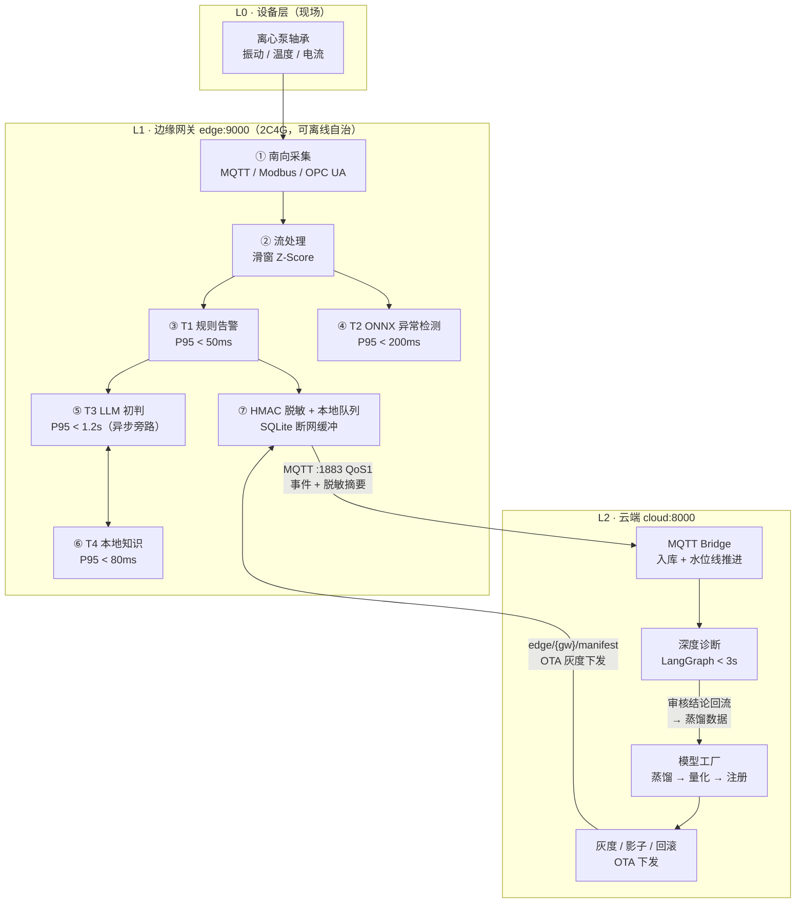

# Palpation 需求主流程

> **格式说明**：从业务诉求出发的推演式主流程——一句话诉求 → 角色 → 要回答的问题 → 逐项推演（规则 → 查数据 → 算决策）→ 让系统自动（系统与接口清单）→ 产出物示例 → 收尾洞见。
> **主场景**：离心泵驱动端轴承振动异常（方案 §1.4 锁定）。
> **端口约定**：边缘 edge=**9000**、云端 cloud=**8000**、管理代理 mgmt=**9001**、MQTT Broker=**1883**。

---

产线上离心泵轴承振动异常，要秒级告警 + 初判，断网也不能变哑巴，原始数据一步都不出工厂，联网后云端越用越聪明

角色：边缘网关 Agent（现场值班） / 云端诊断服务（后台专家） / 运维 / 管理代理（OTA 投递员）

要回答的六个问题：

1. 现场到底振到什么程度算异常
2. 异常了谁来判、判多快
3. 断网了怎么办
4. 判完了原始数据要不要传上去
5. 云端怎么"越用越聪明"
6. 模型更新怎么安全下发到边缘盒子

---

## 主流程架构图



> **读图要点**：
> - **异步解耦**：T1/T2（确定性告警）与 T3（LLM 初判）异步旁路——告警**永不等待 LLM**，这是"既有 <50ms 告警、又有 <1.2s 语义初判"的工程解法。
> - **数据不出厂**：边缘只上行"事件 + 脱敏摘要"（MQTT QoS1），10kHz 原始波形留在本地，上行压缩比 ≥ 99%。
> - **闭环进化**：云端深度诊断 → 人工审核 → 结论回流为蒸馏数据 → 模型工厂产出新端侧模型 → OTA 灰度下发回边缘 → 逐轮降低云端升级率。
> - **断网自治**：MQTT 断连时事件入本地 SQLite 队列；恢复后水位线补传（顺序、幂等、去重）。

---

## 振动（以驱动端轴承 RMS 越限为例）

公司的告警规则规定：振动 RMS > 4.5 → 一级告警 severity=high

1. 边缘网关 MQTT 订阅振动流，滑窗聚合，当前 RMS = 5.2
2. 规则判定：5.2 > 4.5 → 命中 → 一级告警
3. 端侧 LLM 初判："疑似轴承磨损，建议检查润滑"（置信度 0.85，标注"端侧初判，未经验证"）

延迟预算（分路径，拒绝笼统的单一数字）：

- **T1** 规则告警 P95 < 50ms（纯代码，无模型）—— 实测 1.29ms，余量 38.7×
- **T2** ONNX 异常检测 P95 < 200ms —— 实测 3.66ms
- **T3** 端侧 LLM 初判 P95 < 1.2s（2C 模拟环境）—— 实测 888.8ms，余量 1.35×（真机 2C 有超时风险）
- **T4** 本地知识检索 P95 < 80ms —— 实测 0.18ms
- **关键设计**：T1/T2 与 T3 异步解耦，告警**永不等待 LLM**。这是"既有 <50ms 确定性告警、又有 <1.2s 语义初判"的工程解法。

---

## 断网（厂区断网是家常便饭）

断网降级矩阵：

| 断网时长 | 边缘行为 | 云端可见性 |
|---|---|---|
| 0–5min | 正常自治，事件入本地队列 | 心跳中断告警 |
| 5min–1h | 提高缓存优先级，关闭非必要日志上行 | 标记"离线"，触发运维告警 |
| 1h–24h | T3 限流省算力，优先保障 T1/T2 | 影子停止更新，展示最后已知状态 |
| >24h | 仅保留 T1 告警链路，T2/T3 降级或关闭 | 标记"长期离线"，进入人工排查 |
| 恢复 | 水位线补传（顺序、幂等、去重），重新同步影子 | 自动退出离线态，gap 记录留存 |

---

## 原始数据不出厂

- 边缘只上行"事件 + 脱敏摘要"，**不上行 10kHz 原始波形**
- 上行数据压缩比 ≥ 99%（L0 原始 → L1 聚合）
- HMAC 脱敏：设备 ID 哈希化，敏感字段截断

---

## 云端越用越聪明

- 人工审核结论回流 → 成为云端蒸馏数据 → 下一版端侧模型下发 → 逐轮降低云端升级率
- 云端深度诊断（<3s）：LangGraph 走完整链路（传感器分析 + 混合检索 + 图谱推理 + 历史工单）
- 高风险（涉及停机）→ `interrupt()` 强制人工审核

---

## 模型 OTA 安全下发

- 灰度发布（环形）：1 台 → 3 台 → 10 台 → 全量
- 影子验证：desired 下发 → reported 回报 → 比对 delta
- 探针失败 → 自动回滚（OTA 回滚成功率 100%）
- 补传完整率 100%（本地事件数 vs 云端接收数 对账）

---

## 让系统自动

**边缘网关**（edge :9000）

- 南向采集：MQTT / Modbus / OPC UA / CoAP 适配器
- 流处理：滑窗 Z-Score + T1 规则 + T2 ONNX 异常检测
- 端侧 Agent：T3 LLM 初判（Qwen2.5 + llama.cpp）+ 规则兜底
- 本地知识：T4 ONNX 语义检索（bge-small-zh-v1.5 int8 / 512 维，`numpy` 余弦，保留 hash-embed 降级）+ 故障链规则表
- 本地队列：SQLite 断网缓冲 + 水位线 + 幂等
- 资源护栏：cgroup 限额 + 降级矩阵

**云端**（cloud :8000）

- MQTT Bridge：入库 + 水位线推进
- 深度诊断：LangGraph 多源证据融合
- 模型工厂：蒸馏 → 剪枝 → 量化 → 注册
- 灰度编排：环形发布 + 影子验证 + 回滚

**管理代理**（mgmt :9001）

- 健康探针 + 版本清单 + OTA 接收（与主进程隔离）

**MQTT Broker**（:1883）

- 控制面：事件上行、指令下行、影子、健康上报
- Sparkplug B + QoS1

---

## 产出物示例

**一级告警事件**（edge 发布 `edge/{gw}/diagnosis/preliminary`）：

```json
{
  "event_id": "evt-20261015-001",
  "gw_id": "gw-sim-001",
  "device": "centrifugal-pump-01",
  "metric": "vibration_rms",
  "value": 5.2,
  "threshold": 4.5,
  "severity": "high",
  "timestamp": "2026-10-15T10:23:45Z"
}
```

**端侧 LLM 初判**（标注"未经验证"）：

```json
{
  "diagnosis": "疑似轴承磨损，建议检查润滑",
  "confidence": 0.85,
  "tool": null,
  "caveat": "端侧初判，未经验证"
}
```

**云端深度诊断报告**（带引用来源）：

```json
{
  "conclusion": "驱动端轴承外圈磨损，建议停机更换",
  "evidence": ["工单 #2026-089（同类故障）", "振动频谱 1×/2×/3× 特征"],
  "risk_level": "high",
  "action": "interrupt() → 人工审核"
}
```

**模型 OTA 下发**（`edge/{gw}/manifest`）：

```json
{
  "model_version": "0.9.2",
  "url": "https://cloud:8000/v1/models/0.9.2/download",
  "sha256": "a1b2c3...",
  "rollout": "ring-1"
}
```

---

## 收尾

基于工厂的告警规则：振动 RMS > 4.5 → 一级告警。经边缘网关 MQTT 订阅振动流，滑窗聚合得 RMS=5.2，命中规则。端侧 LLM 初判"疑似轴承磨损，建议检查润滑"（置信度 0.85，标注"端侧初判，未经验证"）。事件脱敏后经 MQTT 上行云端，云端 LangGraph 深度诊断"驱动端轴承外圈磨损，建议停机更换"（高风险 → 人工审核）。审核结论回流为蒸馏数据，下一版端侧模型经灰度环形发布 + 影子验证 + OTA 下发到边缘盒子，逐轮降低云端升级率。

**AI = 3 个系统**（边缘网关 + 云端 + 管理代理），决策权在云、执行权在边。