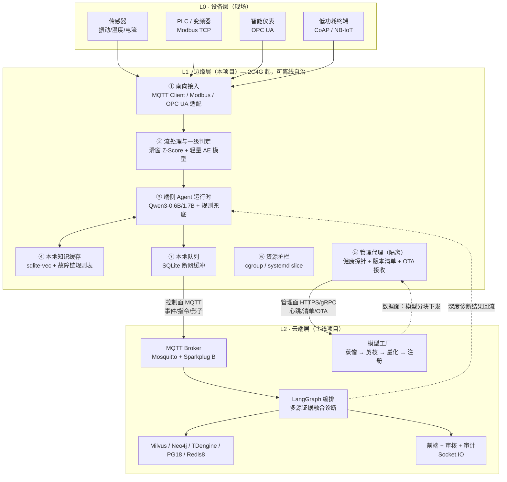

# 端云协同边缘 AI Agent 网关 · 方案设计（V1.0）

> **文档定位**：本文件是"第二项目"的**唯一方案口径**，定义**边缘侧（L1）**的设计，并明确其与**主线项目（云侧工业 IoT 诊断 Agent 系统 V5.0 定稿）**的协同边界与接口契约。
> **上游依据**：`工业设备诊断 Agent.md`（云侧 V5.0 定稿）、`第二项目  端侧 AI Agent 网关.md`（项目定位）、`本机环境基线`（i7-13650HX / 32GB DDR5 / RTX 4060 8GB / 954GB）。
> **调研基线**：2026 年 9 月公开资料（AWS / Azure / NVIDIA 官方文档与对比材料、KubeEdge 官方中文文档、Intel EdgeX 方案、端侧推理框架横评、边缘 OTA 工程实践、边缘 AI 成本报告）。
> **执行主体**：单人（"机器并行、人串行"），除标注"外部依赖"外。
> **定稿日期**：2026-09-30

> **⚠️ 实现修订说明（2026-10-22）**：本方案中 **T4 本地知识检索** 的原设想为 `sentence-transformers` + PyTorch；**实际落地采用 ONNX int8 路线** —— `bge-small-zh-v1.5` 的 **ONNX int8 模型（512 维）**，经 `onnxruntime` 推理（`OnnxEmbedder`）、`tokenizers` 直载 `tokenizer.json`，检索用 `numpy` 余弦相似度取 top-k（知识库 30 条）；**未引入 `sentence-transformers` / PyTorch / `sqlite-vec`**，模型缺失 / 依赖缺失 / 脏数据时优雅回退 `hash-embed`（32 维字节袋）。实测延迟 T4 P95 ≈ 3–7 ms（预算 <80 ms）、`Docker --memory=4g` 无 OOM。实测依据：`evidence/rag_onnx_bench.md`、`evidence/t4_onnx_verification_report.md`（及 `..._round2.md`）。下文涉及 T4 的"原方案设想"表述（如 §0.3 向量库行、§10.2 依赖清单）**按历史口径保留**，以实现修订说明与 §3.5 更正行为准。

---

## 目录

- [零、本方案与主线项目的关系](#零本方案与主线项目的关系)
- [一、项目目标与适用场景](#一项目目标与适用场景)
- [二、系统整体架构](#二系统整体架构)
- [三、边缘端模型选型与推理框架](#三边缘端模型选型与推理框架)
- [四、云端训练与模型下发机制](#四云端训练与模型下发机制)
- [五、数据同步与隐私保护策略](#五数据同步与隐私保护策略)
- [六、通信协议与延迟优化](#六通信协议与延迟优化)
- [七、部署与运维方式](#七部署与运维方式)
- [八、主流方案调研与对比](#八主流方案调研与对比)
- [九、实施路线图与验收指标](#九实施路线图与验收指标)
- [十、附录](#十附录)

---

## 零、本方案与主线项目的关系

### 0.1 一句话定位

> **主线项目是"云侧大脑"（深度诊断 + 知识沉淀 + 模型生产）；本项目是"现场神经末梢 + 一线决策器"（毫秒级感知、断网自治、模型落地）。两者不是竞争关系，而是同一系统的上下半身。**

### 0.2 关键缝合点（**本项目填的正是主线主动留白的坑**）

主线 V5.0 定稿的 §10.3「Won't」明确写道：

> **真实 Modbus / OPC UA 直连｜不做（预留"边缘网关转 MQTT"接口）**

**本项目就是那个"边缘网关"的实现者。** 主线把协议转换、一级过滤、断网自治全部推到边缘侧，本方案负责把这块补齐并回填。这是两个项目天然耦合、而非硬凑的核心证据。

### 0.3 复用 / 新增 / 明确不引入

| 维度          | 主线（云侧 L2）现有                                | 本项目（边缘 L1）处理方式                                                                                                   |
| ----------- | ------------------------------------------ | ---------------------------------------------------------------------------------------------------------------- |
| MQTT Broker | Mosquitto 2.x                              | **复用同一套主题规划**，新增 `edge/{gw_id}/...` 命名空间；边缘侧可选本地 Broker 做断网缓冲                                                    |
| 工业协议        | MQTT + Sparkplug B（taosX 解码）               | **新增** Modbus TCP / OPC UA → Sparkplug B 转换（补齐主线留白）★                                                             |
| 时序库         | TDengine 3.3.6                             | **不引入**。边缘用 SQLite + 环形缓冲（近期数据）+ 上行聚合统计量                                                                         |
| 向量库         | Milvus v3.0.0                              | **不引入**。边缘用 `sqlite-vec` 轻量索引，仅缓存 Top-N 手册片段（实现修订：实际未引入 `sqlite-vec`，改用 `numpy` 余弦，见文首说明）                                     |
| 知识图谱        | Neo4j                                      | **不引入**。边缘用"故障链规则表"（JSON 邻接表）近似 ≤2 跳路径                                                                           |
| 业务库         | PostgreSQL 18                              | **新增表**：`edge_devices` / `edge_heartbeat` / `edge_events` / `model_registry` / `rollout_plan` / `rollout_record` |
| LLM         | `qwen2.5:7b`（工具调用）+ `deepseek-r1:7b`（诊断推理） | 边缘侧 **Qwen3-0.6B / 1.7B Q4**；云端两个 7B 反向作为**蒸馏 teacher 与最终兜底**                                                    |
| Agent 编排    | LangGraph                                  | 云端**新增节点**：`edge_dispatch` / `edge_rollout` / `edge_shadow_eval`；边缘侧用独立**轻量状态机**（不引 LangGraph）★                  |
| 入口网关        | Nginx（Phase 4+）                            | 边缘侧同构，**Caddy / Nginx + mTLS**                                                                                   |
| 可观测         | Langfuse + Prometheus/Grafana              | 边缘 **node_exporter + ring buffer 日志**，断网补传，纳入**同一 Grafana**                                                      |

> **口径纪律**：与主线冲突时，**主线已有版本口径优先**（Milvus v3.0.0 / PG 18 / Redis 8 / Mosquitto 2.x / Qwen2.5-7B 等）。本项目只增加边缘侧专属组件，不改动主线既有选型。
> **重要**：边缘侧**不引入 Redis / Milvus / Neo4j / TDengine**。这四项是边缘资源约束下最不应背的包袱——它们是"云端的能力"，边缘只消费其**结果**。

---

## 一、项目目标与适用场景

### 1.1 从边缘视角重看结构性矛盾

主线 §1.1 提出的三重矛盾（知识获取慢 / 数据不可上云 / 幻觉风险高）在**边缘视角**下会变成另外三条：

| # | 边缘侧的硬矛盾 | 表现 | 后果 |
|---|---|---|---|
| E1 | **时延与带宽的物理下限** | 云端往返 + 排队 + 推理，端到端难稳在 3s 内；产线级联锁要求 ≤60ms | 高速工况下"AI 还没答完，事故已经发生" |
| E2 | **网络不可用是常态而非异常** | 厂区无线抖动、专线中断、现场无外网 | 云端一断，设备从"智能"直接退化为"哑巴" |
| E3 | **全量上传的成本与合规双重不可行** | 原始振动 10kHz 级采样；工艺参数属核心资产 | 带宽与存储成本爆炸 + 数据出域违规 |

> **核心判断**：E1/E2/E3 **不是靠"把云做得更快"能解决的**，而是必须把**一部分智能下沉到数据产生地**。这正是边缘 AI 的立论基础。

### 1.2 核心目标

> 在资源受限（**2 核 4GB 起**）的边缘网关上，构建一个**可离线自治、可被云端持续演进**的 AI Agent 网关：完成**设备接入 → 本地一级告警与诊断 → 脱敏上行 → 模型与知识增量落地**的闭环，把云端诊断为**兜底与深度分析**，而非唯一路径。

### 1.3 适用场景（三类，按落地优先级排序）

| 优先级 | 场景 | 边缘承担什么 | 关键约束 |
|---|---|---|---|
| **P0（主演示）** | **工业设备预测性维护 / 诊断** | 振动/温度/电流本地异常检测 + 一级根因初判 + 断网自治 | 误报率、可追溯性、涉停机动作必须人工审核 |
| P1 | **智慧园区 / 楼宇设备智能体** | 空调/照明/门禁本地感知与主动控制、自然语言指令 | 响应 <500ms、多协议设备接入、节能率 |
| P2 | **无人值守站点（泵站 / 基站 / 矿区）** | 长时间离网自治、本地事件缓存与补传、远程恢复 | 断网 7×24、远程可达、低温/粉尘环境 |
| — | **不适用** | 大规模模型训练、跨站点全局知识检索、正式报告审核、移动端 | 这些留在云端；边缘做只会失真 |

### 1.4 主演示场景（锁定，与主线保持一致）

> **离心泵驱动端轴承振动异常**
>
> **边缘侧（<1s）**：MQTT 订阅 Sparkplug B 振动/温度/电流流 → 滑动窗口 Z-Score + 轻量自编码器 → 判定"驱动端轴承振动 RMS 越限（severity=high）"→ 端侧 LLM 输出**一级初判**："疑似轴承磨损，建议检查润滑"（带置信度、**标注"端侧初判，未经验证"**）→ 发布 `edge/{gw}/diagnosis/preliminary`。
>
> **云端（<3s）**：接收事件 → LangGraph 走完整链路（传感器分析 + 混合检索 + 图谱推理 + 历史工单）→ 输出**带引用来源的正式报告** → 高风险（涉及停机）→ `interrupt()` 强制人工审核。
>
> **闭环**：人工审核结论回流 → 成为云端蒸馏数据 → 下一版端侧模型下发 → 逐轮降低云端升级率。

### 1.5 电梯演讲（一句话卖点）

> **"一个跑在 2 核 4G 边缘盒子上的诊断 Agent——断网时它能自己判断、联网时它会被云端越用越聪明，而且原始数据一步都不出工厂。"**

### 1.6 明确边界

| 边界 | 说明 |
|---|---|
| ❌ 端侧不做 | 全量知识检索、跨设备全局推理、正式报告生成、模型训练、多跳图谱 |
| ❌ 端侧不做 | **任何"一键执行"**（与主线一致的永久安全边界，永久 Won't） |
| ✅ 端侧只做 | 一级判定、初判建议、脱敏上行、模型落地、断网自治、远程可运维 |

---

## 二、系统整体架构

### 2.1 三级分层架构



### 2.2 边缘侧内部六层（对应上图 ①–⑦）

| 层 | 模块 | 职责 | 关键约束 |
|---|---|---|---|
| ① 接入层 | 协议适配器 | Modbus TCP / OPC UA / CoAP → **统一内部事件模型** → Sparkplug B 编码上行 | 新增协议只加适配器，不动上层 |
| ② 流处理层 | 窗口 + 判定 | 滑动窗口（Z-Score）、EWMA、轻量 AE / Isolation Forest（ONNX） | **确定性优先**：规则路径永远不被 LLM 阻塞 |
| ③ Agent 运行时 | 轻量状态机 | 意图识别 → 工具调用（**白名单**）→ 一级初判；无状态、可重放 | 不引 LangGraph；状态落 SQLite 可恢复 |
| ④ 本地知识层 | sqlite-vec + 规则表 | 缓存 Top-N 手册片段与"故障→原因→措施"邻接表 | 只读缓存，**由云端下发**，不在边缘编辑 |
| ⑤ 管理代理 | **与主应用进程隔离** | 健康探针、版本清单、OTA 接收、回滚执行 | 主应用崩溃时管理代理仍可远程接管（见 §7.6） |
| ⑥ 资源护栏 | cgroup / slice | CPU 2 核、内存 4GB、磁盘配额、温度降频联动 | 防止 LLM 抢占把接入链路饿死 |
| ⑦ 本地队列 | SQLite 环形缓冲 | 断网期事件落盘（保留 7 天）、水位线、幂等去重 | 补传不丢不重（见 §5.2） |

### 2.3 云端侧职责（复用主线，只列增量）

| 增量 | 说明 |
|---|---|
| 新表 6 张 | `edge_devices` / `edge_heartbeat` / `edge_events` / `model_registry` / `rollout_plan` / `rollout_record` |
| 新 LangGraph 节点 3 个 | `edge_dispatch`（分流：端侧事件 vs 直接告警）、`edge_rollout`（灰度发布编排）、`edge_shadow_eval`（影子评估） |
| 新服务 1 个 | **模型工厂**（蒸馏/剪枝/量化/注册流水线，异步任务） |
| 新主题族 1 个 | `edge/{gw_id}/{telemetry\|event\|diagnosis\|health\|manifest}` |

### 2.4 职责划分矩阵（**一表定责 —— 本方案核心**）

| 能力 | L1 边缘（本项目） | L2 云端（主线） | 判定依据 |
|---|---|---|---|
| 数据采集 / 清洗 / **降采样** | ✅ **主责** | — | 带宽与合规 |
| 一级异常检测（规则 + 判别模型） | ✅ **主责** | 复核 | 时延（<50ms / <200ms） |
| 意图识别 / 槽位抽取 | ✅ 主责 | — | 短输出，端侧足够 |
| 一级根因初判 | ✅ 主责（**标注"未验证"**） | — | 时效价值 |
| 深度根因诊断（多源融合） | ❌ 转发 | ✅ **主责** | 需 Milvus + Neo4j + 全量工单 |
| 知识检索 | ✅ 缓存子集（<80ms） | ✅ **全量混合检索** | 容量 vs 速度 |
| 报告生成 / 人工审核 / 审计 | ❌ | ✅ **主责** | 权威性与职责分离 |
| 模型**训练 / 蒸馏 / 量化** | ❌ | ✅ **主责** | 算力（RTX 4060 / 云 GPU） |
| 模型**下发 / 灰度 / 回滚决策** | ✅ 执行 | ✅ **决策** | 控制面归云，执行面归边 |
| 断网自治 | ✅ **主责** | — | 物理必然 |
| 全局设备影子 / 多站点视图 | ❌ | ✅ **主责** | 全局一致性 |
| 脱敏与隐私策略执行 | ✅ **执行** | ✅ 策略下发 | 策略集中、执行就近 |
| 本地审计留痕 | ✅ 主责（追加式） | ✅ **权威** | 断网也要可追溯 |

> **一条灰线**：**"决策权在云，执行权在边"**——所有涉及全局状态（哪些设备用哪个模型、什么时候回滚、什么算高风险）的判定，边缘**只执行不发明**；所有涉及毫秒级实时反应（阈值判定、一级初判、协议转换、断网自治）的判定，边缘**自主完成**。

### 2.5 四个交互面（交互方式定义）

| 交互面 | 方向 | 协议 | 承载内容 | 频率 / 量级 |
|---|---|---|---|---|
| **南向（设备面）** | 设备 → 边缘 | Modbus TCP / OPC UA / MQTT / CoAP | 原始遥测与控制回执 | 高频（1–10 kHz 原始采样，本地消费） |
| **北向 · 控制面** | 双向 | **MQTT QoS1**（+ Sparkplug B） | 事件上行、指令下行、设备影子、健康上报 | 中频（秒级～分钟级） |
| **北向 · 数据面** | 双向 | **HTTPS + gRPC（HTTP/2 流式）** | 模型分块下载、批量日志补传、向量索引增量包 | 低频、大包（MB 级） |
| **管理面** | 双向 | HTTPS（REST）+ mTLS | 设备注册、清单上报、灰度编排、回滚指令 | 低频（小时～天级） |

> **为什么控制面与数据面分开？** 借鉴 KubeEdge 的 **Router（管控面通道）/ EdgeMesh（数据面通道）** 分离思想：控制面要**极小包、极低延迟、弱网可存活**（MQTT 最优）；数据面要**大包、可续传、可校验**（HTTP/2 最优）。混在一起会两头不讨好。

### 2.6 设备影子（Device Twin）

| 影子段 | 内容 | 谁写 |
|---|---|---|
| `desired` | 期望的 `model_version` / `config_version` / `sampling_policy` / `upload_policy` | **云端写** |
| `reported` | 实际 `model_version` / `config_version` / `firmware_version` / 硬件指纹 / 健康摘要 | **边缘写** |
| `delta` | 云端计算出的差集（驱动边缘主动拉取） | 云端计算 |
| `meta` | 最后同步时间、离线时长、累计补传条数 | 双方 |

**设计原则**：边缘**永不**自己决定"我要升级到哪个版本"；它只观察到 `desired ≠ reported` 时**主动拉取**。这是"决策权在云"的落地机制。

### 2.7 接口契约（边缘侧消息 Schema）

```python
# ---- 边缘 → 云：遥测聚合（降采样后） ----
class EdgeTelemetry(BaseModel):
    gw_id: str
    device_id_hash: str          # HMAC-SHA256(device_id, salt)，不可逆
    metric: str                  # vibration_rms / temperature / current
    window_start: datetime
    window_end: datetime
    agg: dict                    # {avg, max, min, p95, std, slope, sample_count}
    raw_rate_hz: float           # 原始采样率（证明降采样比）
    schema_ver: str = "1.0"

# ---- 边缘 → 云：一级事件（触发云端深度诊断） ----
class EdgeEvent(BaseModel):
    event_id: str                # ULID，全局唯一
    gw_id: str
    device_id_hash: str
    seq: int                     # 单调递增序号（断网补传水位线）
    detected_at: datetime
    rule_id: str                 # 命中的确定性规则（可追溯）
    severity: Literal["low","medium","high"]
    metric: str
    value: float
    threshold: float
    preliminary_diagnosis: str | None      # 端侧初判（可空）
    preliminary_confidence: float | None   # 端侧置信度
    evidence_refs: list[str]               # 本地证据引用（滑动窗口快照 ID）
    degraded: bool = False                 # 是否处于降级态
    schema_ver: str = "1.0"

# ---- 云 → 边缘：模型清单（灰度下发单元） ----
class ModelManifest(BaseModel):
    model_id: str                # e.g. "edge-intent-qwen3-0.6b"
    version: str                 # semver
    artifact_url: str            # 分块下载地址
    sha256: str
    size_bytes: int
    quant: str                   # Q4_K_M / Q8_0 / int8
    runtime: str                 # llama.cpp / onnxruntime / rknn
    target_hardware: list[str]   # ["x86-avx2","jetson-orin","rk3588"]
    requires_firmware: str       # 前置固件版本（**硬约束**）
    preproc_ver: str             # 前处理脚本版本（**与模型强绑定**）
    metrics_at_register: dict    # {eval_acc, p95_latency_ms, peak_mem_mb}
    rollout: dict                # {strategy:"ring", rings:[1,10,50,100], stable_window_h:"24"}

# ---- 边缘 → 云：健康与版本报告（探针结果，驱动回滚判定） ----
class EdgeHealth(BaseModel):
    gw_id: str
    ts: datetime
    firmware_version: str
    model_versions: dict         # {intent:"1.2.0", anomaly_det:"0.9.1"}
    config_version: str
    inference_p95_ms: float
    mem_used_mb: int
    disk_free_mb: int
    cpu_temp_c: float | None
    input_links: dict            # {"modbus:plc1": true, "opcua:meter2": false}
    offline_since: datetime | None
    queue_depth: int             # 待补传事件数
    probe_ok: bool               # 启动健康探针综合结论
```

**通用约定**（与主线 §5.2 对齐）：

| 约定 | 规则 |
|---|---|
| 幂等 | 以 `event_id` 去重（云端 PG 唯一索引）；补传以 `(gw_id, seq)` 做水位线 |
| 顺序 | 单网关内 `seq` 单调递增；云端按 `seq` 排序重建时序 |
| 超时 | 控制面 MQTT 不设请求超时（异步）；管理面 REST 10s |
| 错误码 | 复用主线：`E_TIMEOUT/E_NOT_FOUND/E_INVALID_ARG/E_UPSTREAM/E_CONFLICT/E_PERMISSION`，新增 `E_MODEL_HASH_MISMATCH` / `E_REQUIRES_FIRMWARE` / `E_DISK_FULL` |
| 版本 | 所有消息带 `schema_ver`；**不兼容变更必须升大版本**，边缘对未知大版本只做"收到但不执行" |

### 2.8 与主线的改造清单

| # | 改造项 | 位置 | 工作量 |
|---|---|---|---|
| 1 | 新增 6 张表 + 迁移脚本 | 主线 PostgreSQL 18 | 0.5d |
| 2 | 新增 `edge_dispatch` 节点 | 主线 LangGraph | 0.5d |
| 3 | 新增 `edge_rollout` / `edge_shadow_eval` 节点 | 主线 LangGraph | 1d |
| 4 | 新增模型工厂服务（异步任务） | 主线后端 | 1.5d |
| 5 | MQTT 主题族扩展 + ACL | Mosquitto | 0.5d |
| 6 | Grafana 增加边缘看板 | 可观测 | 0.5d |
| | **合计** | | **≈4.5 人日**（不侵入主线既有逻辑，纯增量） |

---

## 三、边缘端模型选型与推理框架

### 3.1 端侧能力分四层（**不要把一切押在 LLM 上**）

| 层 | 用途 | 技术 | 体积 | 目标延迟 |
|---|---|---|---|---|
| **T1 确定性规则** | 阈值、变化率、多条件与或 | 纯代码（YAML 规则表） | ~0 | **P95 < 50ms** |
| **T2 判别式小模型** | 异常检测、模式分类 | Isolation Forest / 1D-CNN-AE → **ONNX** | < 20MB | **P95 < 200ms** |
| **T3 轻量 LLM** | 意图识别、槽位抽取、一级初判 | Qwen3-0.6B / 1.7B，**GGUF Q4_K_M** | 0.4–1.2GB | P95 < 1.2s（2C） |
| **T4 嵌入/检索** | 本地知识片段召回 | `bge-small-zh-v1.5`（512 维） | ~95MB | < 80ms |

> **关键工程决策**：**告警路径（T1+T2）与 LLM 路径（T3）异步解耦**。T1/T2 判定为真即**立刻**发事件，永不等待 LLM；T3 的初判作为**旁路追加**到同一事件（`preliminary_diagnosis` 可空）。这样"端到端 <50ms 告警"与"带语义初判 <1.2s"两个指标互不拖累。

### 3.2 轻量 LLM 候选与评分矩阵

| 候选 | 量化后体积 | 2C4G 可行性 | 工具调用 | 中文 | 结论 |
|---|---|---|---|---|---|
| **Qwen3-0.6B（Q4_K_M）** | ~0.4GB | ✅ 轻松，余量大 | ⚠️ 基础可用 | 强 | **选为主力（T3a：意图/槽位/分类）** |
| **Qwen3-1.7B（Q4_K_M）** | ~1.1GB | ✅ 可跑（余 ~1.6GB） | ✅ 可用 | 强 | **选为增强（T3b：一级初判）** |
| Qwen2.5-1.5B-Instruct | ~1.0GB | ✅ 可跑 | ✅ **原生 FC** | 强 | 备选（若 Qwen3 工具调用不稳） |
| Phi-3-mini（3.8B） | ~2.3GB | ⚠️ 紧张 | ⚠️ | 中 | 淘汰（4GB 容器内余量不足） |
| MiniCPM-2.4B | ~1.6GB | ⚠️ 边缘 | ⚠️ | 强 | 备选（多模态扩展时再评估） |
| deepseek-r1 蒸馏系 | ≥1.5GB | ❌ | ❌ **不支持结构化 FC** | 强 | 淘汰（与主线结论一致：**蒸馏模型不做工具调用**） |
| 4B 及以上 | ≥2.5GB | ❌ | — | — | 淘汰（2C4G 硬约束） |

> **选型纪律（与主线 §3.7 同源）**：边缘的**最高权重维度是"体积与延迟"**，而非推理质量——质量由云端兜底。因此在同等 FC 能力下**永远选更小的模型**。
> **口径说明**：端侧 Qwen3-0.6B 与云端 `qwen2.5:7b` 是**同一工具契约的两个实现**（见 §2.7），Prompt 与 JSON Schema 共用一套，**降低双端维护成本**。

### 3.3 量化档位选型

| 档位 | 相对体积 | 精度损失（经验） | 端侧适用性 | 裁决 |
|---|---|---|---|---|
| FP16 | 1.00× | 0 | 内存不允许 | 仅用于**云端构建引擎**（如 Jetson TensorRT） |
| **Q8_0** | ~0.53× | 极小 | 内存充裕时首选 | 仅在 **≥8GB** 边缘设备启用 |
| **Q4_K_M** | ~0.30× | 小（可接受） | **体积/精度/速度最优平衡** | ✅ **默认档位** |
| Q4_0 | ~0.28× | 略大于 Q4_K_M | 兼容性最好 | 备选 |
| Q3 / Q2 | ~0.22× / 0.15× | **明显塌陷**（中文尤甚） | 不用于诊断类任务 | ❌ 禁止 |

> **论证依据**：端侧诊断任务的失败代价是"错误维修建议"，因此**禁止用 Q2/Q3 换体积**。Q4_K_M 是"能进 4GB 内存"与"输出仍可解析"的交点。
> **重要区分**：量化在**云端完成**（构建期），边缘只**加载推理**。原因：量化校准需要先加载全量 FP16 模型跑推理，**在 8GB 统一内存的边缘设备上很容易在校准阶段就 OOM**（NVIDIA 社区的 Jetson Orin 8GB 实测中，1.5B 模型的构建因 embedding 表 445MB 超出连续内存峰值而五次全部失败）。**边缘只做"下载 + 校验 + 加载"，不做"转换 + 校准"。**

### 3.4 推理框架选型矩阵（按硬件后端）

| 硬件形态 | 推荐框架 | 理由 | 备选 |
|---|---|---|---|
| **x86 边缘盒子 / 开发模拟（本项目 Phase 0）** | **llama.cpp**（GGUF） | CPU 优化成熟、量化支持最好、易集成、跨平台一致，适合统一基准测试 | Ollama（封装层，便于对比） |
| x86 + Intel iGPU/NPU | **OpenVINO**（+ OVMS） | 官方针对 Intel CPU/GPU/NPU 深度优化；与 EdgeX Foundry 有官方零代码集成 | ONNX Runtime |
| **NVIDIA Jetson（Orin 系列）** | **TensorRT-Edge-LLM**（或 llama.cpp CUDA） | 官方 C++ 生成式推理运行时；TRT 引擎速度显著优于通用框架 | llama.cpp CUDA |
| 瑞芯微 RK3568 / RK3588 | **RKNN-LLM** | 官方 NPU 链路，6 TOPS 级算力性价比高 | llama.cpp（CPU 兜底） |
| 高通 / 手机 / 车载 | **ONNX Runtime（QNN EP）** | Snapdragon NPU（Hexagon HTP）上速度与能效双优 | MLC-LLM（GPU 路径） |
| 通用兜底 / T2 判别模型 | **ONNX Runtime** | 跨平台 EP（CoreML / NNAPI / QNN / CPU），一套模型多端跑 | — |

> **框架选型的第一性原理**：**"没有单一最快的运行时"——它取决于加速器。** 已有 2026 年横评明确指出：Snapdragon NPU 上 ONNX Runtime + QNN EP 通常最快、能效最好；移动 GPU 上 MLC-LLM 的编译内核常领先；桌面 CPU 或 CUDA GPU 上 llama.cpp 极具竞争力。**因此必须在目标 SoC 上实测，不能照抄跨框架的公开跑分。**
> **风险提示（必读）**：**NPU 路径的内核常为闭源**（QNN kernel、RKNN kernel 均如此），这意味着算子覆盖不足时**无法自行补算子**，只能退回 CPU。故本方案策略是：**NPU 用于 T2 判别模型（算子集稳定），LLM（T3）初期走 llama.cpp CPU 路径**，待 NPU 链路验证成熟再迁移。

### 3.5 内存预算表（**本方案最硬的一张表**）

**A. 开发期模拟环境（Docker `--cpus=2 --memory=4g`）**

| 组成 | 占用 | 说明 |
|---|---|---|
| OS + 容器运行时开销 | ~300MB | 固定 |
| Edge Agent 运行时（Python + FastAPI） | ~150MB | 常驻 |
| MQTT 客户端 + 流处理 | ~50MB | 常驻 |
| T3a LLM 权重（Qwen3-0.6B Q4_K_M） | ~400MB | 常驻 |
| LLM KV Cache（`num_ctx=2048`） | ~100MB | 常驻 |
| llama.cpp 运行时 | ~100MB | 常驻 |
| T2 异常检测（ONNX + Runtime） | ~200MB | 常驻 |
| T4 嵌入模型（bge-small-zh-v1.5，**实际采用 ONNX int8**） | ~47MB | 实测加载增量（磁盘资产 ≈23MB）；PyTorch 路线对照约 ~520MB（本行原记 ~120MB） |
| SQLite + 本地队列 + 索引 | ~100MB | 常驻 |
| 探针 / 监控 / 日志缓冲 | ~50MB | 常驻 |
| **合计** | **≈1.57GB** | **余量 ~2.4GB** |

> **余量的用途**：可无缝升级到 **Qwen3-1.7B（+0.7GB）** 或并入 T2 的多模型集成，**无需改架构**。这是本方案"留有余量"而非"卡死在 4GB"的关键设计。

**B. 生产环境（典型 8GB 边缘盒子）**

| 组成 | 占用 | 说明 |
|---|---|---|
| 系统 + 容器 | ~800MB | Linux + Docker/K3s |
| T3b LLM（Qwen3-1.7B Q4_K_M 或 Qwen2.5-1.5B） | ~1.1GB | 常驻 |
| KV Cache（4K ctx） | ~250MB | — |
| T2 + T4 | ~500MB | — |
| 本地缓存 / 队列 / 日志 | ~500MB | 可调 |
| **合计** | **≈3.2GB** | 余量充足，可再上 3B 级模型 |

**C. 参考上限（来自 NVIDIA Jetson Orin 实测报告）**

| 设备 | 可构建引擎上限 | 可推理上限 |
|---|---|---|
| Orin 8GB | 0.5B（fp16 引擎） | 7B Q4（走 llama.cpp） |
| Orin NX / Nano Super 16GB | 3B（int8） | 7B ~ 14B 量化 |
| Orin AGX 64GB | 7B+ | 14B ~ 32B 量化 |

> **同架构引擎可跨机型迁移**（同 sm 架构 + 同 TensorRT 版本 + 同插件），这意味着**可以在 16GB 设备上构建引擎、拷回 8GB 设备推理**——本方案把这一条纳入云端模型工厂的产线设计（§4.2）。

### 3.6 实测基准（引用，用于设定指标）

| 指标 | 实测值 | 环境 | 来源性质 |
|---|---|---|---|
| 生成速率 | **21.9 ~ 30.5 tok/s（均 ~26.5）** | Jetson Orin Nano 8GB / Qwen2.5-0.5B fp16 / TensorRT-Edge-LLM v0.6.0 | 社区实测 |
| TTFT | **~1.9s（含每次引擎加载 1–2s）**；常驻进程可降至数百 ms | 同上 | 社区实测（强调：**瓶颈是引擎加载而非计算**） |
| 峰值内存 | ~4.23GB（55.7%） | 同上 | 社区实测 |
| 峰值功耗 | ~15.2W，GPU 利用率 99%，温度 ~58°C | 同上 | 社区实测（热余量充足） |
| CPU 推理（0.6B） | ~15 tok/s | i5 + 8GB + SSD，纯 CPU | 厂商参考 |
| CPU 推理（1.7B） | ~20 tok/s | i7 + 64GB，纯 CPU | 厂商参考 |
| CPU 推理（4B） | ~12 tok/s | i7 + 64GB，纯 CPU | 厂商参考 |

> **⚠️ 口径警告**：上表 CPU 数值来自**桌面 i7 多核**环境。本项目 Phase 0 的 **2 核 4GB 容器**速度会显著低于此（预估 0.6B 约 5–10 tok/s、1.7B 约 3–6 tok/s）。**所有端侧指标必须在自己的目标环境实测，禁止外推**。
> **结论对应的设计选择**：正因为边缘推理慢，本方案才坚持 **T1/T2 承担"实时告警"，T3 只承担"短输出的语义初判"**（≤32 token），把长文本生成全部留给云端。

### 3.7 端侧降级映射（**任何降级不得默认沿用原指标**）

| 触发条件 | T3 LLM | T2 异常检测 | T4 检索 | 对指标的影响 |
|---|---|---|---|---|
| 内存峰值 ≤ 3GB | Qwen3-1.7B 常驻 | 完整模型 | 常驻 | 原指标不变 |
| 3–3.6GB | 降为 Qwen3-0.6B | 完整模型 | 按需加载 | **一级初判质量下降**，须记录 |
| > 3.6GB | **LLM 卸载**，仅规则 + T2 | 简化（仅 Z-Score） | 关闭 | 仅保障"告警链路"；`preliminary_diagnosis` 置空并标 `degraded=true` |
| CPU 温度 > 阈值 / 降频 | 降低 T3 调用频率（限流） | 不变 | 不变 | 端侧初判延迟上升 |
| 磁盘 < 500MB 可用 | LLM 不变 | 不变 | 清缓存 | **停止接受新模型**，上报 `E_DISK_FULL` |
| 断网 > 24h | 不变 | 不变 | 仅用旧缓存 | 事件积压，`queue_depth` 告警 |

---

## 四、云端训练与模型下发机制

### 4.1 端侧模型从哪来？—— **不训练，只蒸馏**

> **核心判断**：**边缘不需要"从零训练模型"**，需要的是**把云端已有能力"压缩投递"到边缘**。
> 本项目的模型来源是三条路径的**组合**，且全部在云端完成：

| 路径 | 产出 | 用途 |
|---|---|---|
| **① 领域蒸馏** | 用主线 `deepseek-r1:7b` / 云端大模型作为 **teacher**，生成标注意图/工具调用/初判样例，蒸馏出 0.6B/1.7B 的 **student** | T3 语义层 |
| **② 判别模型训练** | 用 TDengine 历史时序训练 Isolation Forest / 1D-CNN-AE | T2 异常检测 |
| **③ 检索侧适配** | 从 Milvus 全量知识中**筛选高频 Top-N 片段**，配套生成 `sqlite-vec` 索引包与故障链规则表 | T4 本地知识 |

> **为什么不做端侧全参数训练？** 与主线 §3.9 结论一致：**本机 RTX 4060 8GB 全参数训练 7B 不可行**；即便可行，边缘也无训练算力。**微调（QLoRA）是"可选"，训练是"不可行"。**

### 4.2 模型工厂：七阶段流水线

```
① 数据回流        云端接收 → 影子评估结果 / 人工审核修正 / 端侧误报样本
        ↓
② 清洗与标注      去重、脱敏、分层抽样；审核结论作为黄金标签
        ↓
③ 蒸馏            teacher(cloud) → student(0.6B/1.7B)；温度 T 需调优
        ↓
④ 剪枝           结构化剪枝（去冗余注意力头/FFN 通道）
        ↓
⑤ 量化            FP16 → AWQ/GPTQ → GGUF Q4_K_M（**校准集必须包含工业语料**）
        ↓
⑥ 校准与评测      端侧回放集（Top-50 真实案例）→ 准确率 / P95 延迟 / 峰值内存
        ↓
⑦ 注册            写入 model_registry（含 sha256 + 指标 + 前置依赖），产出 ModelManifest
```

**流水线纪律**：

| 纪律 | 说明 |
|---|---|
| **每阶段都留基线** | 蒸馏/剪枝/量化各留一版产物，便于**定位是哪一步导致了精度下降**（常见坑：一步扣一点，叠加后不可用） |
| **校准集必须含工业语料** | 用通用语料校准的 Q4 模型在工业术语上损失明显更大 |
| **评测必须含端侧回放** | 只有"在目标硬件上跑通 + 指标达标"才允许进注册表；**未回放的模型禁止进入灰度** |
| **蒸馏温度不可拍脑袋** | 温度过低软标签退化为硬标签，学生学不到暗知识；须在验证集上搜索 |
| **构建在"更胖"的机器上** | 引擎构建/量化校准在云端（或 16GB 设备）完成，产物**拷贝**到边缘（同架构可迁移） |

### 4.3 模型清单 ModelManifest（发布的最小单元）

见 §2.7 的 `ModelManifest` Schema。**三个字段最关键，缺一不可**：

| 字段 | 为什么关键 | 失败案例 |
|---|---|---|
| `requires_firmware` | **前置固件版本硬约束** | 新模型已下发，但旧固件不支持新的输入前处理 → 推理线程启动失败 |
| `preproc_ver` | 前/后处理脚本与**模型权重强绑定** | 模型换了但预处理没换 → 静默输出错误结果（**比崩溃更危险**） |
| `sha256` | 分块传输的完整性校验 | 断点续传拼接错误 → 加载损坏权重 |

### 4.4 三层版本解耦（**OTA 可运维性的基石**）

> **核心原则**：**绝不把"模型 / 固件 / 配置"绑成一个版本号。** 边缘 AI 升级失败与普通固件升级失败**性质不同**——后者是"某功能不可用"，前者是**整条能力链断裂**（采集 → 预处理 → 推理 → 上传）。

| 层级 | 覆盖内容 | 变更代价 | 回滚特征 |
|---|---|---|---|
| **Firmware Version** | 驱动、采集、推理运行时、管理代理 | **最高** | 通常需重启 / 切分区 |
| **Model Version** | 权重、量化文件、标签映射、前/后处理脚本 | 中 | **可热切换**（目录 + 符号链接），**不依赖固件重启** |
| **Config Version** | 阈值、采样策略、上传频率、模型选择规则、开关 | **最低** | 秒级生效，**最快的止血手段** |

**发布对象模型必须回答五个问题**（发布前强制填写）：

1. 发布到哪些**设备组 / 站点 / 型号**？
2. 本次变更是**模型、固件、配置，还是组合**？
3. 是否要求设备先满足**某个前置版本**？
4. **发布成功的判据**是什么（不是"包已下发"）？
5. 失败后**按哪一层回滚**？

**落地形态**：

```
/opt/edge-agent/
├── models/
│   ├── intent/
│   │   ├── v1.1.0/          # 完整版本目录
│   │   └── v1.2.0/          # 新版本（下载完成后才建 current 链接）
│   └── current -> v1.1.0    # ★ 符号链接热切换，原子操作
├── config/
│   ├── v0007.yaml
│   └── current.yaml -> v0007.yaml
└── firmware/                # 固件单独管理，不参与模型热切换
```

### 4.5 灰度发布：五步节奏 + 状态机

**五步节奏**：

| 步 | 动作 | 验证什么 |
|---|---|---|
| 1 | **内部实验设备**（1 台，实验室） | **版本依赖是否正确**（`requires_firmware` / `preproc_ver`） |
| 2 | **Canary（≈1%）** | **三条链路**：升级、推理、**回滚** |
| 3 | **按站点 / 型号分环扩圈**（10% → 50%） | 硬件差异与现场差异 |
| 4 | **稳定窗口观察**（默认 24h） | 推理质量与资源是否稳定 |
| 5 | **全量 + 保留冻结与回滚窗口（默认 7 天）** | **不立刻清理旧版本** |

**发布状态机**：

```
pending → downloading → verifying(sha256) → staged
   → activating(切换符号链接) → probing(启动健康探针)
   → [probe_ok] observing(稳定窗口) → succeeded
   → [probe_fail] rolling_back → rolled_back → 冻结该发布
```

> **关键约束**：**灰度验证的不是"数量比例"，而是"恢复能力"**——只看"包发下去了没"、不看健康与恢复路径，全量时问题会被放大。

### 4.6 影子验证（Shadow Inference）

> **机制**：新模型在 Canary 组**与在线模型并行推理**，但**结果只记录、不生效**。稳定窗口内比对两版的 KPI，达标才允许切流。

| 比对指标 | 阈值（示例） |
|---|---|
| 端侧一级初判与云端结论一致率 | ≥ 现网版本 − 2pp |
| 推理 P95 延迟 | ≤ 现网版本 × 1.2 |
| 峰值内存 | ≤ 现网版本 × 1.15 |
| JSON 可解析率（工具调用） | ≥ 95% |
| 误报率 | 不劣化 |

**为什么必须做影子验证？** 因为"离线评测集达标"≠"现场达标"。现场数据分布与评测集不同（设备型号、工况、季节）。**影子验证是把现场当作最终评测集的方式，且零业务风险。**

### 4.7 回滚与失败收敛

**回滚触发信号（必须是"推理链路"级，而非"设备在线"级）**：

| 信号 | 阈值（示例） | 说明 |
|---|---|---|
| 模型进程启动失败 | 任意一次 | 立即回滚 |
| 启动健康探针失败 | `probe_ok=false` | 立即回滚 |
| 推理 P95 超安全阈值 | > 3s 持续 10min | 回滚 |
| 内存 / 磁盘 / CPU 温度异常 | 超限持续 5min | 回滚 |
| 关键输入链路断开 | Modbus/OPC UA 连接失败 | **告警，不自动回滚**（可能是外部原因） |
| JSON 可解析率骤降 | < 80% 持续 100 次 | 回滚（模型输出格式坏了） |

**普通 OTA 视角 vs 边缘 AI OTA 视角**（对照表）：

| 策略 | 普通 OTA 视角 | **边缘 AI OTA 视角（本项目）** |
|---|---|---|
| 发布成功 | 设备上线 | **推理链路恢复且健康** |
| 回滚触发 | 超时未上线 | **超时 + 探针失败 + 资源异常 + 质量异常** |
| 监控重点 | 联网状态 | **联网 + 模型服务 + 资源健康** |
| 回滚对象 | 整体版本 | **固件 / 模型 / 配置按层回退** |

**失败收敛逻辑**：探针失败 → **自动回滚**（秒级，符号链接切回）→ **自动冻结该发布**（阻止扩散）→ 锁定问题版本（加入黑名单）→ 上报云端 → 人工介入。

### 4.8 传输优化

| 手段 | 说明 |
|---|---|
| **分块传输** | 固定 4MB 分块，逐块 sha256 校验，最终整体校验 |
| **断点续传** | HTTP `Range` 请求；边缘记录 `(model_id, version, chunk_index)` 进度 |
| **夜间窗口下载** | 默认 02:00–05:00，避开产线高峰；**带宽限速**（如 2 Mbps） |
| **差分更新（可选）** | 权重未变层跳过（需分片存储，Phase 2 评估） |
| **压缩** | 传输层 zstd（GGUF 已高熵，压缩收益有限，但元数据与索引包收益显著） |
| **磁盘预检** | 下载前校验 `size_bytes × 2 + 500MB` 可用空间，不足则拒绝并上报 `E_DISK_FULL` |

### 4.9 联邦聚合（进阶，Phase 3+ 预留）

> **机制**：多站点边缘各自基于本地数据做**局部微调**（只训轻量 LoRA 或末层），**只上传模型更新（梯度/权重差）**，云端 `FedAvg` 聚合成全局模型后重新量化下发。原始数据**一步不出厂**。这与 KubeEdge Sedna 的联邦学习思路一致。

**为什么放后期？** 联邦聚合的工程复杂度（通信轮次、非独立同分布数据、聚合收敛、参与方可靠性）远高于其早期收益。**Phase 0–2 用"云端集中蒸馏"已能覆盖 90% 价值**，联邦是扩展到"多客户 / 多厂区"时的必要选项，而非项目初期选项。

---

## 五、数据同步与隐私保护策略

### 5.1 数据分级（**决定"什么能出边缘"的唯一依据**）

| 级别 | 数据 | 是否出厂 | 处理方式 |
|---|---|---|---|
| **L0 原始数据** | 原始振动/电流波形、工艺参数曲线、设备编号原值 | ❌ **永不出厂** | 完全本地闭环，仅留环形缓冲 |
| **L1 特征统计量** | 窗口聚合（avg/max/p95/std/slope） | ✅ 可出厂 | 聚合后上传，**带宽降低 ~99%** |
| **L2 事件与告警** | `EdgeEvent`（含 `device_id_hash`） | ✅ 可出厂 | 设备标识 **HMAC 哈希化**，不可逆 |
| **L3 脱敏摘要** | 可送**公有云**的通用知识摘要 | ⚠️ 按开关 | 剥离设备编号 / 工艺参数 / 厂区信息，仅留"故障现象 + 通用知识" |

> **默认策略**：**L0 永不出厂，L1/L2 只到自有云端（与主线同源），L3 仅在显式开关打开时送外部 LLM 兜底。** 这与主线 §3.8"本地优先、云为兜底"的结论完全一致。

### 5.2 数据同步策略

| 方向 | 内容 | 机制 |
|---|---|---|
| **上行 · 遥测** | L1 聚合统计量 | 周期上报（默认 10s / 60s 两档），MQTT QoS0（可丢，量大） |
| **上行 · 事件** | L2 `EdgeEvent` | 事件触发，MQTT QoS1（不可丢） |
| **上行 · 日志** | 结构化日志 | 批量压缩，数据面 HTTP/2 补传 |
| **下行 · 模型** | `ModelManifest` + 分块权重 | 数据面 HTTPS 分块 + 断点续传 |
| **下行 · 知识** | `sqlite-vec` 索引包 + 故障链规则表 | 数据面 HTTPS（增量包） |
| **下行 · 策略** | 采样策略、上传策略、阈值、脱敏规则 | 管理面 REST（配置版本热更新） |

**断网补传协议（水位线 + 幂等）**：

```
边缘侧：
  每个事件分配单调递增 seq，写入 SQLite（本地权威，append-only）
  queue_depth 上报 → 云端可见积压量

联网恢复：
  边缘读取 last_acked_seq（云端确认过的水位线）
  → 从 last_acked_seq+1 开始**顺序批量补传**（每批 ≤100 条）
  → 等待云端 ack(seq) 后推进水位线
  → 直到补齐

云端侧：
  以 event_id 唯一索引去重（重复补传幂等）
  以 (gw_id, seq) 检测**缺口**：若收到 seq=105 但水位线在 100 → 请求重传 101–104
  → 若某 seq 永久缺失（边缘侧被磁盘清理），标记 gap 并记录（**不阻塞后续**）
```

> **关键设计**：**边缘的本地队列是"本地权威"，云端是"全局权威"。** 断网期边缘有完整本地记录（可追溯、可审计）；联网后是"同步"而非"上报"——因为边缘可能比云端知道得更多（云端错过的时段）。

### 5.3 冲突与权威源

| 数据 | 权威源 | 冲突处理 |
|---|---|---|
| 原始遥测 | **边缘**（云端未持有） | 无冲突（单向） |
| 事件时序 | **边缘**（本地 append-only） | 以边缘 `seq` 为准；云端不修改，只追加状态 |
| 事件状态（已处理/已审核） | **云端** | 云端为准，下发回边缘 |
| 设备影子 `desired` | **云端** | 云端为准 |
| 设备影子 `reported` | **边缘** | 边缘为准 |
| 模型清单与版本 | **云端** | 云端为准 |
| 审计记录 | **云端**（权威）/ 边缘（本地留痕） | 双写，以云端为最终口径 |

> **原则**：**同一份数据只有一个权威源。** 边缘与云端各自的"局部真相"通过影子与水位线**收敛**，而非互相覆盖。

### 5.4 隐私保护四层防线

| 防线 | 措施 | 落地位置 |
|---|---|---|
| **① 数据最小化** | 边缘只上传聚合统计量（L1），原始数据不出厂 | 边缘流处理层 |
| **② 脱敏** | `device_id` → `HMAC-SHA256(device_id, salt)`；工艺参数区间化；厂区/客户名剥离；salt 定期轮换 | 边缘（策略由云端下发） |
| **③ 联邦学习（可选）** | 只传模型更新，不传数据；`FedAvg` 聚合 | 边缘（本地训练）+ 云端（聚合） |
| **④ 差分隐私（可选）** | 上报统计量加拉普拉斯/高斯噪声，防"通过统计量反推个体" | 边缘上报前 |

**补充措施**：

| 项 | 措施 |
|---|---|
| 传输安全 | 全链路 **mTLS**（设备证书）；MQTT over TLS 1.2+ |
| 存储安全 | 边缘本地队列加密（LUKS / SQLCipher）；密钥由安全区保管 |
| 密钥管理 | 设备私钥优先存 **TPM / 安全区**，软件环境用加密文件 + 权限隔离 |
| 审计不可篡改 | 边缘审计表 **append-only + 触发器禁改**（与主线 §7.1 同策略）；同步至云端 WORM |
| 注入防护 | 端侧 LLM **工具白名单**；输入净化；高风险判定**用确定性规则，不依赖 LLM**（与主线同源） |

### 5.5 合规对照

| 法规 / 标准 | 本方案的对应 |
|---|---|
| 中国《个人信息保护法》 | 原始数据不出厂（L0 本地闭环）+ 去标识化（HMAC）+ 最小必要（只传聚合量与事件） |
| 欧盟《AI 法案》执行细则 | 高风险判定强制人工审核、结论可追溯（引用强制）、降级显式标注"端侧初判，未经验证" |
| 工业数据分类分级 | L0–L3 分级与出厂策略（§5.1）直接可映射到企业分级标准 |
| 数据出境 | 默认架构下**无数据出境路径**（L0/L1/L2 只到自有云端） |

---

## 六、通信协议与延迟优化

### 6.1 协议分层选型

| 链路 | 协议 | QoS / 模式 | 理由 |
|---|---|---|---|
| 设备 → 边缘（新设备） | **MQTT + Sparkplug B** | QoS1 | 与主线一致，事件驱动，语义统一 |
| 设备 → 边缘（既有产线） | **Modbus TCP / OPC UA** | 轮询 / 订阅 | 存量设备不可改；由边缘做协议转换 |
| 设备 → 边缘（低功耗远传） | **CoAP / NB-IoT** | CON（可选确认） | 电池寿命优先（实测案例：NB-IoT 传感器改 CoAP 后平均电流 120μA → 45μA） |
| 边缘 → 云（**控制面**） | **MQTT（TLS + QoS1）** | QoS0/QoS1 分级 | 极小包、弱网可存活、有 Broker 解耦 |
| 边缘 → 云（**数据面**） | **HTTPS + gRPC（HTTP/2 流式）** | 流 + Range | 大包、断点续传、多路复用 |
| 边缘 → 云（管理面） | **HTTPS REST + mTLS** | — | 与主线 REST 契约同构 |
| 云端内部 / 前端 | **Socket.IO** | — | 复用主线实时推送 |

### 6.2 协议选型论证（量化数据）

| 论据 | 数据 |
|---|---|
| **MQTT 头部极轻** | 固定头**最小 2 字节**；CoAP 基础头 4 字节；HTTP 头部开销最大 |
| **实测传输量差距悬殊** | 发送 **1000 次 × 10 字节**：**MQTT 总传输 12KB vs HTTP/1.1 总传输 800KB**（约 67×） |
| **弱网优势** | 2.4kbps 卫星链路上，MQTT 完成相同数据量传输**比 HTTP 快约 6 倍** |
| **HTTP 的握手成本** | 每个 HTTPS 请求**至少 2 个 RTT**（TCP 1 + TLS 1~2）+ 数据传输 + 四次挥手；对每 10s 上报一次的传感器开销巨大 |
| **事件驱动改造收益** | 工业案例：汽车工厂改造为 **MQTT + Sparkplug B** 后（轮询改事件触发），**网络流量降低 80%** |
| **QoS 代价可控** | MQTT QoS2 需四次握手（+1 RTT）；本方案**只用 QoS0/QoS1**，不用 QoS2 |
| **实时性排序** | `CoAP NON ≈ MQTT QoS0 > CoAP CON > MQTT QoS1 > HTTP` |
| **NB-IoT 时延上限** | 典型 **1.6–3 秒** → **高实时场景不适用 NB-IoT**，须用 Cat.1/Cat.4 有线 |

### 6.3 为什么**不**"全上 gRPC"或"全上 HTTP"

| 假设方案 | 为什么不采用 |
|---|---|
| **全部 gRPC** | gRPC 依赖 HTTP/2 长连接，**弱网下重连代价高**；**无成熟 Broker 生态**（无法做发布订阅与"断网期本地缓存 + 恢复后续传"）；工业侧工具链与网关支持远不如 MQTT；**NB-IoT/CoAP 场景直接不可用** |
| **全部 HTTP** | 每个请求 ≥2 RTT；长轮询耗电；**流量是 MQTT 的 60 倍以上**；无法做下行主动指令 |
| **全部 MQTT** | 大文件（模型权重）走 MQTT 是**误用**：无 Range 续传、Broker 需要大缓冲、失败重传代价高 |
| **✅ 本方案：控制/事件走 MQTT，大流量走 HTTP/2/gRPC** | 各取所长，**面分离**（§2.5） |

### 6.4 延迟预算分解（**分路径定义，拒绝笼统的单一数字**）

> **口径纪律**（与主线 §11.1 同源）：**不做"端到端 < X ms"的笼统承诺**，而是按路径分解，每条路径单独统计、单独达标。

| 路径 | 描述 | 目标（P95） | 依赖 |
|---|---|---|---|
| **A** | 采集 → 规则告警输出（T1） | **< 50ms** | 纯代码，无模型 |
| **B** | 采集 → 判别模型判定（T2, ONNX） | **< 200ms** | ONNX Runtime + 小模型 |
| **C** | 本地知识检索（T4 缓存命中） | **< 80ms** | sqlite-vec |
| **D** | 告警 → 端侧 LLM 一级初判（T3a，≤32 token） | **< 1.2s**（2C 模拟） | llama.cpp；**异步旁路，不阻塞 A/B** |
| **E** | 端侧事件 → 云端深度诊断报告 | **< 3s** | 与主线 `P95 端到端 < 3s` 同口径 |
| **F** | 事件上行（边缘 → 云 MQTT，厂区内网） | < 30ms | 同网段 |
| **G** | 模型下发（10MB 模型 @5Mbps） | ~20s（含校验 ~30s） | 夜间窗口，可限速延长 |

> **关键设计：路径 A/B 与路径 D 异步解耦。** 告警**永不等待 LLM**。这是"端侧既有 <50ms 的确定性告警，又有 <1.2s 的语义初判"的工程解法。

### 6.5 延迟优化九条

| # | 手段 | 收益 |
|---|---|---|
| 1 | **模型常驻内存**（`keep_alive` 不卸载） | 消除引擎加载开销——Jetson 实测中 **TTFT 1.9s 的大头正是引擎加载（1–2s），而非计算**；常驻后可降到数百 ms 量级 |
| 2 | **量化（Q4_K_M）** | 权重体积 ~0.3×，内存带宽压力大降（CPU 推理的主要瓶颈） |
| 3 | **限制输出长度**（T3 ≤32 token） | 生成时间线性下降；语义初判不需要长文本 |
| 4 | **Prompt 前缀缓存** | 固定 system prompt 与工具 Schema 复用 KV，降低首 token 延迟 |
| 5 | **KV Cache 复用 + 适度 `num_ctx`** | 2K 上下文足够（本地知识是 Top-N 片段，不是长文档） |
| 6 | **端侧结果缓存** | 相同 `(device, metric, rule)` 在 TTL 内复用初判，命中率通常很高 |
| 7 | **规则前置 + 短路** | T1 命中即决，不启动 T2/T3（最高频路径最省） |
| 8 | **QoS 分级 + 消息压缩** | 周期健康 QoS0（可丢）与事件 QoS1（必达）分离；批量日志 zstd |
| 9 | **连接保活 + 指数退避重连** | MQTT 保活 30–60s；断线重连退避 1s/2s/4s…上限 60s，避免"惊群" |

### 6.6 断网降级矩阵

| 断网时长 | 边缘行为 | 云端可见性 |
|---|---|---|
| 0–5min | 正常自治，事件入本地队列 | 心跳中断告警 |
| 5min–1h | 正常自治；**提高本地缓存保留优先级**；关闭非必要日志上行 | 标记"离线"，触发运维告警 |
| 1h–24h | 自治；**T3 调用限流**（省算力，优先保障 A/B 路径）；上报频率降为最低档 | 影子 `reported` 停止更新，展示**最后已知状态** |
| > 24h | 自治；**仅保留 T1 告警链路**，T2/T3 降级或关闭；队列深度告警 | 云端标记为"长期离线"，进入人工排查清单 |
| 恢复 | 顺序补传（水位线机制，§5.2）；重新同步影子 | 补传完成后自动退出离线态，`gap` 记录留存 |

### 6.7 QoS 与可靠性策略

| 数据 | QoS | 保留消息 | 遗嘱消息 |
|---|---|---|---|
| 周期遥测（L1） | 0 | 否 | 否 |
| 事件（L2） | 1 | 否 | 否 |
| 健康心跳 | 0 | **是**（`retained`，便于云端立即获取最后状态） | — |
| 指令下行 | 1 | 否 | 否 |
| 设备影子 | 1 | **是**（`retained`） | — |
| **遗嘱（LWT）** | — | — | ✅ **边缘设置 LWT**：`edge/{gw_id}/status = offline`，Broker 在连接异常断开时自动发布，云端**立即感知掉线**（无需等待心跳超时） |

---

## 七、部署与运维方式

### 7.1 两级部署形态

| 形态 | 用途 | 环境 | 成本 |
|---|---|---|---|
| **开发 / 验证（Phase 0–2）** | 完整功能验证、指标实测、演示 | **Docker `--cpus=2 --memory=4g`**，本机模拟 | **0 元** |
| **生产（Phase 3+）** | 真实现场部署 | 边缘盒子（RK3588 / Jetson / 工控机） | 800–3000 元/台 |

> **迁移成本承诺**：模拟环境与生产环境**共用同一份镜像与同一份配置**，差异只在 `docker-compose.edge.yml` 的资源限制与硬件加速开关。**代码零改动即可上真机**——这是本方案"零硬件可验证"的核心保障。

### 7.2 编排选型

| 方案 | 内存开销 | 优势 | 劣势 | 适用 |
|---|---|---|---|---|
| **Docker Compose + systemd** | ~50MB | 极简、启动快、调试直观 | 无自愈、无滚动更新、多机组管理弱 | ✅ **单机边缘 / Phase 0–3** |
| **K3s** | ~512MB | 标准 K8s API、自愈、滚动更新、可接 GitOps（ArgoCD/Flux） | 内存开销大（对 4GB 设备偏重） | ✅ **多站点批量 / ≥8GB 设备 / Phase 4+** |
| KubeEdge | ~256MB+（边缘侧） | 云边统一 API、**原生云边协同**、Sedna 提供联邦/增量学习 | **要求云端有 K8s 集群**；运维复杂度最高 | ⚠️ 仅在"多站点 + 需要联邦学习"时评估 |
| **裸机 systemd** | 最低 | 极致轻量 | 无隔离、依赖管理困难 | ⚠️ 仅用于极致受限设备 |

**选型结论**：

- **单站点 / 演示 / 2C4G**：**Docker Compose + systemd**（管理代理独立为 systemd 服务，主应用在容器内）
- **多站点 / ≥8GB**：**K3s + GitOps**（云端 Git 仓库为唯一事实源，模型与配置通过镜像/ConfigMap 分发）
- **引入门槛纪律**：**不为了"看起来先进"而引入 K8s**。若边缘规模 < 10 台，Compose 的生产力更高。KubeEdge 仅当"跨站点联邦学习"成为真实需求时才考虑。

### 7.3 开发期 Docker 模拟方案（Phase 0 完整复现）

```yaml
# docker-compose.edge.yml
services:
  edge-agent:                      # 端侧 Agent 主应用
    build: .
    cpus: 2.0                      # ★ 模拟 2 核
    mem_limit: 4g                  # ★ 模拟 4GB
    memswap_limit: 4g              # 禁用 swap 超配，更贴近真实
    pids_limit: 256
    read_only: true
    tmpfs: ["/tmp:size=128m"]
    volumes:
      - edge-models:/opt/edge-agent/models     # 模型 A/B 双槽
      - edge-queue:/var/lib/edge-agent         # 本地队列（SQLite）
    environment:
      - GW_ID=gw-sim-001
      - CLOUD_MQTT=mosquitto:1883              # 复用主线 Broker
      - CLOUD_API=http://host.docker.internal:8000
      - EDGE_LLM_MODEL=Qwen3-0.6B-Q4_K_M.gguf
      - EDGE_LLM_CTX=2048
      - EDGE_LLM_MAXTOK=32
    healthcheck:
      test: ["CMD", "curl", "-f", "http://localhost:9000/health"]
      interval: 30s
      timeout: 5s
      retries: 3

  # 模拟 3 类现场设备（发布 Modbus/MQTT 时序数据）
  device-sim-modbus:
    build: ./sim
    command: ["python", "modbus_device.py", "--rate", "10"]      # 10Hz 振动
  device-sim-opcua:
    build: ./sim
    command: ["python", "opcua_meter.py"]
  device-sim-esp32:
    build: ./sim
    command: ["python", "coap_sensor.py", "--interval", "600"]

  # 故障注入：断网、丢包、高延迟
  netem:
    image: ghcr.io/alexei-led/pumba
    command: ["--help"]

volumes:
  edge-models:
  edge-queue:
```

**模拟保真度检查清单**：

| 项 | 模拟方式 | 是否贴近真实 |
|---|---|---|
| 算力约束 | `cpus: 2.0` | ✅ cgroup 硬件级限制 |
| 内存约束 | `mem_limit: 4g` | ✅ cgroup 硬件级限制 |
| 断网 | `docker network disconnect` / toxiproxy | ✅ 完全等效 |
| 高延迟 / 丢包 | `tc netem` / pumba | ✅ 内核级 |
| 传感器数据 | Python 模拟设备 | ✅ 协议层等效（真机替换 IP 即可） |
| 硬件加速缺失 | 无 NPU，CPU 推理 | ⚠️ **差异点**，须显式声明（见 §3.6 口径警告） |

### 7.4 生产硬件选型与成本

| 档位 | 硬件 | 算力 | 价格（参考） | 适配模型 |
|---|---|---|---|---|
| **入门** | 工控小主机（Intel N100/N305，8GB） | CPU only | **~800–1500 元** | T1+T2+Qwen3-0.6B |
| **主力** | 瑞芯微 **RK3588** 边缘盒子（8/16GB） | NPU 6 TOPS | **~1500–3000 元** | T1+T2+Qwen3-1.7B（T3 可迁 NPU） |
| **AI 增强** | **Jetson Orin Nano Super 8GB** | 40 TOPS (INT8) | **~1800 元**（DevKit 参考价 $249）+ 载板/SSD | Triton/TensorRT 引擎；T2 走 NPU |
| **工业加固** | 宽温无风扇工控机 / Jetson AGX | 高 | 5000 元+ | 多路视频 + 大模型 |

> **选型建议**：**先用 0 元模拟完成全部验证（Phase 0–2），再按首个真实场景选一台主力档（RK3588 或 Orin Nano Super，约 1500–3000 元）做"真机迁移验证"（Phase 3）。** 不建议一开始就采购——因为模型选型在实测后极可能变化（§3.7 降级矩阵）。

### 7.5 设备管理与可观测

**设备管理（设备影子驱动）**：

| 能力 | 机制 |
|---|---|
| 设备注册 | 首次启动上报硬件指纹（CPU/内存/磁盘/加速器）→ 云端分配 `gw_id` 与设备证书 |
| 分组标签 | `site` / `model` / `firmware_ver` / `capability`（是否有 NPU）→ **灰度发布的分环依据** |
| 状态视图 | 影子 `desired` vs `reported` → 一眼看出"哪些设备落后了" |
| 批量操作 | 按标签批量下发配置版本 / 触发模型升级 / 冻结发布 |

**可观测性**：

| 维度 | 边缘侧 | 云端侧 |
|---|---|---|
| 指标 | `node_exporter`（CPU/内存/磁盘/温度）+ 自定义指标（推理 P95、命中率、队列深度、模型版本） | Prometheus + Grafana（**统一看板**） |
| 日志 | **ring buffer**（默认保留 24h，断网期不丢）→ 联网批量补传 | Loki / 结构化日志聚合 |
| 链路 | 本地 trace id 贯穿（`event_id` → 云端 `thread_id` 关联） | Langfuse（复用主线） |
| 告警 | 本地探针（推理异常、磁盘不足、温度过高） | **Grafana 告警**：离线超时、队列积压、灰度异常、对账差异 |
| 成本 | 边缘零 token 成本 | 云端 token 预算熔断（复用主线 `budget:cloud:{day}`） |

**关键指标（边缘专属）**：`inference_p95_ms` / `model_version` / `queue_depth` / `offline_duration` / `local_cache_hit_rate` / `cloud_escalation_rate`（**这个指标下降 = 端侧在进步**）。

### 7.6 安全运维（**"出事了能不能拉回来"优先于"怎么发出去"**）

| 措施 | 说明 |
|---|---|
| **管理代理与主应用进程隔离** ★ | 主应用崩溃/升级失败时，**管理代理仍存活**，可远程接管、回滚、恢复。这是"最低要求"——若事故后才发现"管理代理也跟着坏了"，那是**系统设计问题，不是发布问题** |
| **安全模式 / 恢复分区独立存在** | Bootloader 级 A/B 分区；主系统启动失败自动切到恢复分区 |
| **mTLS 双向认证** | 设备证书（硬件信任根 / TPM 优先）；证书轮换与吊销 |
| **模型签名校验** | `sha256` + 数字签名；**未签名或校验失败的模型拒绝加载** |
| **最小权限** | 容器非 root、`read_only` 根文件系统、能力裁剪（cap_drop ALL） |
| **远程控制能力** | 暂停自动升级、**锁定问题版本**（黑名单）、一键回切稳定模型、按设备组**快速冻结发布** |
| **配置即代码** | 所有配置版本化（Git），变更可追溯、可回滚 |

### 7.7 备份与恢复

| 对象 | 方式 | 频率 | 恢复目标 |
|---|---|---|---|
| 边缘模型（A/B 双槽） | 保留 2 个版本 + 云端仓库全量 | 每次发布 | **秒级**（符号链接切回） |
| 边缘配置 | 版本化 + Git | 每次变更 | 秒级 |
| 边缘本地队列 | SQLite 文件 + WAL | 持续 | 分钟级 |
| 云端模型仓库 | 对象存储 + 多版本 | 每次注册 | 分钟级 |
| 云端业务库 | 复用主线 `pg_dump` + WAL 归档 | 每日全量 | 主线既有策略 |
| 边缘整机 | 全新设备一键恢复（从云端重建 + 影子同步） | — | **小时级**（无人到场） |

---

## 八、主流方案调研与对比

### 8.1 调研范围与方法

**选取 5 个主流方案**，覆盖"公有云托管 / 芯片原厂栈 / 云原生开源 / 中立开源"四种路线：

| # | 方案 | 路线 |
|---|---|---|
| ① | **AWS IoT Greengrass V2 + SageMaker Edge Manager** | 公有云托管（AWS） |
| ② | **Azure IoT Edge + Azure ML / Device Update** | 公有云托管（微软，容器优先） |
| ③ | **NVIDIA Jetson 平台栈**（JetPack + TensorRT-Edge-LLM + Fleet Command） | 芯片原厂栈 |
| ④ | **KubeEdge + Sedna**（CNCF 毕业项目） | 云原生开源 |
| ⑤ | **Intel OpenVINO + EdgeX Foundry**（LF Edge） | 中立开源 |

**辅助参照**：华为（MindSpore Lite + 云侧推理 / Atlas 系列）——国产私有化路线的代表，作为"信创替代"参照项。

### 8.2 五个方案逐一画像

---

#### ① AWS IoT Greengrass V2 + SageMaker Edge Manager

| 维度 | 内容 |
|---|---|
| **架构特点** | 组件化（Component）模型；本地 pub/sub + Lambda 执行 + Docker 容器编排；与 SageMaker 深度绑定做边缘 ML 推理；本地 Spooler 缓存 |
| **性能指标** | **最小资源占用 ~128MB RAM**；离线消息本地暂存**最长 30 天**；官方称 SageMaker Neo 编译可使硬件上延迟**最多降低 2 倍**；主打工亚 10ms 级推理（视觉检测、预测性维护） |
| **适用场景** | 网络不稳定场景（农业传感器、远洋航运、偏远采矿）；AWS 生态内的工业 IoT |
| **成本** | **运行时免费**；**$0.16 / 活跃设备 / 月**；IoT Core 数据摄取 **$2.00/GB** |
| **生态支持** | 与 **200+ AWS 服务**原生低延迟连通（IAM / Kinesis / S3 / IoT SiteWise）；支持 TensorFlow Lite / ONNX / DLR / MXNet |
| **短板** | 学习曲线陡峭、运维开销大；**供应商锁定严重**，迁移需大量重构；**Greengrass V1 已于 2026 年终止支持**（迁移压力） |

---

#### ② Azure IoT Edge + Azure ML / Device Update

| 维度 | 内容 |
|---|---|
| **架构特点** | **容器优先（Container-first）**，基于**开源 IoT Edge 框架**的 OCI 兼容容器；模块孪生（Module Twin）期望属性驱动更新；Moby + K3s 编排 |
| **性能指标** | **最小资源占用 ~256MB RAM**；本地存储转发（store-and-forward）支持无限离线窗口（受存储限制） |
| **适用场景** | 大规模异构设备群、混合云/多云、.NET/Azure 原生团队；需硬件级安全与零接触预配的场景 |
| **成本** | **运行时免费，无每设备费用**；IoT Hub 数据摄取 **$1.00/GB**（约为 AWS 一半） |
| **生态支持** | 官方开源核心、OCI 标准可移植；**Azure Arc 统一控制平面**；支持 ONNX / TensorFlow / PyTorch；**GPU/VPU/FPGA 认证硬件**；硬件信任根 + DPS 零接触预配 |
| **短板** | 容器管理带来额外运维复杂度；对 4GB 级设备的 256MB 基线偏重；深度能力（诊断/Agent）仍需自建 |

---

#### ③ NVIDIA Jetson 平台栈

| 维度 | 内容 |
|---|---|
| **架构特点** | 芯片原厂全栈：JetPack（系统）→ TensorRT / **TensorRT-Edge-LLM**（生成式推理运行时，C++）→ DeepStream（视觉）→ **Fleet Command**（车队管理/OTA）；统一内存架构（CPU/GPU 共享） |
| **性能指标（实测）** | Orin Nano 8GB + Qwen2.5-0.5B fp16：**~26.5 tok/s、TTFT ~1.9s（含引擎加载）、峰值内存 ~4.23GB、~15.2W、GPU 99%、~58°C**。能力上限：8GB 可构建 0.5B 引擎 / 可推理 7B Q4（llama.cpp）；16GB 可构建 3B int8 / 推理 7B–14B；AGX 64GB 可 7B+ / 14B–32B |
| **适用场景** | 机器人、视觉密集型（多路摄像头）、自动驾驶、需 GPU 加速的边缘 AI |
| **成本** | 硬件成本为主：Orin Nano Super 8GB DevKit **~$249（约 1800 元）**；AGX 系列显著更高；**Fleet Command 为商业订阅（未公开报价）** |
| **生态支持** | CUDA/TensorRT 生态最成熟；NVIDIA 官方文档与社区最丰富；Isaac（机器人）/ DeepStream（视觉）配套完整 |
| **短板** | **NPU 缺失**（GPU 路线功耗偏高）；8GB 统一内存的**构建期内存碎片问题**导致较大模型构建失败（实测 1.5B 五次全败）；**Fleet Command 商业授权**；硬件成本高于国产 SoC |

---

#### ④ KubeEdge + Sedna（CNCF 毕业项目）

| 维度 | 内容 |
|---|---|
| **架构特点** | Kubernetes 原生云边协同：**Router**（管控面跨云边消息通道）+ **EdgeMesh**（数据面跨云边服务发现与流量治理）。Sedna 作为其上的**边云协同 AI 框架**，提供四大能力：**增量学习 / 联邦学习 / 联合推理（协同推理）/ 终身学习**。组件：`GlobalManager`（云端统一任务管理）/ `LocalController`（边缘流程控制与模型数据集同步）/ `Worker`（按需启动的推理或训练容器）/ `Lib` |
| **性能指标** | 官方未公开统一跑分；核心价值在**协同机制**而非单点性能。联合推理在边缘资源有限时把困难任务卸载到云端以保持吞吐 |
| **适用场景** | 已有 K8s 集群、多站点、**数据不愿出域且需跨站点联合训练**的场景（数据孤岛问题） |
| **成本** | **软件 100% 开源免费**；真实成本 = K8s 运维人力 + 云端集群 + 硬件 |
| **生态支持** | CNCF 毕业项目，社区活跃；支持 **TensorFlow / PyTorch / PaddlePaddle / MindSpore**；提供难样本发现、聚合算法等预设协同算法与扩展接口 |
| **短板** | **要求云端具备 K8s 集群**，对单机/小规模项目偏重；学习与运维成本高；Sedna 文档更新较慢（中文文档最后更新 2024-09）；**Agent 编排能力需完全自建** |

---

#### ⑤ Intel OpenVINO + EdgeX Foundry（LF Edge）

| 维度 | 内容 |
|---|---|
| **架构特点** | **100% 开源、供应商中立**的边缘物联网中间件（EdgeX Foundry）+ Intel 推理加速工具链（OpenVINO / OpenVINO Model Server）。官方提供 `device-ai-openvino-ovms` 仓库，实现**零代码、即插即用**的模型接入 |
| **性能指标** | OpenVINO 针对 **Intel CPU / iGPU / NPU** 深度优化（算子融合、低精度推理）；在 Intel 平台上能效比显著优于通用框架；**无独立跑分统一口径**（与硬件强相关） |
| **适用场景** | 已有大量 x86 工控设备的产线与园区；**不希望被云厂商锁定**；需要协议网关 + 推理加速的组合 |
| **成本** | **软件完全免费开源**；成本 = 既有 x86 硬件（可复用）+ 集成人力；**无每设备费用、无数据摄取费用** |
| **生态支持** | LF Edge 基金会背书；EdgeX 设备服务生态丰富（Modbus / OPC UA / BACnet / MQTT 等）；OpenVINO 支持 ONNX/TF/PyTorch 模型转换 |
| **短板** | **加速强依赖 Intel 硬件**（换成 ARM/NVIDIA 优势尽失）；**不具备 AI Agent 编排能力**（只到"推理服务"层）；云边协同的"云"需自建 |

---

### 8.3 六维对比总表

| 维度 | ① AWS Greengrass V2 | ② Azure IoT Edge | ③ NVIDIA Jetson 栈 | ④ KubeEdge + Sedna | ⑤ OpenVINO + EdgeX | **⑥ 本项目** |
|---|---|---|---|---|---|---|
| **架构路线** | 公有云托管·组件模型 | 公有云托管·容器优先 | 芯片原厂全栈 | 云原生开源（需 K8s） | 中立开源·中间件 | **Agent 原生·端云协同** |
| **架构特点** | Lambda+容器+Spooler；SageMaker 绑定 | OCI 容器+模块孪生；Arc 统一管控 | JetPack+TRT+Fleet Command 全栈 | Router+EdgeMesh；Sedna 联邦/增量/联合推理 | EdgeX 协议网关+OVMS 推理 | **规则+判别模型+轻量 LLM 三级分工；控制/数据面分离；影子驱动** |
| **最小资源** | ~128MB | ~256MB | 取决于 Jetson（≥4GB 实际） | KubeEdge ~256MB / K3s ~512MB | 取决于 x86 主机 | **设计目标 2C4G（实测 ~1.57GB）** |
| **离线能力** | ✅ **最强**（Spooler 最长 30 天） | ✅ 存储转发（受存储限） | 本地运行，车队管理需联网 | ✅ 原生云边自治 | ✅ 本地闭环 | ✅ **队列 7 天 + 水位线补传 + 分层降级** |
| **端侧推理性能** | 依赖 SageMaker Neo（延迟最多降 2×） | 依赖 ONNX/硬件（认证 GPU/VPU/FPGA） | ⭐ **最强**（26.5 tok/s@0.5B，15.2W） | 无统一跑分（协同机制导向） | ⭐ Intel 平台能效最优 | 中（CPU 路线；**目标 P95 分层：50ms/200ms/1.2s**） |
| **云侧模型训练/下发** | SageMaker 训练 + 组件版本 OTA | Azure ML + Device Update | TAO Toolkit + Fleet Command OTA | Sedna 增量/联邦训练 | 需自建 | ✅ **七阶段模型工厂 + 三层版本解耦 + 影子验证 + 自动回滚** |
| **协议支持** | MQTT / OPC-UA / Modbus | MQTT / AMQP / OPC-UA | 自定义/ROS 为主 | MQTT + K8s API | **最丰富**（EdgeX 设备服务） | MQTT+SparkplugB / Modbus / OPC UA / CoAP |
| **成本（软件）** | 免费；**$0.16/设备/月** | **免费，无设备费** | JetPack/TRT 免费；**Fleet Command 商业订阅** | **完全免费开源** | **完全免费开源** | **完全开源，0 授权费** |
| **成本（数据）** | $2.00/GB（IoT Core） | $1.00/GB（IoT Hub） | — | 自建 | 自建 | **边缘聚合后上行量降 ~99%，成本趋零** |
| **成本（硬件）** | 任意 | 任意（认证硬件更贵） | **偏高**（Orin Nano ~1800 元起） | 任意 | **可复用既有 x86** | 0 元（模拟）→ 800–3000 元/台 |
| **生态支持** | ⭐ 200+ AWS 服务 | ⭐ Azure + Arc + 开源核心 | ⭐ CUDA/TensorRT 最成熟 | CNCF 毕业；TF/PT/Paddle/MindSpore | LF Edge；EdgeX 设备服务丰富 | 复用主线全部开源栈；**可插拔对接上述任一** |
| **厂商锁定** | ❌ **高** | ⚠️ 中（开源核心可移植） | ⚠️ 中高（CUDA 绑定） | ✅ 低 | ✅ **最低** | ✅ **最低（全栈开源可私有化）** |
| **AI Agent 编排能力** | ❌ 无（仅推理托管） | ❌ 无（仅推理托管） | ❌ 无 | ⚠️ 部分（Sedna 协同训练/推理，非业务 Agent） | ❌ 无（仅推理服务） | ✅ **原生（工具调用+置信度路由+人工审核闭环）** |
| **工业诊断语义** | ⚠️ 需自建 | ⚠️ 需自建 | ⚠️ 需自建 | ⚠️ 需自建 | ⚠️ 需自建 | ✅ **复用主线（时序+图谱+向量多源证据）** |
| **私有化/信创** | ❌ 难 | ⚠️ 有限 | ⚠️ 硬件受限 | ✅ 可行 | ✅ 可行 | ✅ **完全可行** |
| **学习/运维成本** | 高（陡峭+锁定） | 中高（容器管理） | 中（生态成熟） | **高（需 K8s 能力）** | 中 | 中（复用主线既有运维栈） |

### 8.4 本项目的差异化优势（**四条硬差异 + 三条软优势**）

**四条硬差异（竞品结构性缺失）**

| # | 差异化点 | 为什么竞品做不到 |
|---|---|---|
| **D1** | **Agent 原生，而非"推理托管"** | 五个方案本质上都是"把模型跑起来 + 把设备管起来"的**基础设施**；**没有一个提供业务级 Agent 编排**（多源证据融合、工具调用、置信度路由、高风险人工审核）。本项目把"诊断决策链"做进了边缘与云端。 |
| **D2** | **三级分工的确定性 + 可解释** | 竞品倾向于"把模型推下去"；本项目坚持 **规则(T1) → 判别模型(T2) → LLM(T3)** 三层，且 **T1/T2 与 T3 异步解耦**。这带来两个竞品难有的性质：**告警路径不被 LLM 阻塞（<50ms）**、**高风险判定不依赖 LLM（确定性）**。 |
| **D3** | **可运维性优先（三层版本解耦 + 影子验证 + 自动回滚）** | 竞品普遍把"发布"做得很好，但**"按层回滚 + 影子验证 + 冻结发布"是零散能力**。本项目把 OTA 当成"模型/固件/配置三层独立生命周期"，并以**推理链路健康**（而非设备在线）作为发布成功判据。 |
| **D4** | **零硬件可验证 + 零成本启动** | 竞品①③的验证路径都强依赖云账户或特定硬件（Jetson / 认证设备）。本项目在 **2C4G 容器**中即可完成全部功能与指标验证，**真机迁移仅换硬件不换代码**。 |

**三条软优势（工程与商业）**

| # | 优势 | 说明 |
|---|---|---|
| S1 | **无厂商锁定、可私有化/信创** | 全栈开源（llama.cpp / ONNX Runtime / Mosquitto / SQLite / FastAPI）；同时**可插拔对接**竞品（如需，边缘可用 OpenVINO 加速，云端可对接 Greengrass 组件） |
| S2 | **成本结构最优** | 软件 0 授权费、无每设备费、无数据摄取费；边缘聚合使上行数据量降 ~99%；行业报告显示 2026 年边缘推理成本已降至 **$0.07/百万 token** 量级，而云端 API 按 token 线性增长——**边缘的边际成本优势随"7×24 全天候 Agent"放大** |
| S3 | **复用主线的语义资产** | MQTT+Sparkplug B、五工具契约、复合置信度、Outbox 对账、四道安全防线——**这些全部已在主线定稿并被本项目复用**，成为竞品需要从零构建的壁垒 |

### 8.5 可行性论证

| 维度        | 论证                                                                                                                                                                            | 结论             |
| --------- | ----------------------------------------------------------------------------------------------------------------------------------------------------------------------------- | -------------- |
| **技术可行性** | ① 主线栈已实测就绪（Ollama 双 7B、Milvus v3.0.0、PG18、Redis8、Mosquitto）；② 端侧模型 Qwen3-0.6B/1.7B Q4 在 2C4G 内可跑（预算 ~1.57GB，余 2.4GB）；③ llama.cpp/ONNX Runtime 均为成熟跨平台方案；④ 主线已预留"边缘网关转 MQTT"接口 | ✅ **高**        |
| **成本可行性** | Phase 0–2 **0 元**（本机 Docker 模拟）；Phase 3 真机 1 台 1500–3000 元；**无云服务订阅、无授权费、无数据摄取费**                                                                                             | ✅ **高**        |
| **工期可行性** | 复用主线 Phase 0 的"10 工作日 + 机器并行人串行"节奏；对主线的改造量仅 **≈4.5 人日**（纯增量，不侵入既有逻辑）                                                                                                          | ✅ **高**        |
| **市场可行性** | IDC 预计 **2026 年超过 45% 的企业级 AI 推理请求将在设备端完成（较 2024 增长 3.8 倍）**；消费电子中支持本地 LLM 的手机出货占比**首次突破 60%**；全球 AI 市场 2026 年突破 5000 亿美元（2024–2028 CAGR 32.1%）；深圳 2026 年计划 AI 终端产量突破 1.5 亿台  | ✅ **高**        |
| **主要风险**  | ① 2 核 CPU 推理慢（已在 §3.6/§3.7 显式量化并给出降级）；② NPU 工具链闭源（已用"NPU 只跑判别模型、LLM 走 CPU"规避）；③ 量化精度损失（已用 Q4_K_M + 工业语料校准 + 端侧回放集约束）；④ OTA 回滚复杂度（已用三层解耦 + 探针 + 影子验证收敛）                        | ⚠️ **中低，均有对策** |

### 8.6 对比结论

> **五个主流方案各自优秀，但都不是"端云协同的工业诊断 Agent"的完整答案**：
> ①② 是**云厂商的托管基础设施**（强在生态与运维，弱在业务语义与锁定）；③ 是**芯片原厂的性能王者**（强在算力与工具链，弱在成本与"Agent 层"）；④ 是**云原生的协同框架**（强在联邦/增量学习，弱在 K8s 门槛与业务语义）；⑤ 是**最中立最开放的中间件**（强在无锁定与协议生态，弱在无协同、无 Agent）。
>
> **本项目的正确定位不是"再造一个平台"，而是"在既有的云侧诊断 Agent 上，长出一个可运维、可离线、可演进的边缘肢体"**——它**复用**这些方案的成熟组件（llama.cpp / ONNX Runtime / MQTT / EdgeX 式协议网关），**补齐**它们共同缺失的一层：**面向工业诊断的、端云一体的 Agent 决策编排与生命周期管理。**

---

## 九、实施路线图与验收指标

### 9.1 四阶段路线图

| 阶段 | 名称 | 时长 | 出口里程碑 |
|---|---|---|---|
| **E0** | **环境模拟与基线锁定** | **10 工作日**（对齐主线 Phase 0 风格） | 2C4G 环境跑通、指标基线表、模型选型决策 |
| E1 | 端侧能力闭环 | ~15% | 告警→初判→上行→云端深度诊断全链路可演示 |
| E2 | 云边协同机制 | ~25% | 模型工厂 + 灰度 + 影子验证 + 回滚全链路可用 |
| E3 | 硬化与真机迁移 | ~20% | 单台真机（RK3588 / Orin Nano）零改码迁移成功 |

**E0 十天排期（机器并行、人串行）**

| 天 | 主线任务（独占资源） | 并行任务（低资源） | 当日出口 |
|---|---|---|---|
| D1 | 镜像构建 + `--cpus=2 --memory=4g` 环境基线；协议适配器骨架 | 数据模拟器（Modbus/OPC UA/CoAP）；主题命名空间设计 | **环境基线 + 模拟数据源就绪** |
| D2–D3 | **V-1：端侧 LLM 选型实测**（0.6B vs 1.7B × 20 用例 × 3 次，含 tok/s / P95 / 峰值内存） | 工具调用 Prompt 与 Schema v1（复用主线契约） | **模型选型决策表 + 实测指标** |
| D4 | **V-2：T2 异常检测实测**（Z-Score vs Isolation Forest vs 1D-CNN-AE，ONNX 路径） | 本地知识包生成脚本（sqlite-vec） | 判别模型决策 + 误报率基线 |
| D5 | **V-3：内存与降级实测**（峰值 ≤3GB / 3–3.6GB / >3.6GB 三档） | 断网降级矩阵代码化 | **降级映射表定稿** |
| D6–D7 | **V-4：OTA 全链路实测**（分块下载 → 校验 → 符号链接切换 → 探针 → 回滚） | 云端模型工厂骨架 + `model_registry` 表 | **OTA 与回滚可用** |
| D8 | **V-5：断网补传与幂等实测**（断网 24h → 恢复 → 水位线补传 → 去重 → gap 检测） | 影子验证逻辑 | 一致性结论 |
| D9 | **V-6：影子验证 + 灰度分环实测**（模拟 3 站点 10 设备） | 可观测看板 + 告警规则 | 灰度结论 |
| D10 | **E0 门禁评审** | 交付物整理 | **E0 报告 + E1 移交清单** |

### 9.2 量化验收指标

| 指标 | 目标 | 测量方式 |
|---|---|---|
| **告警路径 P95（T1）** | **< 50ms** | 本地探针，1000 次 |
| **判别路径 P95（T2）** | **< 200ms** | 同上 |
| **端侧 LLM 初判 P95（T3）** | **< 1.2s**（2C 模拟环境） | 同上 |
| **本地知识检索 P95（T4）** | **< 80ms** | 同上 |
| **端到端（云端升级路径）** | **< 3s**（与主线同口径） | 同上，单独统计 |
| **容器峰值内存** | **≤ 3.0GB**（4GB 限额下留 25% 余量） | cgroup 统计 |
| **上行数据压缩比** | **≥ 99%**（L0 原始 → L1 聚合） | 字节数比对 |
| **断网自治时长** | **≥ 24h** 全功能，**≥ 7 天** 告警链路 | 断网注入测试 |
| **补传完整率** | **100%**（无丢失） | `(本地事件数 vs 云端接收数)` 对账 |
| **补传幂等性** | **0 重复**（`event_id` 唯一索引） | 云端 PG 校验 |
| **OTA 成功率** | **≥ 99%**（100 次模拟发布） | 发布记录 |
| **OTA 回滚成功率** | **100%**（含探针失败的自动回滚） | 故障注入测试 |
| **回滚耗时** | **< 10s**（符号链接切换 + 探针） | 探针计时 |
| **端侧工具调用 JSON 可解析率** | **≥ 95%** | 20 用例 × 3 次 |
| **端侧初判与云端结论一致率** | **≥ 75%**（基线，随迭代提升） | 影子评估 |
| **云端升级率下降**（**核心演进指标**） | 3 个迭代后 **下降 ≥ 30%** | `cloud_escalation_rate` 趋势 |
| **端侧误报率** | **≤ 15%**（冷启动期允许放宽，需显式标注） | 人工抽检 |
| **真机迁移改动量** | **0 行代码**（仅配置） | 代码 diff |

> **口径纪律**：所有指标基于**模拟环境 + 模拟数据**的初步验证，**须显式声明局限**；真机迁移后必须**重新实测**（见 §3.6 口径警告）。

### 9.3 风险登记册

| 编号 | 风险 | 概率 | 影响 | 触发条件 | 应对 | 阶段 |
|---|---|---|---|---|---|---|
| RE1 | **2 核 CPU 推理过慢** | **高** | 中 | T3 P95 > 2s | ① 限定输出 ≤32 token；② 降级至 0.6B；③ 规则前置短路；④ **告警路径与 LLM 解耦**（已设计） | E0 |
| RE2 | 量化精度损失超预期 | 中 | 高 | 端侧初判一致率 < 60% | 工业语料校准 + 提高档位（Q8）+ 蒸馏数据加强；**不降质换体积** | E0/E1 |
| RE3 | **NPU 工具链闭源导致算子不支持** | **高** | 中 | RKNN/QNN 转换失败 | **NPU 只跑 T2 判别模型**（算子稳定）；LLM 走 CPU；不做深度定制 | E1/E3 |
| RE4 | OTA 升级导致能力链断裂 | 中 | **高** | 版本依赖不匹配 | **三层版本解耦** + `requires_firmware` 硬约束 + **probe 失败自动回滚** + 影子验证 | E2 |
| RE5 | 断网补传丢数据 / 重复 | 中 | 高 | 长时间断网 | 水位线 + `event_id` 幂等 + 缺口检测；**本地队列本地权威** | E0/E2 |
| RE6 | 端侧内存超限（OOM Kill） | 中 | 高 | 峰值 > 4GB | §3.7 降级矩阵 + cgroup 硬限 + 内存告警；**三级降级而非崩溃** | E0 |
| RE7 | 模拟环境与真机行为差异 | **高** | 中 | 真机指标不合格 | 显式声明差异点；E3 阶段**必须真机重测**；预留在 16GB 设备构建引擎再拷回的路径 | E3 |
| RE8 | 管理代理与主应用同归于尽 | 低 | **高** | 主应用崩溃 | **进程隔离**（管理代理独立 systemd）+ 恢复分区 | E2 |
| RE9 | 云端改造侵入主线既有逻辑 | 低 | 中 | 主线回归失败 | **纯增量改造**（新增表/节点/服务，不改既有路径）；上线前跑主线回归 | E1 |
| RE10 | 影子验证的统计功效不足 | 中 | 中 | 样本太少，结论不可信 | Canary 组维持足够时长（≥24h）+ 最少样本量门槛；结论标注置信区间 | E2 |

### 9.4 MVP 范围

| 级别 | 内容 |
|---|---|
| **Must（闭环可演示）** | ① 多协议接入（Modbus + MQTT 至少 2 种）；② 规则 + 判别模型告警（P95 <50ms/<200ms）；③ 端侧 LLM 一级初判（标注"未验证"）；④ 事件脱敏上行 + 云端深度诊断联动；⑤ **断网自治 + 水位线补传 + 幂等去重**；⑥ **模型分块下发 + 三层版本解耦 + 探针自动回滚**；⑦ 设备影子与健康上报；⑧ 边缘独立审计留痕 |
| **Should** | 灰度分环 + 影子验证 + 自动化看板；CoAP 低功耗链路；规则表热更新 |
| **Could** | 联邦学习聚合；差分隐私上报；NPU 迁移；多模型集成；真机宽温验证 |
| **Won't（明确边界）** | ❌ 端侧训练（只做蒸馏的接收方）；❌ 端侧多跳图谱；❌ 端侧正式报告生成与审核；❌ 端侧"一键执行"（**永久 Won't**）；❌ 自研 NPU 算子 |

---

## 十、附录

### 10.1 边缘工程目录结构

```
edge-agent/
├── edge/
│   ├── adapters/              # ① 南向接入层
│   │   ├── modbus_tcp.py
│   │   ├── opcua_client.py
│   │   ├── coap_sensor.py
│   │   └── mqtt_sparkplug.py
│   ├── stream/                # ② 流处理与一级判定
│   │   ├── window.py          # 滑动窗口 / EWMA
│   │   ├── rules.py           # T1 确定性规则引擎
│   │   └── anomaly_onnx.py    # T2 判别模型（ONNX）
│   ├── agent/                 # ③ 端侧 Agent 运行时
│   │   ├── state_machine.py   # 轻量状态机（非 LangGraph）
│   │   ├── tools.py           # 工具白名单（复用主线契约子集）
│   │   └── llm_llamacpp.py    # T3 llama.cpp 调用
│   ├── knowledge/             # ④ 本地知识层
│   │   ├── sqlite_vec.py
│   │   └── fault_chain.py     # 故障链规则表（邻接表）
│   ├── cloud/                 # 北向：控制面/数据面/管理面
│   │   ├── mqtt_client.py
│   │   ├── data_plane.py      # HTTP/2 + Range 断点续传
│   │   ├── shadow.py          # 设备影子
│   │   └── masking.py         # 脱敏（HMAC / 区间化）
│   ├── queue/                 # ⑦ 本地队列
│   │   ├── sqlite_queue.py
│   │   └── watermark.py       # 水位线 + 幂等
│   └── main.py
├── mgmt-agent/                # ⑤ 管理代理（★ 独立进程，与主应用隔离）
│   ├── probe.py               # 健康探针（推理/内存/磁盘/温度/输入链路）
│   ├── ota.py                 # 下载/校验/切换/回滚
│   ├── version.py             # 三层版本清单
│   └── main.py
├── sim/                       # 设备模拟器（开发期）
│   ├── modbus_device.py
│   ├── opcua_meter.py
│   └── coap_sensor.py
├── deploy/
│   ├── docker-compose.edge.yml
│   ├── edge-agent.service     # systemd（生产）
│   └── mgmt-agent.service     # systemd（★ 独立，先于主应用启动）
├── models/                    # A/B 双槽 + current 符号链接
│   ├── intent/{v1.1.0,v1.2.0}/
│   ├── anomaly/{v0.9.1}/
│   └── current -> intent/v1.1.0
└── tests/
    ├── test_offline_autonomy.py
    ├── test_ota_rollback.py
    └── test_watermark.py
```

### 10.2 依赖清单

```
# 边缘运行时（Python，精确锁定）
fastapi / uvicorn
paho-mqtt            # MQTT + Sparkplug B
pymodbus             # Modbus TCP
asyncua              # OPC UA
aiocoap              # CoAP（可选）
llama-cpp-python     # T3 LLM（GGUF Q4_K_M）
onnxruntime          # T2 判别模型
sentence-transformers  # T4 嵌入（bge-small-zh-v1.5）  —— 原方案设想；实现修订：实际用 onnxruntime + tokenizers
sqlite-vec           # 本地轻量向量索引  —— 原方案设想；实现修订：实际未引入，检索用 numpy 余弦
cryptography         # mTLS / HMAC / 签名校验
pydantic             # Schema 校验（与云端共用）

# 边缘基础镜像/组件
python:3.12-slim
eclipse-mosquitto:2        # 可选（边缘本地 Broker）
caddy:2                    # 本地入口 + mTLS

# 云端增量（主线项目侧）
# 复用：FastAPI / LangGraph / PostgreSQL 18 / Mosquitto 2.x
# 新增：模型工厂异步任务（Celery 或 FastAPI BackgroundTasks）
# 新增：Prometheus / Grafana 边缘看板

# 模型产物（示例）
Qwen3-0.6B-Q4_K_M.gguf           # ~400MB  T3a
Qwen3-1.7B-Q4_K_M.gguf           # ~1.1GB  T3b
anomaly_ae_int8.onnx             # ~15MB   T2
bge-small-zh-v1.5/               # ~95MB   T4
knowledge_pack_v{N}.db           # sqlite-vec 索引包（增量）
```

### 10.3 术语表

| 术语 | 含义 |
|---|---|
| **L0 / L1 / L2** | 设备层 / 边缘层（本项目）/ 云端层（主线） |
| **T1 / T2 / T3 / T4** | 确定性规则 / 判别式小模型 / 轻量 LLM / 嵌入检索 |
| **控制面 / 数据面 / 管理面** | MQTT（事件指令）/ HTTP2+gRPC（大流量）/ REST（设备与发布管理） |
| **三层版本** | Firmware Version / Model Version / Config Version |
| **影子（Device Twin）** | `desired`（云写）vs `reported`（边写）的收敛机制 |
| **水位线（Watermark）** | 云端已确认的 `seq`，断网补传的起点与去重依据 |
| **影子验证（Shadow Inference）** | 新模型并行推理但结果不生效，用于零风险现场评估 |
| **云升级率（Cloud Escalation Rate）** | 端侧无法定案而转发云端的比例——**衡量端侧能力进步的核心指标** |
| **gap** | 补传后仍缺失的事件序号区间（已记录但不阻塞） |

---

> **一句话总结**：本方案在 **2 核 4G 的强约束**下，用"**规则 + 判别模型 + 轻量 LLM 三级分工**"解决实时性与算力矛盾，用"**控制面/数据面分离 + 水位线补传 + 分层降级**"解决网络不可靠矛盾，用"**三层版本解耦 + 影子验证 + 探针自动回滚**"解决可运维性矛盾，用"**L0–L3 数据分级 + 握手脱敏 + 联邦预留**"解决合规矛盾；并通过与主线 V5.0 定稿的**六项接口契约**完成端云缝合——**补齐的正是主线主动留白的"边缘网关转 MQTT"接口**。
